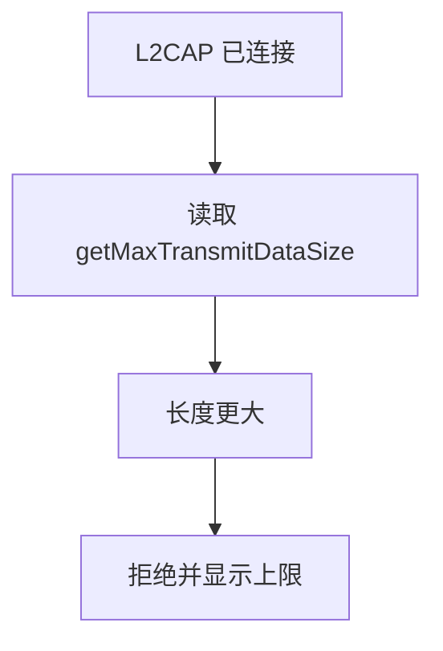
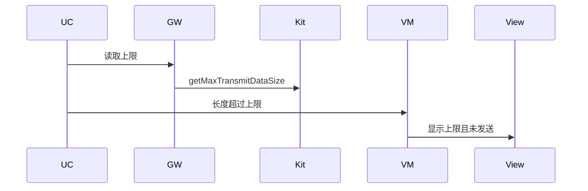
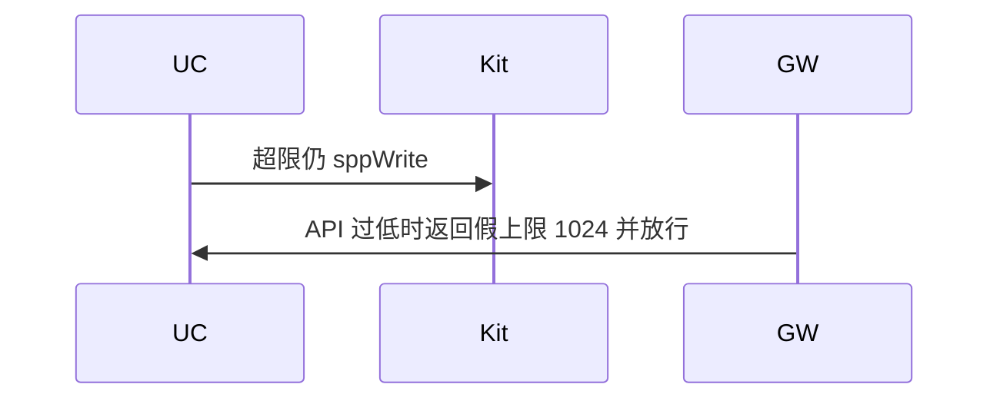

# BT-048 L2CAP 写入不超过链路最大发送长度

## 1. 条目与非目标

**判定：** 支持

**Given** L2CAP 已连接

**When** 写入长度大于 `getMaxTransmitDataSize`

**Then** 拒绝该次写入并显示上限

**证据：** `socket.sppWrite 参数说明；getMaxTransmitDataSize API 22`。行为以已接受的研究笔记和清单为准，本文件不重开行业调查。

**本条输入：** L2CAP 已连接，写入长度大于链路上限。

**本条输出：** 该次写入被拒绝，界面显示读取到的上限。不标成已发送。

**本条失败：** 读不到上限时用猜测值放行，或超限仍显示已发送。

**本条所有者：** API 22+ 的 `getMaxTransmitDataSize` 在 `SppPlatformGateway` 读取。`SendSppCommandUseCase` 比较长度。终端展示上限。

**非目标：**

- 不用 RFCOMM 的 600 代替 L2CAP 上限。
- 不在 API 22 以下编造上限并发送。
- 不新增 `common/yobluetooth` 以外的蓝牙栈，不增加包装层或版本兼容层。版本判断留在本条调用点。

## 2. 模块边界与分层

本组是L2CAP。依赖方向是 `product/phone` → `features/bluetooth` → `common/yobluetooth`。权限、生命周期和系统设置走 `common/platform` 与 `common/debug_core`。字节与 `Result` 走 `common/core`。日志门面走 `common/yolog`。收藏、会话记录和导出走 `common/storage`。`common/youi_kit` 只提供通用控件，不解释蓝牙状态。

**调用点：** `getMaxTransmitDataSize` 的版本判断在 `SppPlatformGateway`。

| 包 | 类型 | 职责 |
| --- | --- | --- |
| common/yobluetooth | SppPlatformGateway | API 22+ 读取上限 |
| common/yobluetooth | SendSppCommandUseCase | 超限拒绝 |
| features/bluetooth | SppTerminalViewModel | 显示上限 |

**设计前：** SPP 写路径只有 1024 常量，L2CAP 链路上限没有进入判断。

**设计后：** L2CAP 写入先读平台上限。大于该值则拒绝并显示。没有该 API 时不发送、不编造数字。

## 3. 架构图

本组总图在 [`BT-047.md`](BT-047.md)。下图只覆盖本条。

## 4. 序列图

### 成功路径

### 错误路径

## 5. 数据模型

领域模型放在 `common/yobluetooth`，持久化模型放在 `common/storage`，平台传输对象只出现在数据源调用点，跨层用 `common/core` 的 `Result` 与 `ResultError`。错误只带类别和结构化字段，不把界面句子塞进邻层错误。

| 模型 | 所在层 | 字段 | 来源 |
| --- | --- | --- | --- |
| WriteResult | 契约 | rejected 与 maxBytes | 平台上限 |
| Spp 类型 | 领域 | L2CAP | 不用 RFCOMM 常量 |

## 6. 层间接口

| 从 | 到 | 接口 | 成功 | 失败 |
| --- | --- | --- | --- | --- |
| SendSppCommandUseCase | SppPlatformGateway | maxTransmitSize | API 22+ 数值 | 不可读则拒绝写入 |
| SendSppCommandUseCase | sppWrite | 超限 | 不调用 | 不返回已发送 |

下层不持有页面类型。结果用 `Result` 或已有观察者回传。`common/yobluetooth` 的 `Index.ets` 继续只导出用例、领域模型和必要门面，不把数据源具体类变成第二套公开栈。

## 7. 权限与生命周期

不涉及新权限。

拒绝不改变连接相位。

## 8. 日志

- `BtLogTag.SPP` 记录 maxTx 与 rejectedLen。
- 领域标签加在已有 `BtLogTag`，不在 `common/yolog` 的 `YoLogTag` 里再开一套蓝牙标签。
- 日志走 `YoLog`，不在页面里直接写 hilog。

## 9. 反模式

- 把 600 当作 L2CAP 上限。
- 超限截断后显示原长度已发送。
- 用新的蓝牙 HAR、适配器或 `ApiCompat` 把本条版本差异包起来。版本判断只留在上面写明的调用点。
- 页面或 `common/youi_kit` 直接调用 `ohos.bluetooth.*`。
