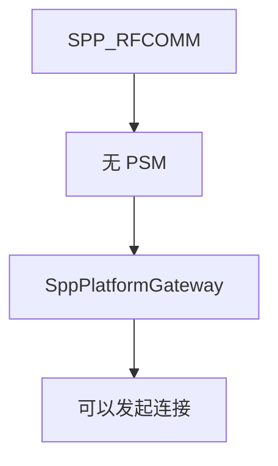
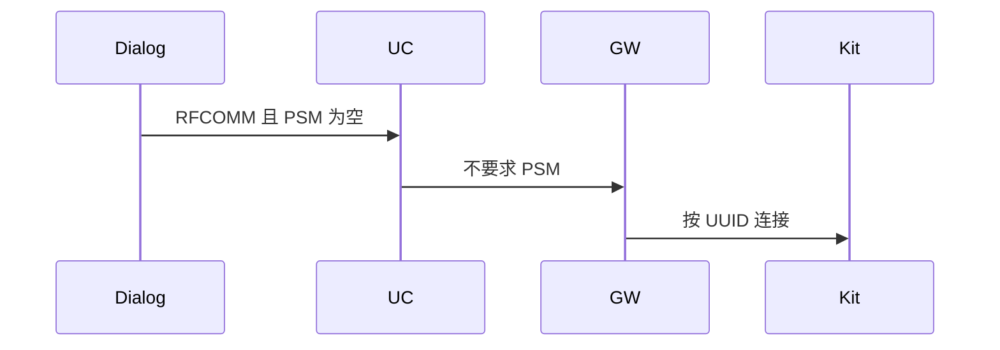
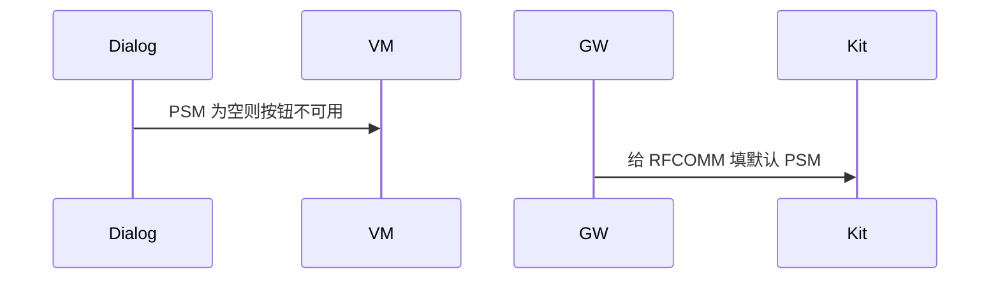

# BT-049 RFCOMM 不填写 PSM

## 1. 条目与非目标

**判定：** 支持

**Given** 类型为 `SPP_RFCOMM`

**When** 发起连接

**Then** 不把 PSM 当作必填

**证据：** `SppOptions.psm 说明`。行为以已接受的研究笔记和清单为准，本文件不重开行业调查。

**本条输入：** 类型为 `SPP_RFCOMM` 的连接请求。

**本条输出：** 连接参数不要求 PSM。界面不因 PSM 为空而阻止连接。

**本条失败：** RFCOMM 被要求填写 PSM 才能连接。

**本条所有者：** `SppConnectParams` 对 RFCOMM 忽略 PSM。`SppConnectDialogController` 不把它标成必填。`SppPlatformGateway` 不把空 PSM 当成错误。

**非目标：**

- 不把 PSM 0 写成用户已填写。
- 不因此禁止 L2CAP 使用 PSM。
- 不新增 `common/yobluetooth` 以外的蓝牙栈，不增加包装层或版本兼容层。版本判断留在本条调用点。

## 2. 模块边界与分层

本组是L2CAP。依赖方向是 `product/phone` → `features/bluetooth` → `common/yobluetooth`。权限、生命周期和系统设置走 `common/platform` 与 `common/debug_core`。字节与 `Result` 走 `common/core`。日志门面走 `common/yolog`。收藏、会话记录和导出走 `common/storage`。`common/youi_kit` 只提供通用控件，不解释蓝牙状态。

**调用点：** 类型分支在 `SppPlatformGateway` 组装选项处，不另做类型适配器。

| 包 | 类型 | 职责 |
| --- | --- | --- |
| features/bluetooth | SppConnectDialogController | RFCOMM 不要求 PSM |
| common/yobluetooth | SppConnectParams | 类型为 RFCOMM |
| common/yobluetooth | SppPlatformGateway | 不把 PSM 当必填 |

**设计前：** 若 L2CAP 校验套到全部类型，RFCOMM 会被 PSM 空值挡住。

**设计后：** 必填校验只在 L2CAP 类型启用。RFCOMM 连接路径不读取 PSM 作为前置。

## 3. 架构图

本组总图在 [`BT-047.md`](BT-047.md)。下图只覆盖本条。

## 4. 序列图

### 成功路径

### 错误路径

## 5. 数据模型

领域模型放在 `common/yobluetooth`，持久化模型放在 `common/storage`，平台传输对象只出现在数据源调用点，跨层用 `common/core` 的 `Result` 与 `ResultError`。错误只带类别和结构化字段，不把界面句子塞进邻层错误。

| 模型 | 所在层 | 字段 | 来源 |
| --- | --- | --- | --- |
| SppConnectParams | 领域 | rfcomm 时 psm 为空 | 不是错误 |

## 6. 层间接口

| 从 | 到 | 接口 | 成功 | 失败 |
| --- | --- | --- | --- | --- |
| SppConnectDialogController | ConnectSppUseCase | RFCOMM 参数 | 无 PSM 也可 | UUID 仍必填 |
| SppPlatformGateway | socket | psm | RFCOMM 不作为必填 | 不传伪造 PSM |

下层不持有页面类型。结果用 `Result` 或已有观察者回传。`common/yobluetooth` 的 `Index.ets` 继续只导出用例、领域模型和必要门面，不把数据源具体类变成第二套公开栈。

## 7. 权限与生命周期

不涉及。

不因 PSM 订阅额外事件。

## 8. 日志

- `BtLogTag.SPP` 记录 type=rfcomm psm=absent。
- 领域标签加在已有 `BtLogTag`，不在 `common/yolog` 的 `YoLogTag` 里再开一套蓝牙标签。
- 日志走 `YoLog`，不在页面里直接写 hilog。

## 9. 反模式

- 为 RFCOMM 填 PSM 1。
- 两种类型共用一个必填表单。
- 用新的蓝牙 HAR、适配器或 `ApiCompat` 把本条版本差异包起来。版本判断只留在上面写明的调用点。
- 页面或 `common/youi_kit` 直接调用 `ohos.bluetooth.*`。
