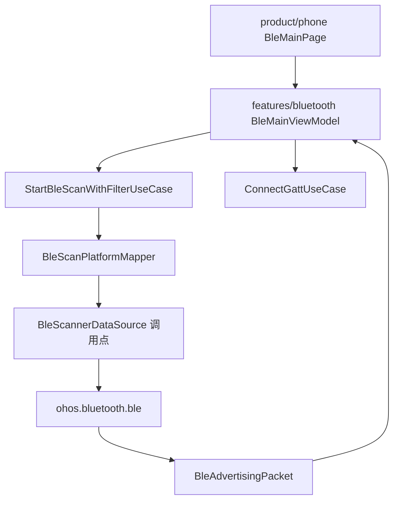
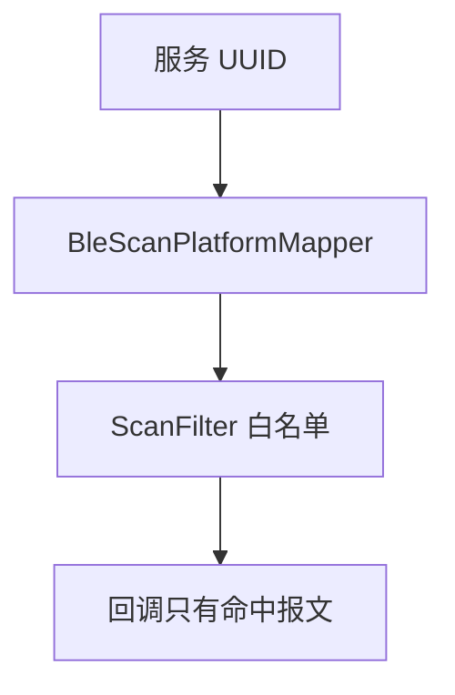
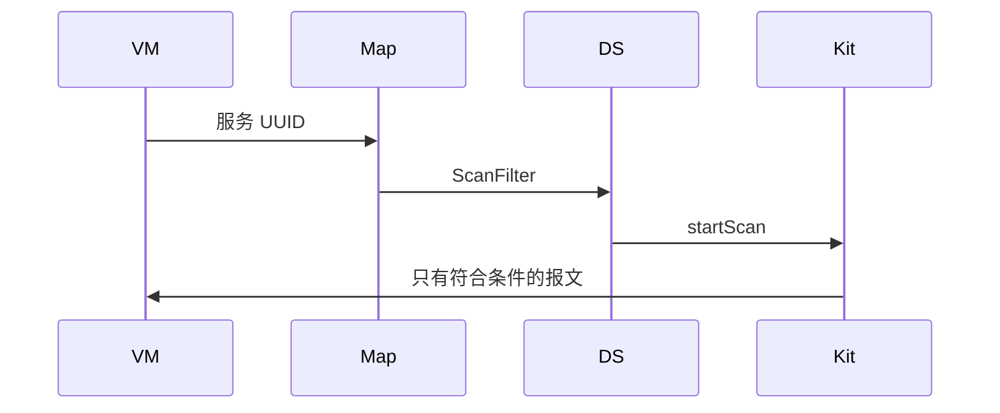
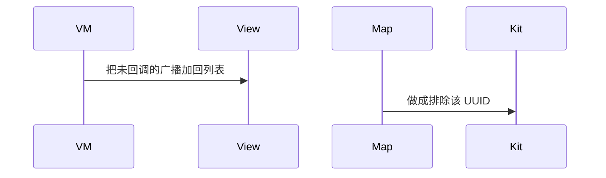

# BT-050 过滤条件是白名单

## 1. 条目与非目标

**判定：** 支持

**Given** `ScanFilter` 指定了服务 UUID

**When** 周围还有不含该 UUID 的广播

**Then** 回调里只有符合条件的报文

**证据：** `FAQ「ScanFilter 是过滤出（仅包含）」；ScanFilter 说明`。行为以已接受的研究笔记和清单为准，本文件不重开行业调查。

**本条输入：** 带服务 UUID 的 `ScanFilter`，周围存在不含该 UUID 的广播。

**本条输出：** 回调只含符合条件的报文。领域列表不补进被平台滤掉的设备。

**本条失败：** 应用再把未出现的广播加回列表。

**本条所有者：** 过滤字段由 `BleScanPlatformMapper` 写入平台 `ScanFilter`。扫描在 `BleScannerDataSource`。结果模型是 `BleAdvertisingPacket`。

**非目标：**

- 不把白名单做成排除名单。
- 不在回调里再放宽 UUID。
- 不新增 `common/yobluetooth` 以外的蓝牙栈，不增加包装层或版本兼容层。版本判断留在本条调用点。

## 2. 模块边界与分层

本组是BLE 扫描。依赖方向是 `product/phone` → `features/bluetooth` → `common/yobluetooth`。权限、生命周期和系统设置走 `common/platform` 与 `common/debug_core`。字节与 `Result` 走 `common/core`。日志门面走 `common/yolog`。收藏、会话记录和导出走 `common/storage`。`common/youi_kit` 只提供通用控件，不解释蓝牙状态。

**调用点：** `ScanFilter` 在 `BleScannerDataSource.startScan` 提交。

| 包 | 类型 | 职责 |
| --- | --- | --- |
| features/bluetooth | BleMainViewModel | 提交服务 UUID |
| common/yobluetooth | BleScanFilter | 保存精确 UUID |
| common/yobluetooth | BleScanPlatformMapper | 映射为 ScanFilter |
| common/yobluetooth | BleScannerDataSource | startScan |

**设计前：** 领域过滤若只在界面隐藏，容易和平台白名单各做一遍并含义不同。

**设计后：** 服务 UUID 进入平台过滤器。回调没有的报文不由应用补回。

## 3. 架构图

本组总图放在本文件。BLE 扫描里其余条目各自再画本条链路，链接不能代替本条的输入、输出、失败和所有者。

本条链路：

## 4. 序列图

### 成功路径

### 错误路径

## 5. 数据模型

领域模型放在 `common/yobluetooth`，持久化模型放在 `common/storage`，平台传输对象只出现在数据源调用点，跨层用 `common/core` 的 `Result` 与 `ResultError`。错误只带类别和结构化字段，不把界面句子塞进邻层错误。

| 模型 | 所在层 | 字段 | 来源 |
| --- | --- | --- | --- |
| BleScanFilter | 领域 | serviceUuid | 用户 |
| BleAdvertisingPacket | 领域 | 仅回调报文 | 平台 |

## 6. 层间接口

| 从 | 到 | 接口 | 成功 | 失败 |
| --- | --- | --- | --- | --- |
| StartBleScanWithFilterUseCase | BleScanPlatformMapper | toScanFilter | 含 UUID | 空则不是本条 |
| BleScannerDataSource | ble | startScan | 白名单 | 不后补设备 |

下层不持有页面类型。结果用 `Result` 或已有观察者回传。`common/yobluetooth` 的 `Index.ets` 继续只导出用例、领域模型和必要门面，不把数据源具体类变成第二套公开栈。

## 7. 权限与生命周期

扫描权限仍是 `ACCESS_BLUETOOTH`。

停止扫描时丢弃这一轮过滤器的回调注册。

## 8. 日志

- `BtLogTag.SCAN` 记录 filter=uuid count。
- 领域标签加在已有 `BtLogTag`，不在 `common/yolog` 的 `YoLogTag` 里再开一套蓝牙标签。
- 日志走 `YoLog`，不在页面里直接写 hilog。

## 9. 反模式

- 回调后按黑名单再删另一批并说成平台行为。
- 无回调时显示扫描失败。
- 用新的蓝牙 HAR、适配器或 `ApiCompat` 把本条版本差异包起来。版本判断只留在上面写明的调用点。
- 页面或 `common/youi_kit` 直接调用 `ohos.bluetooth.*`。
