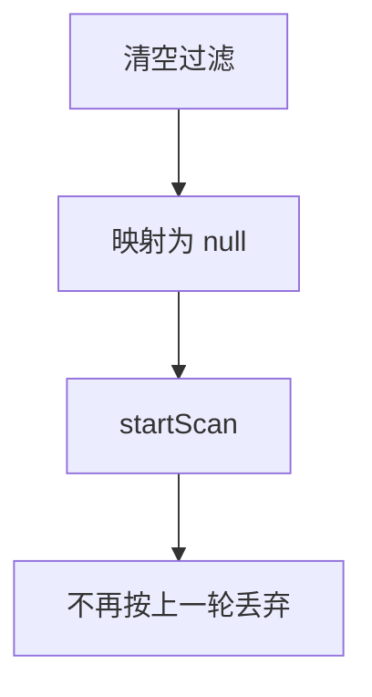
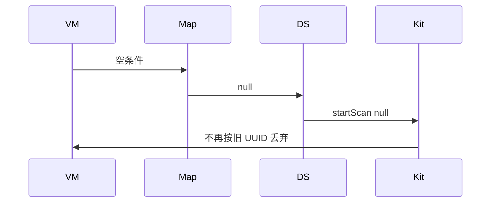
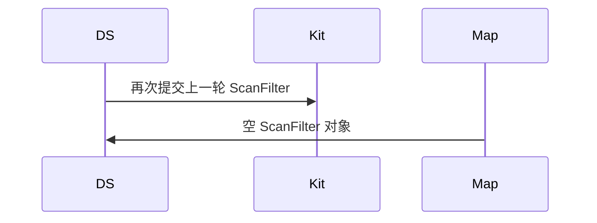

# BT-051 空过滤表示不过滤

## 1. 条目与非目标

**判定：** 支持

**Given** 用户清空过滤

**When** 开始扫描

**Then** 以 `null` 过滤启动，回调不再按上一轮条件丢弃

**证据：** `ScanFilter 的 FAQ：空过滤表示取消过滤`。行为以已接受的研究笔记和清单为准，本文件不重开行业调查。

**本条输入：** 用户清空过滤后的开始扫描。

**本条输出：** `startScan` 使用 `null` 过滤。上一轮 UUID 或厂商条件不再丢弃报文。

**本条失败：** 清空后仍提交上一轮 `ScanFilter`。

**本条所有者：** `BleMainViewModel` 清空 `BleScanFilter`。`BleScanPlatformMapper` 在无条件时返回 null。`BleScannerDataSource` 把 null 传给开始扫描。

**非目标：**

- 不用空对象表示不过滤。
- 不在回调里继续套用旧条件。
- 不新增 `common/yobluetooth` 以外的蓝牙栈，不增加包装层或版本兼容层。版本判断留在本条调用点。

## 2. 模块边界与分层

本组是BLE 扫描。依赖方向是 `product/phone` → `features/bluetooth` → `common/yobluetooth`。权限、生命周期和系统设置走 `common/platform` 与 `common/debug_core`。字节与 `Result` 走 `common/core`。日志门面走 `common/yolog`。收藏、会话记录和导出走 `common/storage`。`common/youi_kit` 只提供通用控件，不解释蓝牙状态。

**调用点：** null 与对象的选择在 `BleScannerDataSource`。

| 包 | 类型 | 职责 |
| --- | --- | --- |
| features/bluetooth | BleMainViewModel | 清空条件 |
| common/yobluetooth | BleScanPlatformMapper | 无条件则 null |
| common/yobluetooth | BleScannerDataSource | startScan(null) |

**设计前：** 映射器可能把空过滤器编成字段全空的 `ScanFilter`，平台语义与 null 不同。

**设计后：** 没有任何平台字段时，调用点传 `null`。旧条件不留在数据源成员里。

## 3. 架构图

本组总图在 [`BT-050.md`](BT-050.md)。下图只覆盖本条。

## 4. 序列图

### 成功路径

### 错误路径

## 5. 数据模型

领域模型放在 `common/yobluetooth`，持久化模型放在 `common/storage`，平台传输对象只出现在数据源调用点，跨层用 `common/core` 的 `Result` 与 `ResultError`。错误只带类别和结构化字段，不把界面句子塞进邻层错误。

| 模型 | 所在层 | 字段 | 来源 |
| --- | --- | --- | --- |
| BleScanFilter | 领域 | 各字段空 | 用户清空 |
| 平台过滤 | 调用点 | null | 不是空对象 |

## 6. 层间接口

| 从 | 到 | 接口 | 成功 | 失败 |
| --- | --- | --- | --- | --- |
| BleScanPlatformMapper | BleScannerDataSource | 过滤参数 | null | 不返回残留对象 |
| BleScannerDataSource | ble | startScan | 无过滤 | 不沿用旧过滤器 |

下层不持有页面类型。结果用 `Result` 或已有观察者回传。`common/yobluetooth` 的 `Index.ets` 继续只导出用例、领域模型和必要门面，不把数据源具体类变成第二套公开栈。

## 7. 权限与生命周期

不涉及新权限。

新一轮扫描替换旧注册，避免两轮过滤器叠在同一回调。

## 8. 日志

- `BtLogTag.SCAN` 记录 filter=null。
- 领域标签加在已有 `BtLogTag`，不在 `common/yolog` 的 `YoLogTag` 里再开一套蓝牙标签。
- 日志走 `YoLog`，不在页面里直接写 hilog。

## 9. 反模式

- 清空 UI 但数据源保留旧 filter。
- 用匹配一切的假 UUID。
- 用新的蓝牙 HAR、适配器或 `ApiCompat` 把本条版本差异包起来。版本判断只留在上面写明的调用点。
- 页面或 `common/youi_kit` 直接调用 `ohos.bluetooth.*`。
