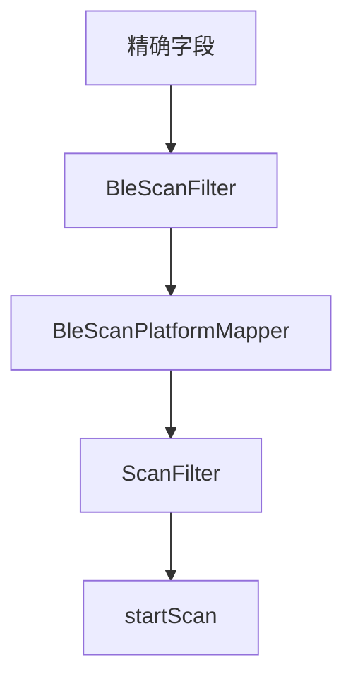
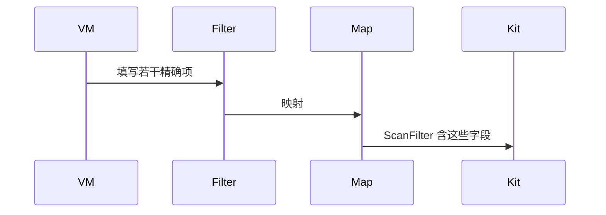
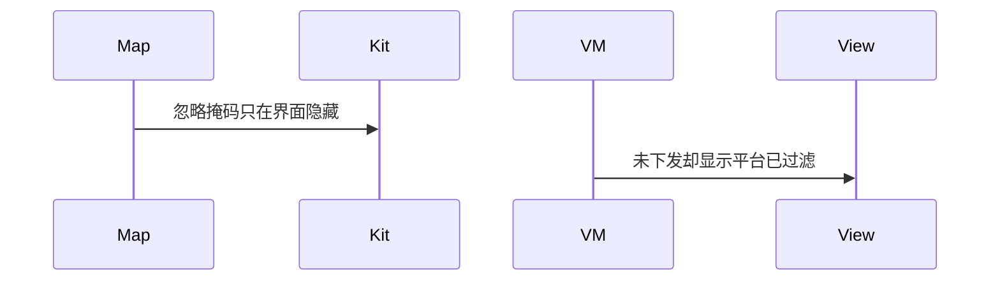

# BT-052 精确名称、UUID、厂商数据与掩码可下发

## 1. 条目与非目标

**判定：** 支持

**Given** 用户填写 name、serviceUuid、serviceUuidMask、manufactureId、manufactureData、manufactureDataMask 中的若干项

**When** 开始扫描

**Then** 这些字段进入 `ScanFilter`，而不是只在界面上隐藏行

**证据：** `ohos.bluetooth.ble 的 ScanFilter`。行为以已接受的研究笔记和清单为准，本文件不重开行业调查。

**本条输入：** 用户填写的精确名称、UUID、UUID 掩码、厂商 ID、厂商数据与掩码。

**本条输出：** 这些字段出现在提交给平台的 `ScanFilter` 中。

**本条失败：** 字段只留在界面过滤，平台收到空过滤。

**本条所有者：** 领域侧扩展 `BleScanFilter` 的精确字段。`BleScanPlatformMapper` 写入 `ScanFilter`。`BleManufacturerMaskMatcher` 不再替代平台掩码。界面是 `BleMainViewModel`。

**非目标：**

- 不把模糊名称放进精确 name。
- 不新增扫描栈。
- 不新增 `common/yobluetooth` 以外的蓝牙栈，不增加包装层或版本兼容层。版本判断留在本条调用点。

## 2. 模块边界与分层

本组是BLE 扫描。依赖方向是 `product/phone` → `features/bluetooth` → `common/yobluetooth`。权限、生命周期和系统设置走 `common/platform` 与 `common/debug_core`。字节与 `Result` 走 `common/core`。日志门面走 `common/yolog`。收藏、会话记录和导出走 `common/storage`。`common/youi_kit` 只提供通用控件，不解释蓝牙状态。

**调用点：** 字段赋值在 `BleScanPlatformMapper`，提交在 `BleScannerDataSource`。

| 包 | 类型 | 职责 |
| --- | --- | --- |
| features/bluetooth | BleMainViewModel | 收集精确字段 |
| common/yobluetooth | BleScanFilter | 保存平台可下发字段 |
| common/yobluetooth | BleScanPlatformMapper | 写入 ScanFilter |
| common/yobluetooth | BleScannerDataSource | 提交 |

**设计前：** `BleScanFilter.namePrefix` 是子串，厂商掩码也有应用层匹配器，精确字段可能没有下发。

**设计后：** 清单中的精确字段进入平台过滤器。应用层匹配器不吞掉这些字段。

## 3. 架构图

本组总图在 [`BT-050.md`](BT-050.md)。下图只覆盖本条。

## 4. 序列图

### 成功路径

### 错误路径

## 5. 数据模型

领域模型放在 `common/yobluetooth`，持久化模型放在 `common/storage`，平台传输对象只出现在数据源调用点，跨层用 `common/core` 的 `Result` 与 `ResultError`。错误只带类别和结构化字段，不把界面句子塞进邻层错误。

| 模型 | 所在层 | 字段 | 来源 |
| --- | --- | --- | --- |
| BleScanFilter | 领域 | 精确 name、uuid、mask、厂商字段 | 与子串字段分开 |
| ScanFilter | 调用点平台对象 | 同名能力字段 | 映射产物 |

## 6. 层间接口

| 从 | 到 | 接口 | 成功 | 失败 |
| --- | --- | --- | --- | --- |
| BleMainViewModel | StartBleScanWithFilterUseCase | 过滤 | 精确字段在内 | 缺失不填假值 |
| BleScanPlatformMapper | BleScannerDataSource | ScanFilter | 含已填字段 | 不降级成界面过滤 |

下层不持有页面类型。结果用 `Result` 或已有观察者回传。`common/yobluetooth` 的 `Index.ets` 继续只导出用例、领域模型和必要门面，不把数据源具体类变成第二套公开栈。

## 7. 权限与生命周期

不涉及新权限。

过滤器生命周期与该次扫描相同。

## 8. 日志

- `BtLogTag.SCAN` 记录哪些平台字段被设置，不记录厂商数据全文到 HiLog。
- 领域标签加在已有 `BtLogTag`，不在 `common/yolog` 的 `YoLogTag` 里再开一套蓝牙标签。
- 日志走 `YoLog`，不在页面里直接写 hilog。

## 9. 反模式

- 用 `BleManufacturerMaskMatcher` 代替平台 manufactureDataMask。
- 精确名称走子串匹配却声称已下发。
- 用新的蓝牙 HAR、适配器或 `ApiCompat` 把本条版本差异包起来。版本判断只留在上面写明的调用点。
- 页面或 `common/youi_kit` 直接调用 `ohos.bluetooth.*`。
