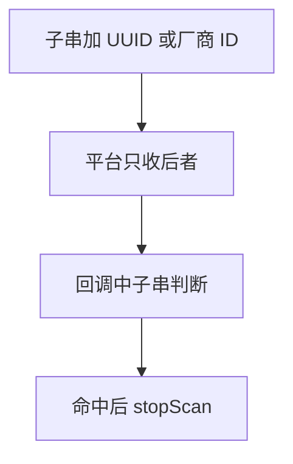
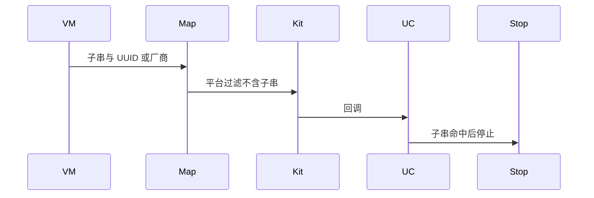
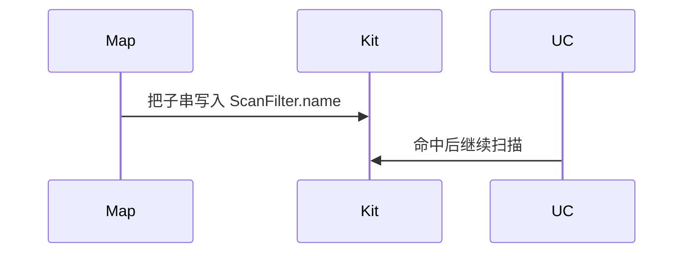

# BT-053 模糊名称在回调中匹配

## 1. 条目与非目标

**判定：** 支持

**Given** 用户要的是名称子串，且另有 UUID 或厂商 ID

**When** 扫描

**Then** 平台过滤用 UUID 或厂商条件；子串在回调中判断；命中后停止扫描

**证据：** `FAQ「存在较大量的蓝牙设备时低功耗蓝牙连接效率低」`。行为以已接受的研究笔记和清单为准，本文件不重开行业调查。

**本条输入：** 名称子串，以及 UUID 或厂商 ID。

**本条输出：** 平台过滤器只有 UUID 或厂商条件。子串在回调中判断。命中后停止该路扫描。

**本条失败：** 把子串写入 `ScanFilter.name`，或命中后继续扫描。

**本条所有者：** 精确条件下发仍由 `BleScanPlatformMapper`。子串使用 `BleScanFilter.matchesPostFilter` 的名称判断，放在扫描用例收到报文之后。停止用 `StopBleScanUseCase`。

**非目标：**

- 不在没有 UUID 或厂商 ID 时用模糊名称假装平台过滤。
- 不命中后自动连接。
- 不新增 `common/yobluetooth` 以外的蓝牙栈，不增加包装层或版本兼容层。版本判断留在本条调用点。

## 2. 模块边界与分层

本组是BLE 扫描。依赖方向是 `product/phone` → `features/bluetooth` → `common/yobluetooth`。权限、生命周期和系统设置走 `common/platform` 与 `common/debug_core`。字节与 `Result` 走 `common/core`。日志门面走 `common/yolog`。收藏、会话记录和导出走 `common/storage`。`common/youi_kit` 只提供通用控件，不解释蓝牙状态。

**调用点：** 平台字段在 `BleScannerDataSource`。子串不进入该对象。

| 包 | 类型 | 职责 |
| --- | --- | --- |
| common/yobluetooth | BleScanPlatformMapper | 只下发 UUID 或厂商条件 |
| common/yobluetooth | BleScanFilter | 回调中比较子串 |
| common/yobluetooth | StopBleScanUseCase | 命中后停止 |
| features/bluetooth | BleMainViewModel | 展示命中并结束扫描 |

**设计前：** `namePrefix` 若被映射成平台 name，模糊名称会变成精确匹配。

**设计后：** 平台 name 字段不接收子串。回调命中后停止扫描。未命中的报文不进入目标列表。

## 3. 架构图

本组总图在 [`BT-050.md`](BT-050.md)。下图只覆盖本条。

## 4. 序列图

### 成功路径

### 错误路径

## 5. 数据模型

领域模型放在 `common/yobluetooth`，持久化模型放在 `common/storage`，平台传输对象只出现在数据源调用点，跨层用 `common/core` 的 `Result` 与 `ResultError`。错误只带类别和结构化字段，不把界面句子塞进邻层错误。

| 模型 | 所在层 | 字段 | 来源 |
| --- | --- | --- | --- |
| BleScanFilter.namePrefix | 领域 | 子串 | 只用于回调 |
| ScanFilter | 平台 | uuid 或 manufactureId | 不含子串 |

## 6. 层间接口

| 从 | 到 | 接口 | 成功 | 失败 |
| --- | --- | --- | --- | --- |
| StartBleScanWithFilterUseCase | BleScanPlatformMapper | 平台过滤 | 无模糊 name | 子串不下发 |
| 报文回调 | StopBleScanUseCase | 命中 | 停止 | 未命中不停止 |

下层不持有页面类型。结果用 `Result` 或已有观察者回传。`common/yobluetooth` 的 `Index.ets` 继续只导出用例、领域模型和必要门面，不把数据源具体类变成第二套公开栈。

## 7. 权限与生命周期

不涉及新权限。

命中停止时取消该路订阅，避免继续耗电。

## 8. 日志

- `BtLogTag.SCAN` 记录 nameMatch=post stop=1。
- 领域标签加在已有 `BtLogTag`，不在 `common/yolog` 的 `YoLogTag` 里再开一套蓝牙标签。
- 日志走 `YoLog`，不在页面里直接写 hilog。

## 9. 反模式

- 没有 UUID 或厂商条件时仍声称模糊名称已下发平台。
- 命中后自动 `gatt.connect`。
- 用新的蓝牙 HAR、适配器或 `ApiCompat` 把本条版本差异包起来。版本判断只留在上面写明的调用点。
- 页面或 `common/youi_kit` 直接调用 `ohos.bluetooth.*`。
