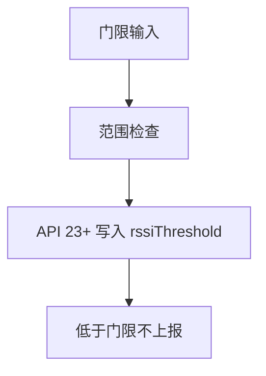
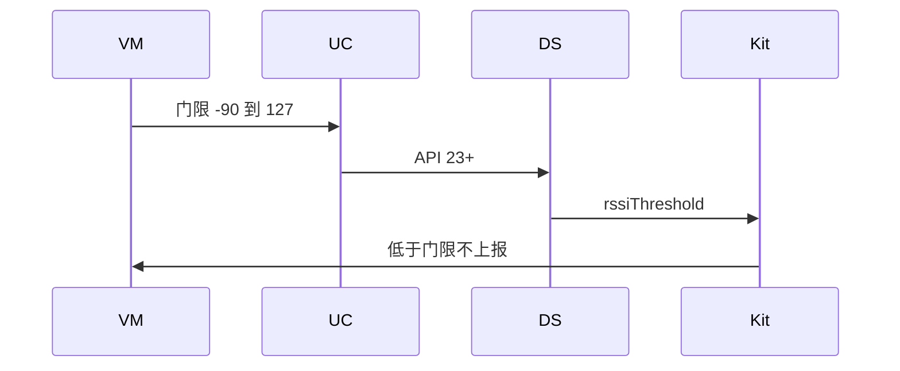
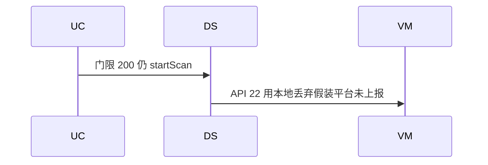

# BT-054 RSSI 门限使用 API 23 字段

## 1. 条目与非目标

**判定：** 支持

**Given** API 23+，门限设在建议区间 [-90, 127] dBm

**When** 扫描

**Then** 低于门限的报文不上报。超出协议范围 [-128, 127] 的输入被拒绝

**证据：** `ScanFilter.rssiThreshold23+`。行为以已接受的研究笔记和清单为准，本文件不重开行业调查。

**本条输入：** API 23+ 的门限，期望在 [-90, 127]，协议范围 [-128, 127]。

**本条输出：** 范围内的门限进入 `rssiThreshold`。低于门限的报文不上报。超出 [-128, 127] 的输入在提交前拒绝。

**本条失败：** 低版本把客户端丢弃说成平台未上报，或超范围仍下发。

**本条所有者：** 范围检查在 `StartBleScanWithFilterUseCase`。API 23 字段写入在 `BleScanPlatformMapper` 与 `BleScannerDataSource`。低版本不提交该字段，并由 `BleMainViewModel` 说明平台门限不可用。

**非目标：**

- 不把建议区间 [-90, 127] 写成协议上限。
- 不用应用层丢弃冒充低版本的平台门限。
- 不新增 `common/yobluetooth` 以外的蓝牙栈，不增加包装层或版本兼容层。版本判断留在本条调用点。

## 2. 模块边界与分层

本组是BLE 扫描。依赖方向是 `product/phone` → `features/bluetooth` → `common/yobluetooth`。权限、生命周期和系统设置走 `common/platform` 与 `common/debug_core`。字节与 `Result` 走 `common/core`。日志门面走 `common/yolog`。收藏、会话记录和导出走 `common/storage`。`common/youi_kit` 只提供通用控件，不解释蓝牙状态。

**调用点：** `rssiThreshold` 是否存在的判断在 `BleScannerDataSource`。

| 包 | 类型 | 职责 |
| --- | --- | --- |
| common/yobluetooth | BleScanFilter | 保存门限数值 |
| common/yobluetooth | StartBleScanWithFilterUseCase | 拒绝超出 -128 到 127 |
| common/yobluetooth | BleScannerDataSource | 仅 API 23+ 写入 rssiThreshold |
| features/bluetooth | BleMainViewModel | 低版本显示门限不可用 |

**设计前：** `minRssi` 只在 `matchesPostFilter` 里丢行，API 23 字段没有下发。

**设计后：** API 23+ 把门限交给平台。超范围不扫描。更低版本显示缺口，不声称报文未上报。

## 3. 架构图

本组总图在 [`BT-050.md`](BT-050.md)。下图只覆盖本条。

## 4. 序列图

### 成功路径

### 错误路径

## 5. 数据模型

领域模型放在 `common/yobluetooth`，持久化模型放在 `common/storage`，平台传输对象只出现在数据源调用点，跨层用 `common/core` 的 `Result` 与 `ResultError`。错误只带类别和结构化字段，不把界面句子塞进邻层错误。

| 模型 | 所在层 | 字段 | 来源 |
| --- | --- | --- | --- |
| BleScanFilter.minRssi | 领域 | dBm | 用户 |
| 平台门限 | 调用点 | rssiThreshold | 仅 API 23+ |

## 6. 层间接口

| 从 | 到 | 接口 | 成功 | 失败 |
| --- | --- | --- | --- | --- |
| BleMainViewModel | StartBleScanWithFilterUseCase | 门限 | 范围内可扫描 | 超出 -128..127 拒绝 |
| BleScannerDataSource | ble.ScanFilter | rssiThreshold | API 23+ 下发 | 更低版本不写该字段 |

下层不持有页面类型。结果用 `Result` 或已有观察者回传。`common/yobluetooth` 的 `Index.ets` 继续只导出用例、领域模型和必要门面，不把数据源具体类变成第二套公开栈。

## 7. 权限与生命周期

不涉及新权限。

拒绝超范围时不启动扫描、不注册回调。

## 8. 日志

- `BtLogTag.SCAN` 记录 rssiThreshold 或 unsupportedApi。
- 领域标签加在已有 `BtLogTag`，不在 `common/yolog` 的 `YoLogTag` 里再开一套蓝牙标签。
- 日志走 `YoLog`，不在页面里直接写 hilog。

## 9. 反模式

- 任何版本都在回调里删掉低 RSSI 并写成平台行为。
- 建议区间外但协议范围内的值被静默改写。
- 用新的蓝牙 HAR、适配器或 `ApiCompat` 把本条版本差异包起来。版本判断只留在上面写明的调用点。
- 页面或 `common/youi_kit` 直接调用 `ohos.bluetooth.*`。
