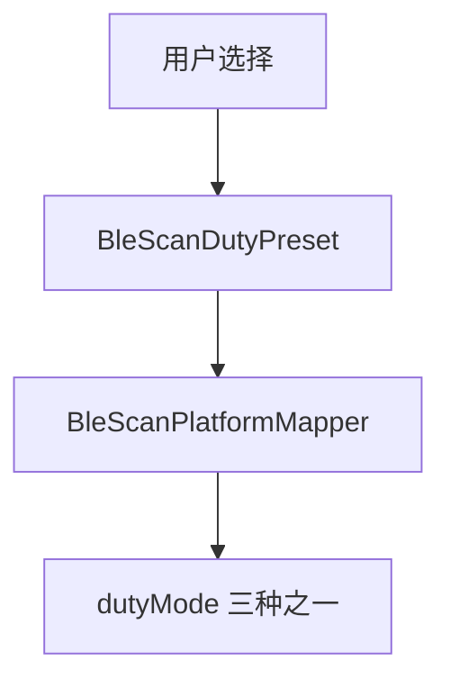
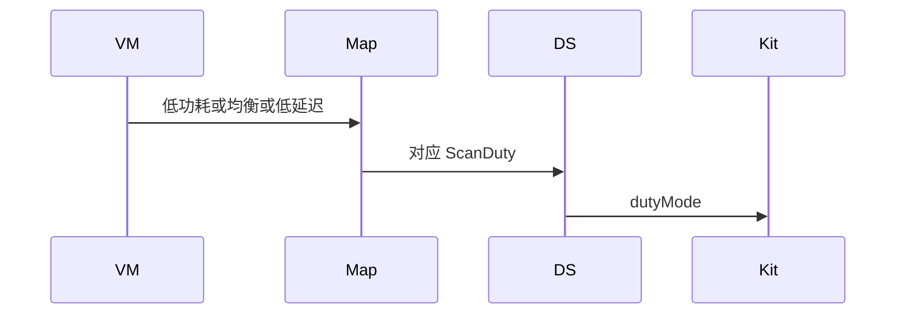
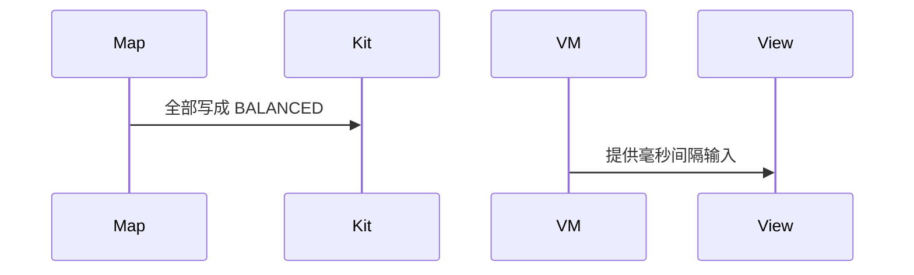

# BT-055 可切换三种扫描占空

## 1. 条目与非目标

**判定：** 支持

**Given** 用户选择低功耗、均衡或低延迟

**When** 开始扫描

**Then** `dutyMode` 分别为 `SCAN_MODE_LOW_POWER`、`BALANCED`、`LOW_LATENCY`

**证据：** `ScanDuty；拥挤场景 FAQ 建议低延迟`。行为以已接受的研究笔记和清单为准，本文件不重开行业调查。

**本条输入：** 用户选择的三种占空之一。

**本条输出：** `dutyMode` 为对应的 `ScanDuty` 枚举。

**本条失败：** 三个选项都提交 BALANCED，或用数字间隔冒充占空。

**本条所有者：** 领域枚举是已有 `BleScanDutyPreset`。映射在 `BleScanPlatformMapper`。提交在 `BleScannerDataSource`。选择 UI 归 `BleMainViewModel`。

**非目标：**

- 不增加第四种自定义占空。
- 不把低延迟固定成唯一模式。
- 不新增 `common/yobluetooth` 以外的蓝牙栈，不增加包装层或版本兼容层。版本判断留在本条调用点。

## 2. 模块边界与分层

本组是BLE 扫描。依赖方向是 `product/phone` → `features/bluetooth` → `common/yobluetooth`。权限、生命周期和系统设置走 `common/platform` 与 `common/debug_core`。字节与 `Result` 走 `common/core`。日志门面走 `common/yolog`。收藏、会话记录和导出走 `common/storage`。`common/youi_kit` 只提供通用控件，不解释蓝牙状态。

**调用点：** `dutyMode` 赋值在 `BleScannerDataSource`。

| 包 | 类型 | 职责 |
| --- | --- | --- |
| features/bluetooth | BleMainViewModel | 三选一 |
| common/yobluetooth | BleScanDutyPreset | 三种预设 |
| common/yobluetooth | BleScanPlatformMapper | 映射 ScanDuty |
| common/yobluetooth | BleScannerDataSource | 写入 dutyMode |

**设计前：** 映射若忽略预设，平台会一直用均衡。

**设计后：** 三种预设一一对应三个平台枚举，在调用点写入。

## 3. 架构图

本组总图在 [`BT-050.md`](BT-050.md)。下图只覆盖本条。

## 4. 序列图

### 成功路径

### 错误路径

## 5. 数据模型

领域模型放在 `common/yobluetooth`，持久化模型放在 `common/storage`，平台传输对象只出现在数据源调用点，跨层用 `common/core` 的 `Result` 与 `ResultError`。错误只带类别和结构化字段，不把界面句子塞进邻层错误。

| 模型 | 所在层 | 字段 | 来源 |
| --- | --- | --- | --- |
| BleScanDutyPreset | 领域 | LOW_POWER BALANCED LOW_LATENCY | 用户 |
| ScanDuty | 平台 | 三个 SCAN_MODE | 映射 |

## 6. 层间接口

| 从 | 到 | 接口 | 成功 | 失败 |
| --- | --- | --- | --- | --- |
| BleMainViewModel | StartBleScanUseCase | dutyPreset | 三值之一 | 无自定义数字 |
| BleScanPlatformMapper | startScan | dutyMode | 对应枚举 | 不写死均衡 |

下层不持有页面类型。结果用 `Result` 或已有观察者回传。`common/yobluetooth` 的 `Index.ets` 继续只导出用例、领域模型和必要门面，不把数据源具体类变成第二套公开栈。

## 7. 权限与生命周期

不涉及。

占空随该次扫描。停止后不保留平台扫描。

## 8. 日志

- `BtLogTag.SCAN` 记录 duty。
- 领域标签加在已有 `BtLogTag`，不在 `common/yolog` 的 `YoLogTag` 里再开一套蓝牙标签。
- 日志走 `YoLog`，不在页面里直接写 hilog。

## 9. 反模式

- 拥挤时静默改低延迟而不经过用户选择。
- 新增扫描模式包装枚举。
- 用新的蓝牙 HAR、适配器或 `ApiCompat` 把本条版本差异包起来。版本判断只留在上面写明的调用点。
- 页面或 `common/youi_kit` 直接调用 `ohos.bluetooth.*`。
