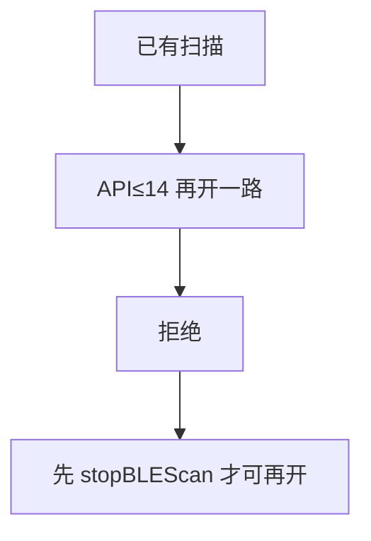
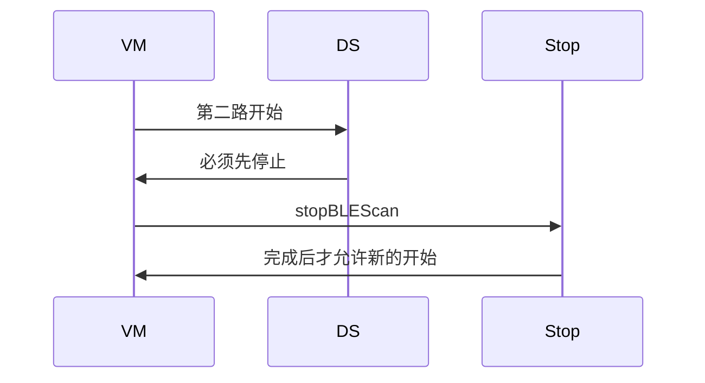
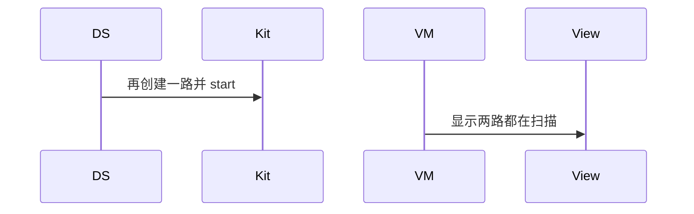

# BT-056 API 14 及以前不能并行两路扫描

## 1. 条目与非目标

**判定：** 支持

**Given** API 小于或等于 14，已有扫描

**When** 再开一路

**Then** 必须先 `stopBLEScan`，否则第二路不启动

**证据：** `低功耗蓝牙查找设备指南`。行为以已接受的研究笔记和清单为准，本文件不重开行业调查。

**本条输入：** API 14 及以前，已经有一轮 BLE 扫描，用户再开一路。

**本条输出：** 第二路不启动，直到 `stopBLEScan` 完成。

**本条失败：** 旧 API 上创建第二个扫描器并显示两路都在跑。

**本条所有者：** 版本判断在 `BleScannerDataSource`。第二路请求由 `StartBleScanUseCase` 拒绝。停止用 `StopBleScanUseCase`。

**非目标：**

- 不在旧 API 上模拟多路回调。
- 不把拒绝排队成停止后自动再开。
- 不新增 `common/yobluetooth` 以外的蓝牙栈，不增加包装层或版本兼容层。版本判断留在本条调用点。

## 2. 模块边界与分层

本组是BLE 扫描。依赖方向是 `product/phone` → `features/bluetooth` → `common/yobluetooth`。权限、生命周期和系统设置走 `common/platform` 与 `common/debug_core`。字节与 `Result` 走 `common/core`。日志门面走 `common/yolog`。收藏、会话记录和导出走 `common/storage`。`common/youi_kit` 只提供通用控件，不解释蓝牙状态。

**调用点：** 单路约束在 `BleScannerDataSource.startScan`。

| 包 | 类型 | 职责 |
| --- | --- | --- |
| common/yobluetooth | BleScannerDataSource | API 14 及以前只保留一路 |
| common/yobluetooth | StartBleScanUseCase | 已有扫描则拒绝第二路 |
| common/yobluetooth | StopBleScanUseCase | 先停止才允许再开 |
| features/bluetooth | BleMainViewModel | 不显示第二路运行 |

**设计前：** 若数据源总是 `createBleScanner`，旧系统会违反单路限制。

**设计后：** 调用点在 API 14 及以前看到活动扫描就拒绝开始。停止完成后才接受下一次。

## 3. 架构图

本组总图在 [`BT-050.md`](BT-050.md)。下图只覆盖本条。

## 4. 序列图

### 成功路径

### 错误路径

## 5. 数据模型

领域模型放在 `common/yobluetooth`，持久化模型放在 `common/storage`，平台传输对象只出现在数据源调用点，跨层用 `common/core` 的 `Result` 与 `ResultError`。错误只带类别和结构化字段，不把界面句子塞进邻层错误。

| 模型 | 所在层 | 字段 | 来源 |
| --- | --- | --- | --- |
| BleScanPhase | 领域 | 已有一路 scanning | 旧 API |
| ResultError | 领域 | 第二路被拒 | 不是成功 |

## 6. 层间接口

| 从 | 到 | 接口 | 成功 | 失败 |
| --- | --- | --- | --- | --- |
| StartBleScanUseCase | BleScannerDataSource | start 第二路 | 不启动 | 先 stop |
| BleScannerDataSource | ble | stopBLEScan | 完成后可再 start | 未完成不 start |

下层不持有页面类型。结果用 `Result` 或已有观察者回传。`common/yobluetooth` 的 `Index.ets` 继续只导出用例、领域模型和必要门面，不把数据源具体类变成第二套公开栈。

## 7. 权限与生命周期

不涉及。

拒绝第二路不为它注册回调。

## 8. 日志

- `BtLogTag.SCAN` 记录 singleScanReject=1 api。
- 领域标签加在已有 `BtLogTag`，不在 `common/yolog` 的 `YoLogTag` 里再开一套蓝牙标签。
- 日志走 `YoLog`，不在页面里直接写 hilog。

## 9. 反模式

- 用两个回调数组假装两路。
- 停止未完成就启动。
- 用新的蓝牙 HAR、适配器或 `ApiCompat` 把本条版本差异包起来。版本判断只留在上面写明的调用点。
- 页面或 `common/youi_kit` 直接调用 `ohos.bluetooth.*`。
