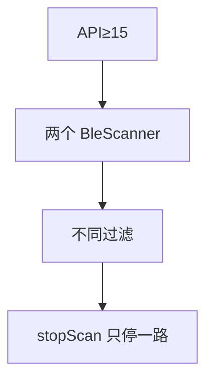
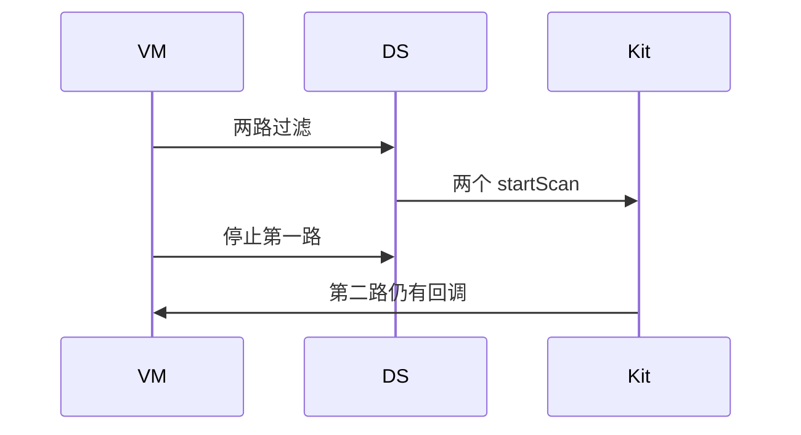
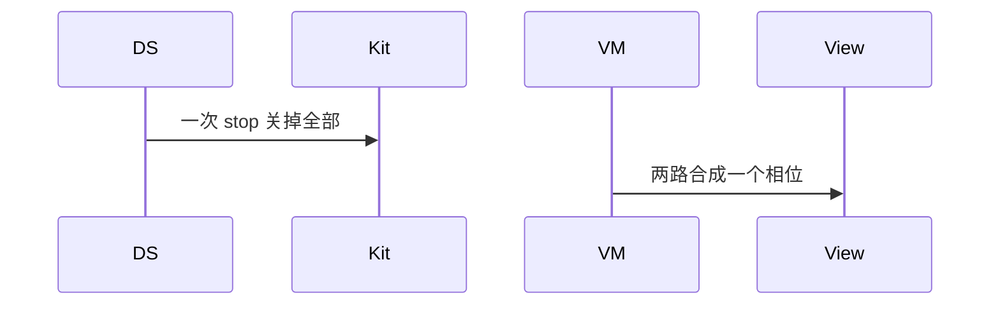

# BT-057 API 15+ 可以同时保留多路扫描

## 1. 条目与非目标

**判定：** 支持

**Given** API 大于或等于 15

**When** 两个 `BleScanner` 使用不同过滤各扫一路

**Then** 两路都有独立停止；停一路不影响另一路

**证据：** `ble.createBleScanner、BleScanner.startScan 与 stopScan`。行为以已接受的研究笔记和清单为准，本文件不重开行业调查。

**本条输入：** API 15+，两路不同过滤的扫描。

**本条输出：** 两路同时存在。停止一路后另一路继续。

**本条失败：** 停一路把另一路的回调一并 `off`。

**本条所有者：** 扫描器实例由 `BleScannerDataSource` 按路持有。过滤各自映射。停止接口按扫描器调用 `stopScan`。页面状态在 `BleMainViewModel`。

**非目标：**

- 不把多路结果合并成无法区分的一路。
- 不在 API 14 启用本条。
- 不新增 `common/yobluetooth` 以外的蓝牙栈，不增加包装层或版本兼容层。版本判断留在本条调用点。

## 2. 模块边界与分层

本组是BLE 扫描。依赖方向是 `product/phone` → `features/bluetooth` → `common/yobluetooth`。权限、生命周期和系统设置走 `common/platform` 与 `common/debug_core`。字节与 `Result` 走 `common/core`。日志门面走 `common/yolog`。收藏、会话记录和导出走 `common/storage`。`common/youi_kit` 只提供通用控件，不解释蓝牙状态。

**调用点：** `createBleScanner` 在 `BleScannerDataSource`，且仅 API 15+。

| 包 | 类型 | 职责 |
| --- | --- | --- |
| common/yobluetooth | BleScannerDataSource | API 15+ 每路一个 BleScanner |
| common/yobluetooth | BleScanPlatformMapper | 每路自己的过滤 |
| common/yobluetooth | StopBleScanUseCase | 按路停止 |
| features/bluetooth | BleMainViewModel | 分别展示 |

**设计前：** 单一扫描器字段无法表达两路独立停止。

**设计后：** 数据源按标识保存多个扫描器。`stopScan` 只作用于该实例。

## 3. 架构图

本组总图在 [`BT-050.md`](BT-050.md)。下图只覆盖本条。

## 4. 序列图

### 成功路径

### 错误路径

## 5. 数据模型

领域模型放在 `common/yobluetooth`，持久化模型放在 `common/storage`，平台传输对象只出现在数据源调用点，跨层用 `common/core` 的 `Result` 与 `ResultError`。错误只带类别和结构化字段，不把界面句子塞进邻层错误。

| 模型 | 所在层 | 字段 | 来源 |
| --- | --- | --- | --- |
| 扫描路标识 | 数据源 | scanner 与 filter | API 15+ |
| BleScanPhase | 领域 | 按路 | 不是全局一个布尔 |

## 6. 层间接口

| 从 | 到 | 接口 | 成功 | 失败 |
| --- | --- | --- | --- | --- |
| StartBleScanWithFilterUseCase | BleScannerDataSource | start 指定路 | 独立回调 | 失败只影响该路 |
| StopBleScanUseCase | BleScanner | stopScan | 该路停止 | 另一路继续 |

下层不持有页面类型。结果用 `Result` 或已有观察者回传。`common/yobluetooth` 的 `Index.ets` 继续只导出用例、领域模型和必要门面，不把数据源具体类变成第二套公开栈。

## 7. 权限与生命周期

两路同一权限，不重复弹窗。

每路订阅单独 `off`。页面离开要停掉仍然活动的每一路，见离开页面条目。

## 8. 日志

- `BtLogTag.SCAN` 记录 scannerId 与 stop 的那一路。
- 领域标签加在已有 `BtLogTag`，不在 `common/yolog` 的 `YoLogTag` 里再开一套蓝牙标签。
- 日志走 `YoLog`，不在页面里直接写 hilog。

## 9. 反模式

- 全局 `stopBLEScan` 代替某一路的 `stopScan`。
- 两路共用一个结果合并键导致互相覆盖。
- 用新的蓝牙 HAR、适配器或 `ApiCompat` 把本条版本差异包起来。版本判断只留在上面写明的调用点。
- 页面或 `common/youi_kit` 直接调用 `ohos.bluetooth.*`。
