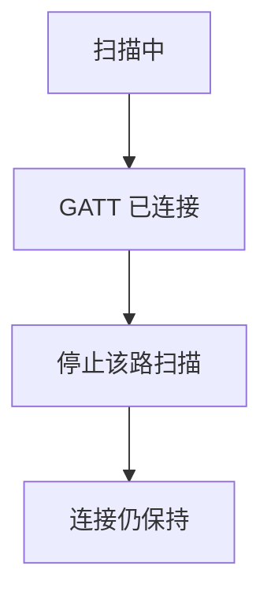
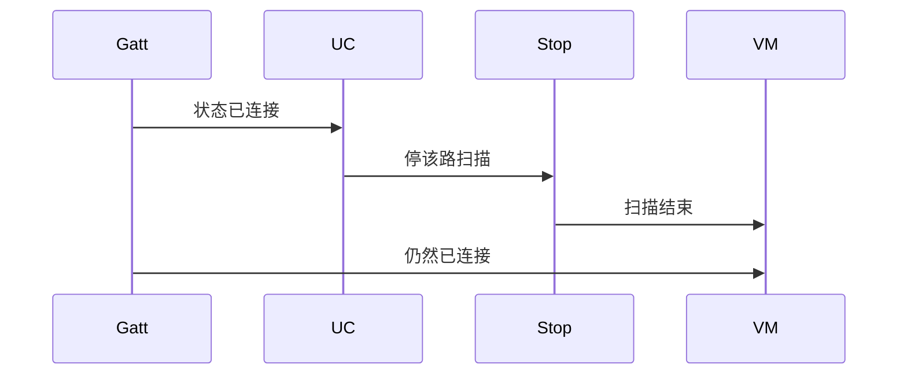
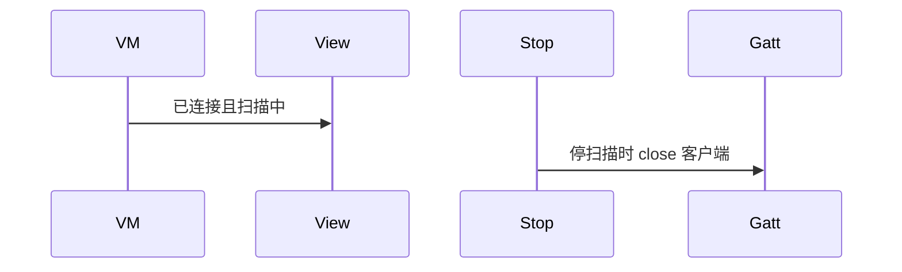

# BT-058 连上目标后停止扫描

## 1. 条目与非目标

**判定：** 支持

**Given** 扫描进行中且 GATT 已连接目标

**When** 连接状态变为已连接

**Then** 该路扫描停止

**证据：** `最佳实践「低功耗蓝牙基础使用」；错误码禁止扫描期间连接`。行为以已接受的研究笔记和清单为准，本文件不重开行业调查。

**本条输入：** 某一路扫描进行中，目标 GATT 变为已连接。

**本条输出：** 该路扫描停止。连接状态保持已连接。

**本条失败：** 已连接后扫描仍继续，或为了停扫描把连接也断开。

**本条所有者：** `ConnectGattUseCase` 在连接前要求扫描可停，连接成功后调用 `StopBleScanUseCase` 停该路。GATT 状态在 `GattClientDataSource`。

**非目标：**

- 不停止另一路无关扫描，除非该路就是连接前必须停的那路。API 14 只有一路时停的就是该路。
- 不把停止失败隐藏成已连接。
- 不新增 `common/yobluetooth` 以外的蓝牙栈，不增加包装层或版本兼容层。版本判断留在本条调用点。

## 2. 模块边界与分层

本组是BLE 扫描。依赖方向是 `product/phone` → `features/bluetooth` → `common/yobluetooth`。权限、生命周期和系统设置走 `common/platform` 与 `common/debug_core`。字节与 `Result` 走 `common/core`。日志门面走 `common/yolog`。收藏、会话记录和导出走 `common/storage`。`common/youi_kit` 只提供通用控件，不解释蓝牙状态。

**调用点：** 停止调用在 `BleScannerDataSource`。连接调用在 `GattClientDataSource`。

| 包 | 类型 | 职责 |
| --- | --- | --- |
| common/yobluetooth | ConnectGattUseCase | 连接成功后停该路扫描 |
| common/yobluetooth | StopBleScanUseCase | stopScan 或 stopBLEScan |
| common/yobluetooth | GattClientDataSource | 保持 GATT 连接 |
| features/bluetooth | BleMainViewModel | 扫描相位结束 |

**设计前：** 连接与扫描相位分离后，连上仍可能继续扫。

**设计后：** 连接状态变为已连接时，对应用例停止该路扫描。GATT 会话不被停止动作关闭。

## 3. 架构图

本组总图在 [`BT-050.md`](BT-050.md)。下图只覆盖本条。

## 4. 序列图

### 成功路径

### 错误路径

## 5. 数据模型

领域模型放在 `common/yobluetooth`，持久化模型放在 `common/storage`，平台传输对象只出现在数据源调用点，跨层用 `common/core` 的 `Result` 与 `ResultError`。错误只带类别和结构化字段，不把界面句子塞进邻层错误。

| 模型 | 所在层 | 字段 | 来源 |
| --- | --- | --- | --- |
| BleScanPhase | 领域 | 该路 idle | 连接之后 |
| GattClientState | 领域 | connected | 不因停扫描改变 |

## 6. 层间接口

| 从 | 到 | 接口 | 成功 | 失败 |
| --- | --- | --- | --- | --- |
| ConnectGattUseCase | StopBleScanUseCase | 连接成功后 stop | 该路停止 | 停止失败则显示，不假装扫描已停 |
| StopBleScanUseCase | GattClientDataSource | 无关闭 | 连接保留 | 禁止顺带 close |

下层不持有页面类型。结果用 `Result` 或已有观察者回传。`common/yobluetooth` 的 `Index.ets` 继续只导出用例、领域模型和必要门面，不把数据源具体类变成第二套公开栈。

## 7. 权限与生命周期

不涉及新权限。

停止时只 `off` 该路扫描。GATT 回调保持到断开。

## 8. 日志

- `BtLogTag.SCAN` 记录 stopReason=gattConnected。
- 领域标签加在已有 `BtLogTag`，不在 `common/yolog` 的 `YoLogTag` 里再开一套蓝牙标签。
- 日志走 `YoLog`，不在页面里直接写 hilog。

## 9. 反模式

- 连接成功后开第二路扫描回避限制。
- 扫描中的 2900099 显示成设备不存在。
- 用新的蓝牙 HAR、适配器或 `ApiCompat` 把本条版本差异包起来。版本判断只留在上面写明的调用点。
- 页面或 `common/youi_kit` 直接调用 `ohos.bluetooth.*`。
