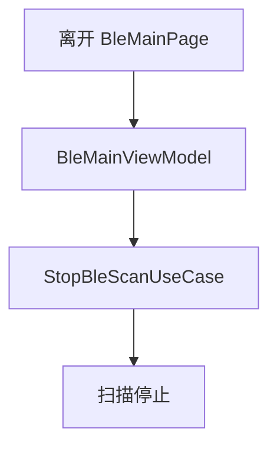
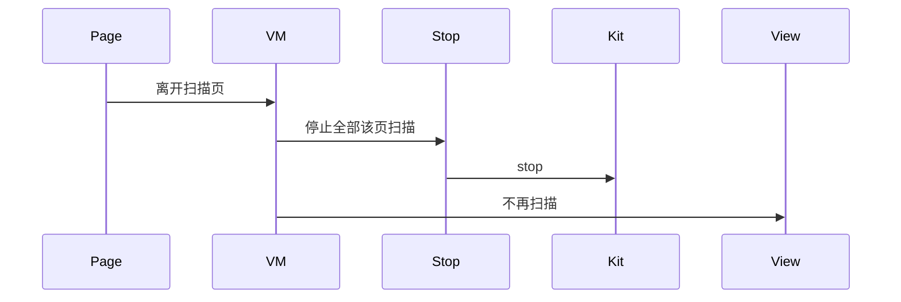
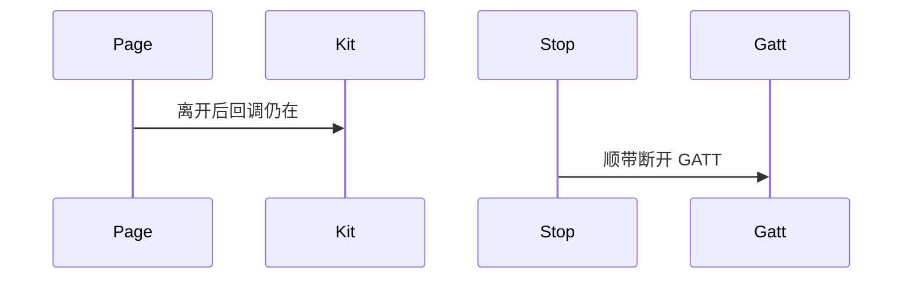

# BT-059 离开扫描页停止扫描

## 1. 条目与非目标

**判定：** 支持

**Given** 扫描进行中

**When** 用户离开该页

**Then** 扫描停止，不再耗电

**证据：** `低功耗蓝牙基础使用最佳实践`。行为以已接受的研究笔记和清单为准，本文件不重开行业调查。

**本条输入：** BLE 扫描进行中，用户离开扫描页。

**本条输出：** 扫描停止，回调取消。

**本条失败：** 页面不可见后扫描继续。

**本条所有者：** `product/phone` 的 `BleMainPage` 把页面隐藏转给 `BleMainViewModel`。停止由 `StopBleScanUseCase` 执行。多路时停掉该页拥有的每一路。

**非目标：**

- 不把离开页面理解成断开已有 GATT。
- 不申请长时任务来保住扫描。
- 不新增 `common/yobluetooth` 以外的蓝牙栈，不增加包装层或版本兼容层。版本判断留在本条调用点。

## 2. 模块边界与分层

本组是BLE 扫描。依赖方向是 `product/phone` → `features/bluetooth` → `common/yobluetooth`。权限、生命周期和系统设置走 `common/platform` 与 `common/debug_core`。字节与 `Result` 走 `common/core`。日志门面走 `common/yolog`。收藏、会话记录和导出走 `common/storage`。`common/youi_kit` 只提供通用控件，不解释蓝牙状态。

**调用点：** `stopScan` 在 `BleScannerDataSource`。页面不调用 Kit。

| 包 | 类型 | 职责 |
| --- | --- | --- |
| product/phone | BleMainPage | 转发 aboutToDisappear 或隐藏 |
| features/bluetooth | BleMainViewModel | 请求停止扫描 |
| common/yobluetooth | StopBleScanUseCase | 停止该页的扫描 |
| common/debug_core | BackgroundPolicyCatalog | 扫描类别保持 STOP |

**设计前：** 空的 `BleMainPage` 没有把离开事件交给停止用例。

**设计后：** 离开扫描页必定停止该页扫描并取消订阅。GATT 会话是否保留由连接页自己的生命周期决定。

## 3. 架构图

本组总图在 [`BT-050.md`](BT-050.md)。下图只覆盖本条。

## 4. 序列图

### 成功路径

### 错误路径

## 5. 数据模型

领域模型放在 `common/yobluetooth`，持久化模型放在 `common/storage`，平台传输对象只出现在数据源调用点，跨层用 `common/core` 的 `Result` 与 `ResultError`。错误只带类别和结构化字段，不把界面句子塞进邻层错误。

| 模型 | 所在层 | 字段 | 来源 |
| --- | --- | --- | --- |
| BleScanPhase | 领域 | idle | 离开后 |
| BackgroundSessionCategory.BLUETOOTH_SCAN | debug_core | 动作 STOP | 不保活扫描 |

## 6. 层间接口

| 从 | 到 | 接口 | 成功 | 失败 |
| --- | --- | --- | --- | --- |
| BleMainPage | BleMainViewModel | 隐藏 | 触发停止 | 不直接 stopBLEScan |
| BleMainViewModel | StopBleScanUseCase | stop all owned | 订阅取消 | 失败可见 |

下层不持有页面类型。结果用 `Result` 或已有观察者回传。`common/yobluetooth` 的 `Index.ets` 继续只导出用例、领域模型和必要门面，不把数据源具体类变成第二套公开栈。

## 7. 权限与生命周期

离开时不弹权限。

扫描订阅在停止时 `off`。再次进入不自动恢复上一轮扫描。

## 8. 日志

- `BtLogTag.SCAN` 记录 stopReason=pageLeave。
- 领域标签加在已有 `BtLogTag`，不在 `common/yolog` 的 `YoLogTag` 里再开一套蓝牙标签。
- 日志走 `YoLog`，不在页面里直接写 hilog。

## 9. 反模式

- 用长时任务让扫描在后台继续。
- 页面隐藏只停 UI 刷新不停扫描。
- 用新的蓝牙 HAR、适配器或 `ApiCompat` 把本条版本差异包起来。版本判断只留在上面写明的调用点。
- 页面或 `common/youi_kit` 直接调用 `ohos.bluetooth.*`。
