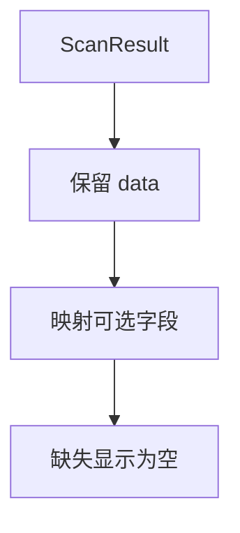
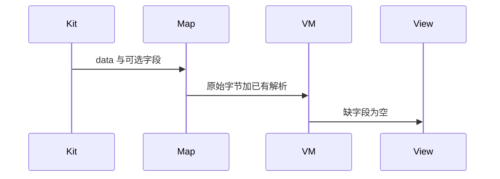
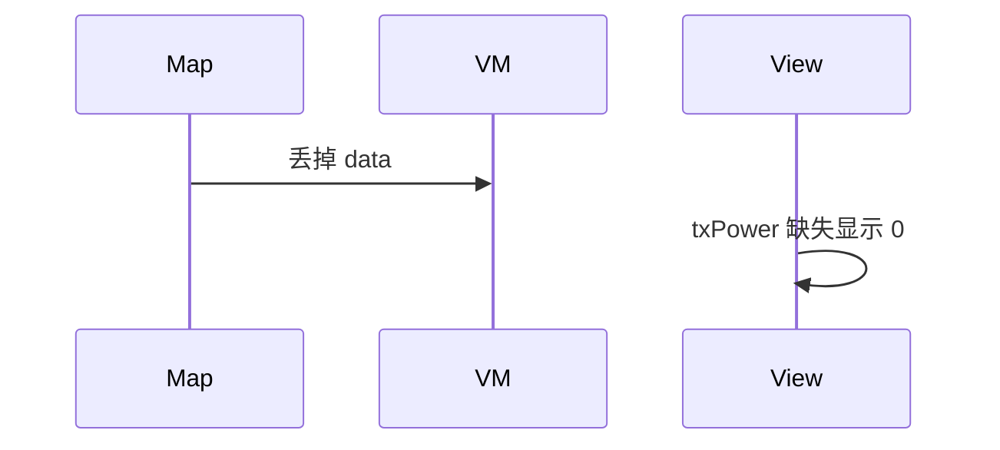

# BT-060 保留原始广播并展示已解析字段

## 1. 条目与非目标

**判定：** 支持

**Given** API 22+ 的一条 `ScanResult`

**When** 展示设备

**Then** 可见原始 `data`，以及存在时的 flags、厂商数据、服务数据、UUID、发射功率；缺字段显示为空而不是 0

**证据：** `ScanResult 字段说明`。行为以已接受的研究笔记和清单为准，本文件不重开行业调查。

**本条输入：** API 22+ 的一条 `ScanResult`。

**本条输出：** 展示原始 `data`。解析字段存在才显示。缺失为空，不是 0。

**本条失败：** 缺发射功率显示 0，或只显示解析字段丢掉原始字节。

**本条所有者：** 原始字节和解析字段进入 `BleAdvertisingPacket`。映射在 `BleAdvertisingPlatformMapper`。解析辅助是 `BleAdStructureParser`。展示在 `BleMainViewModel`。API 22 以下没有这些解析字段时不填 0。

**非目标：**

- 不把解析结果写回成新的广播。
- 不丢弃无法解析的原始 data。
- 不新增 `common/yobluetooth` 以外的蓝牙栈，不增加包装层或版本兼容层。版本判断留在本条调用点。

## 2. 模块边界与分层

本组是BLE 扫描。依赖方向是 `product/phone` → `features/bluetooth` → `common/yobluetooth`。权限、生命周期和系统设置走 `common/platform` 与 `common/debug_core`。字节与 `Result` 走 `common/core`。日志门面走 `common/yolog`。收藏、会话记录和导出走 `common/storage`。`common/youi_kit` 只提供通用控件，不解释蓝牙状态。

**调用点：** 扩展字段读取的 API 判断在 `BleScannerDataSource` 或映射器调用处。

| 包 | 类型 | 职责 |
| --- | --- | --- |
| common/yobluetooth | BleScannerDataSource | API 22+ 读取扩展字段 |
| common/yobluetooth | BleAdvertisingPlatformMapper | 同时保留 data |
| common/yobluetooth | BleAdStructureParser | 辅助展示，不替代原始字节 |
| features/bluetooth | BleMainViewModel | 空与 0 分开 |

**设计前：** 映射若只留名称和 RSSI，原始广播和可选字段到不了界面。

**设计后：** `BleAdvertisingPacket` 同时持有原始 data 和可选解析项。缺项为空。

## 3. 架构图

本组总图在 [`BT-050.md`](BT-050.md)。下图只覆盖本条。

## 4. 序列图

### 成功路径

### 错误路径

## 5. 数据模型

领域模型放在 `common/yobluetooth`，持久化模型放在 `common/storage`，平台传输对象只出现在数据源调用点，跨层用 `common/core` 的 `Result` 与 `ResultError`。错误只带类别和结构化字段，不把界面句子塞进邻层错误。

| 模型 | 所在层 | 字段 | 来源 |
| --- | --- | --- | --- |
| BleAdvertisingPacket | 领域 | data flags 厂商 服务 UUID txPower | 可空 |
| ParsedAdFields | 领域服务 | 解析视图 | 不替换 data |

## 6. 层间接口

| 从 | 到 | 接口 | 成功 | 失败 |
| --- | --- | --- | --- | --- |
| BleAdvertisingPlatformMapper | BleMainViewModel | 报文 | 含原始 data | 缺项 null |
| BleAdStructureParser | 报文 | 解析 | 展示辅助 | 失败仍保留 data |

下层不持有页面类型。结果用 `Result` 或已有观察者回传。`common/yobluetooth` 的 `Index.ets` 继续只导出用例、领域模型和必要门面，不把数据源具体类变成第二套公开栈。

## 7. 权限与生命周期

不涉及。

报文跟随扫描结果缓存，离开页面停止扫描后不再追加。

## 8. 日志

- `BtLogTag.SCAN` 记录 dataLen 与哪些可选字段存在。
- 领域标签加在已有 `BtLogTag`，不在 `common/yolog` 的 `YoLogTag` 里再开一套蓝牙标签。
- 日志走 `YoLog`，不在页面里直接写 hilog。

## 9. 反模式

- 用 0 填充缺失 txPower。
- 只存解析 JSON 不存原始 data。
- 用新的蓝牙 HAR、适配器或 `ApiCompat` 把本条版本差异包起来。版本判断只留在上面写明的调用点。
- 页面或 `common/youi_kit` 直接调用 `ohos.bluetooth.*`。
