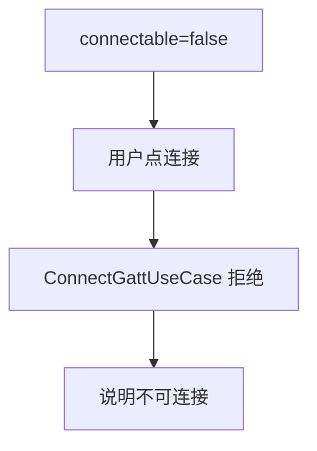
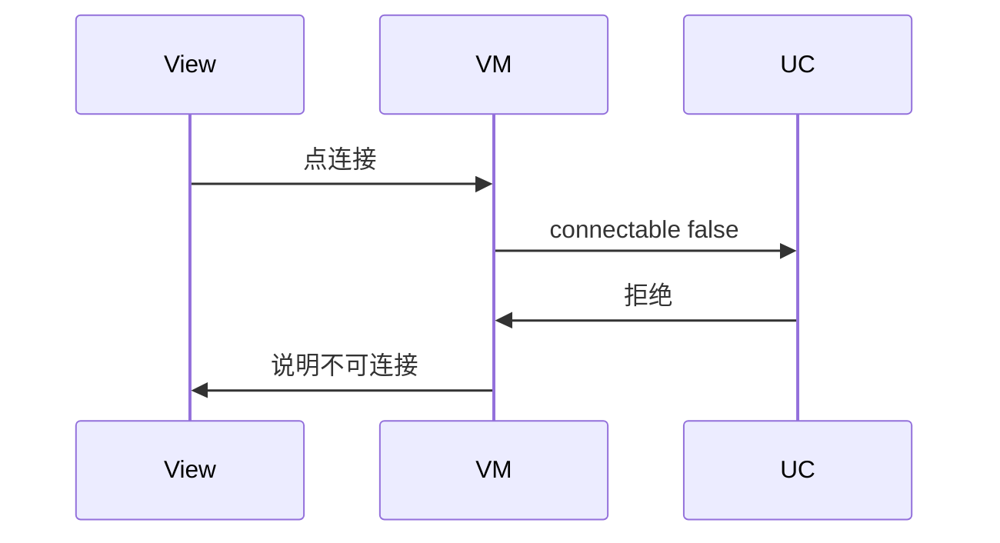
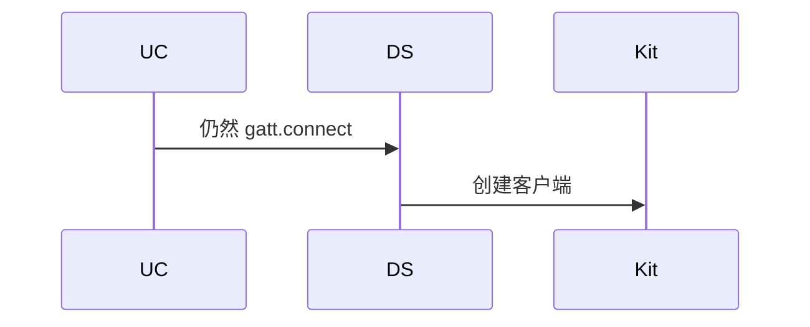

# BT-061 不可连接广播不能发起 GATT

## 1. 条目与非目标

**判定：** 支持

**Given** `connectable` 为 false

**When** 用户点连接

**Then** 不调用 `gatt.connect`；说明该广播不可连接

**证据：** `ScanResult.connectable`。行为以已接受的研究笔记和清单为准，本文件不重开行业调查。

**本条输入：** `connectable` 为 false 的广播，用户点连接。

**本条输出：** 不调用 `gatt.connect`。说明该广播不可连接。

**本条失败：** 不可连接广播仍然建立 GATT。

**本条所有者：** 字段在 `BleAdvertisingPacket`。拒绝在 `ConnectGattUseCase` 之前，由 `BleMainViewModel` 展示。`GattClientDataSource` 不到达。

**非目标：**

- 不把不可连接改成可连接再扫一次。
- 不因此禁止其他可连接设备。
- 不新增 `common/yobluetooth` 以外的蓝牙栈，不增加包装层或版本兼容层。版本判断留在本条调用点。

## 2. 模块边界与分层

本组是BLE 扫描。依赖方向是 `product/phone` → `features/bluetooth` → `common/yobluetooth`。权限、生命周期和系统设置走 `common/platform` 与 `common/debug_core`。字节与 `Result` 走 `common/core`。日志门面走 `common/yolog`。收藏、会话记录和导出走 `common/storage`。`common/youi_kit` 只提供通用控件，不解释蓝牙状态。

**调用点：** 本条没有 `gatt.connect` 调用。字段读取在扫描映射。

| 包 | 类型 | 职责 |
| --- | --- | --- |
| common/yobluetooth | BleAdvertisingPlatformMapper | 保存 connectable |
| features/bluetooth | BleMainViewModel | 说明不可连接 |
| common/yobluetooth | ConnectGattUseCase | false 时不执行 |

**设计前：** 连接按钮若只看地址，会把不可连接广播送进 GATT。

**设计后：** `connectable=false` 在用例入口拒绝。不创建客户端。

## 3. 架构图

本组总图在 [`BT-050.md`](BT-050.md)。下图只覆盖本条。

## 4. 序列图

### 成功路径

### 错误路径

## 5. 数据模型

领域模型放在 `common/yobluetooth`，持久化模型放在 `common/storage`，平台传输对象只出现在数据源调用点，跨层用 `common/core` 的 `Result` 与 `ResultError`。错误只带类别和结构化字段，不把界面句子塞进邻层错误。

| 模型 | 所在层 | 字段 | 来源 |
| --- | --- | --- | --- |
| BleAdvertisingPacket | 领域 | connectable | ScanResult |
| GattConnectParams | 领域 | 本条不创建 | 无连接 |

## 6. 层间接口

| 从 | 到 | 接口 | 成功 | 失败 |
| --- | --- | --- | --- | --- |
| BleMainViewModel | ConnectGattUseCase | connect | 不调用数据源 | 不可连接 |
| ConnectGattUseCase | GattClientDataSource | connect | 禁止 | 无客户端 |

下层不持有页面类型。结果用 `Result` 或已有观察者回传。`common/yobluetooth` 的 `Index.ets` 继续只导出用例、领域模型和必要门面，不把数据源具体类变成第二套公开栈。

## 7. 权限与生命周期

不因拒绝去申请额外权限。

不注册 GATT 回调。

## 8. 日志

- `BtLogTag.CONN` 记录 reject=notConnectable。
- 领域标签加在已有 `BtLogTag`，不在 `common/yolog` 的 `YoLogTag` 里再开一套蓝牙标签。
- 日志走 `YoLog`，不在页面里直接写 hilog。

## 9. 反模式

- 忽略 connectable 字段。
- 连接失败后再改口说不可连接。
- 用新的蓝牙 HAR、适配器或 `ApiCompat` 把本条版本差异包起来。版本判断只留在上面写明的调用点。
- 页面或 `common/youi_kit` 直接调用 `ohos.bluetooth.*`。
