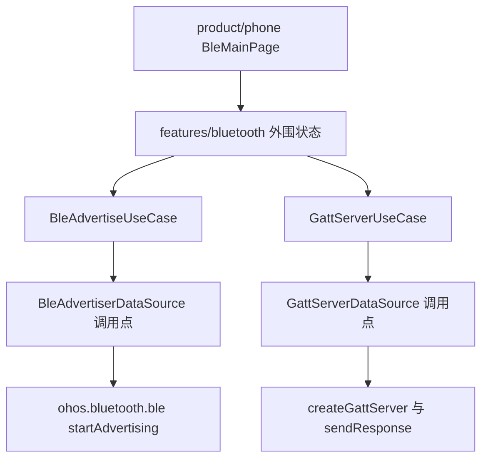
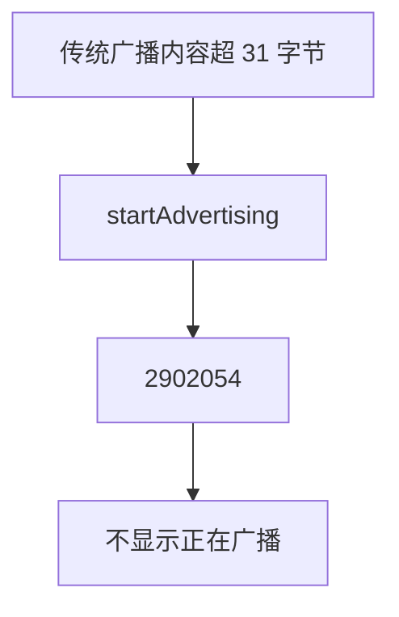
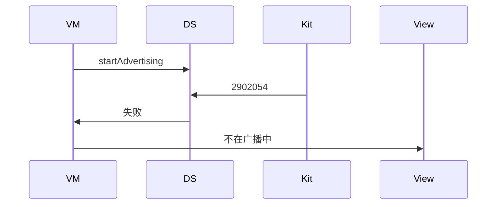
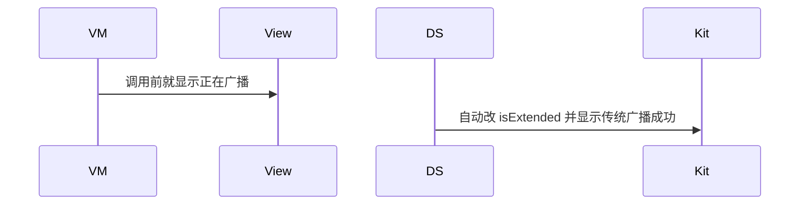

# BT-062 传统广播超过 31 字节失败

## 1. 条目与非目标

**判定：** 支持

**Given** 未开启扩展广播

**When** 设备名与服务 UUID 等合计超过 31 字节并 `startAdvertising`

**Then** 失败可见（2902054）；不显示「正在广播」

**证据：** `FAQ「广播报文长度超出 31 字节」；错误码 2902054`。行为以已接受的研究笔记和清单为准，本文件不重开行业调查。

**本条输入：** 未开扩展广播时，名称与 UUID 等合计超过 31 字节的启动请求。

**本条输出：** 失败可见，平台码 2902054。状态不是正在广播。

**本条失败：** 超长后仍显示正在广播。

**本条所有者：** 广播数据源是 `common/yobluetooth` 内的 `BleAdvertiserDataSource`。长度失败在该调用点识别。状态在 `features/bluetooth` 的外围页面状态。不新建广播模块。

**非目标：**

- 不自动改成扩展广播来冒充传统广播成功。
- 不截断名称后显示原文已广播。
- 不新增 `common/yobluetooth` 以外的蓝牙栈，不增加包装层或版本兼容层。版本判断留在本条调用点。

## 2. 模块边界与分层

本组是广播与 GATT 服务端。依赖方向是 `product/phone` → `features/bluetooth` → `common/yobluetooth`。权限、生命周期和系统设置走 `common/platform` 与 `common/debug_core`。字节与 `Result` 走 `common/core`。日志门面走 `common/yolog`。收藏、会话记录和导出走 `common/storage`。`common/youi_kit` 只提供通用控件，不解释蓝牙状态。

**调用点：** `startAdvertising` 只在 `BleAdvertiserDataSource`。

| 包 | 类型 | 职责 |
| --- | --- | --- |
| features/bluetooth | 外围 ViewModel | 提交传统广播 |
| common/yobluetooth | BleAdvertiseUseCase | 未扩展且超长则失败 |
| common/yobluetooth | BleAdvertiserDataSource | startAdvertising |
| product/phone | BleMainPage | 只装配外围区域 |

**设计前：** 仓库没有广播调用点，页面也无法诚实显示 2902054。

**设计后：** 传统广播超长时数据源返回 2902054，相位留在未广播。

## 3. 架构图

本组总图放在本文件。广播与 GATT 服务端里其余条目各自再画本条链路，链接不能代替本条的输入、输出、失败和所有者。

本条链路：

## 4. 序列图

### 成功路径

### 错误路径

## 5. 数据模型

领域模型放在 `common/yobluetooth`，持久化模型放在 `common/storage`，平台传输对象只出现在数据源调用点，跨层用 `common/core` 的 `Result` 与 `ResultError`。错误只带类别和结构化字段，不把界面句子塞进邻层错误。

| 模型 | 所在层 | 字段 | 来源 |
| --- | --- | --- | --- |
| AdvertisingRequest | 领域 | 传统模式与内容 | 不含扩展开关 |
| ResultError | 领域 | platformCode=2902054 | 数据源 |

## 6. 层间接口

| 从 | 到 | 接口 | 成功 | 失败 |
| --- | --- | --- | --- | --- |
| 外围 ViewModel | BleAdvertiseUseCase | start | 未超长才可能广播 | 2902054 |
| BleAdvertiserDataSource | ble | startAdvertising | 成功才置广播中 | 失败不置位 |

下层不持有页面类型。结果用 `Result` 或已有观察者回传。`common/yobluetooth` 的 `Index.ets` 继续只导出用例、领域模型和必要门面，不把数据源具体类变成第二套公开栈。

## 7. 权限与生命周期

广播使用 `ACCESS_BLUETOOTH`。

失败不注册广播停止以外的多余回调。成功路径的停止见持续广播条目。

## 8. 日志

- `BtLogTag` 增加 ADV 标签，记录 2902054。
- 领域标签加在已有 `BtLogTag`，不在 `common/yolog` 的 `YoLogTag` 里再开一套蓝牙标签。
- 日志走 `YoLog`，不在页面里直接写 hilog。

## 9. 反模式

- 截断到 31 字节仍显示完整名称已发送。
- 新建 `common/yoadvertise` 包。
- 用新的蓝牙 HAR、适配器或 `ApiCompat` 把本条版本差异包起来。版本判断只留在上面写明的调用点。
- 页面或 `common/youi_kit` 直接调用 `ohos.bluetooth.*`。
