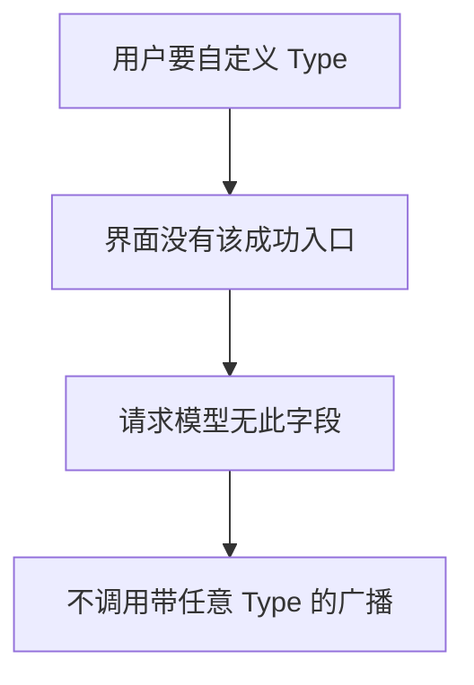
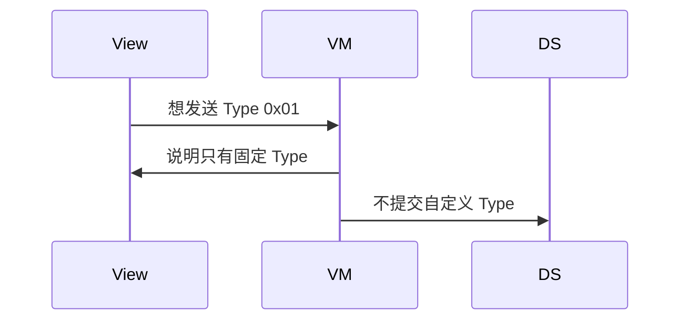
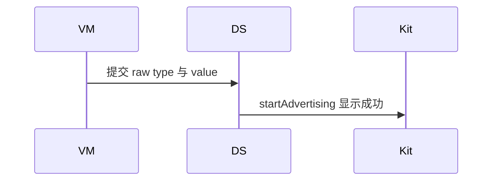

# BT-063 不能任意填写 AD Type

## 1. 条目与非目标

**判定：** 缺口

**Given** 用户想发送 Type 0x01 或其他未列出的 Type

**When** 编辑广播

**Then** 没有自定义 Type 成功路径。可用字段只对应固定 Type：服务 UUID、serviceData 0x16、厂商数据 0xFF、设备名 0x09

**证据：** `FAQ「蓝牙 BLE 广播是否支持自定义广播 Type 数据」`。行为以已接受的研究笔记和清单为准，本文件不重开行业调查。

**本条输入：** 用户要发送任意 AD Type，例如 0x01 或未列出的类型。

**本条输出：** 没有自定义 Type 的启动成功。编辑器只有固定字段：服务 UUID、serviceData、厂商数据、设备名。

**本条失败：** 出现自定义 Type 输入并 `startAdvertising` 成功。

**本条所有者：** 可编辑字段在领域 `AdvertisingRequest`。`BleAdvertiserDataSource` 只映射这四类。`features/bluetooth` 外围状态不提供自定义 Type 成功按钮。

本条按缺口设计。完成态只包含清单允许看见的结果，不包含把缺口做成已成功的路径。

**非目标：**

- 不把 flags 0x01 做成可写字段。
- 不把原始字节拼进广播并显示已发送。
- 不新增 `common/yobluetooth` 以外的蓝牙栈，不增加包装层或版本兼容层。版本判断留在本条调用点。

## 2. 模块边界与分层

本组是广播与 GATT 服务端。依赖方向是 `product/phone` → `features/bluetooth` → `common/yobluetooth`。权限、生命周期和系统设置走 `common/platform` 与 `common/debug_core`。字节与 `Result` 走 `common/core`。日志门面走 `common/yolog`。收藏、会话记录和导出走 `common/storage`。`common/youi_kit` 只提供通用控件，不解释蓝牙状态。

**调用点：** `startAdvertising` 只接收固定字段。没有自定义 Type 参数。

| 包 | 类型 | 职责 |
| --- | --- | --- |
| features/bluetooth | 外围 ViewModel | 只编辑固定字段 |
| common/yobluetooth | AdvertisingRequest | 无自定义 type 字段 |
| common/yobluetooth | BleAdvertiserDataSource | 只映射固定 Type |

**设计前：** 若请求模型有 rawAd 字段，就会形成自定义 Type 成功路径。

**设计后：** 模型没有任意 Type 和原始 AD 载荷。数据源无法发出未列出的 Type。

## 3. 架构图

本组总图在 [`BT-062.md`](BT-062.md)。下图只覆盖本条。

## 4. 序列图

### 成功路径

缺口条目的成功路径是用户看见限制。缺失能力没有被画成已经成功。

### 错误路径

错误路径把缺口做成了成功。这条路径不进入目标分层。

## 5. 数据模型

领域模型放在 `common/yobluetooth`，持久化模型放在 `common/storage`，平台传输对象只出现在数据源调用点，跨层用 `common/core` 的 `Result` 与 `ResultError`。错误只带类别和结构化字段，不把界面句子塞进邻层错误。

| 模型 | 所在层 | 字段 | 来源 |
| --- | --- | --- | --- |
| AdvertisingRequest | 领域 | serviceUuids serviceData manufactureData deviceName | 无 type 字节 |

## 6. 层间接口

| 从 | 到 | 接口 | 成功 | 失败 |
| --- | --- | --- | --- | --- |
| 外围 ViewModel | BleAdvertiseUseCase | 自定义 Type | 无此参数 | 不能成功 |
| BleAdvertiserDataSource | ble | 广播数据 | 只含固定字段 | 不接受任意 AD |

下层不持有页面类型。结果用 `Result` 或已有观察者回传。`common/yobluetooth` 的 `Index.ets` 继续只导出用例、领域模型和必要门面，不把数据源具体类变成第二套公开栈。

## 7. 权限与生命周期

不申请额外权限来写任意 Type。

没有自定义广播会话。

## 8. 日志

- 不记录 customAdSuccess。可记录 rejectedCustomType=1。
- 领域标签加在已有 `BtLogTag`，不在 `common/yolog` 的 `YoLogTag` 里再开一套蓝牙标签。
- 日志走 `YoLog`，不在页面里直接写 hilog。

## 9. 反模式

- 提供 HEX AD 结构编辑器。
- 用厂商数据字段偷运任意 Type 并标成该 Type 已发送。
- 用新的蓝牙 HAR、适配器或 `ApiCompat` 把本条版本差异包起来。版本判断只留在上面写明的调用点。
- 页面或 `common/youi_kit` 直接调用 `ohos.bluetooth.*`。
