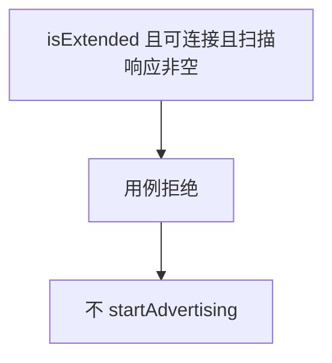
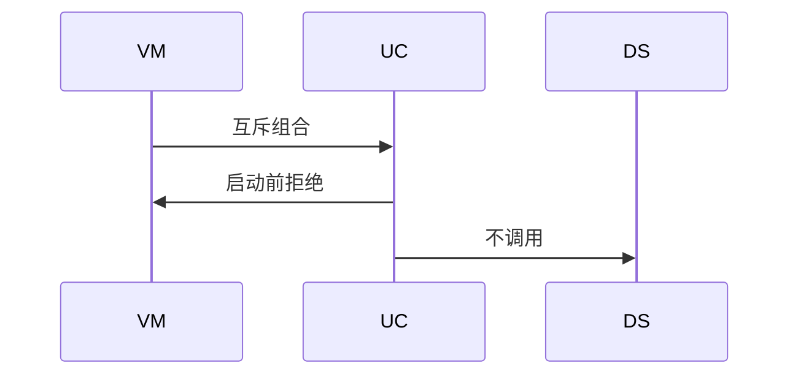
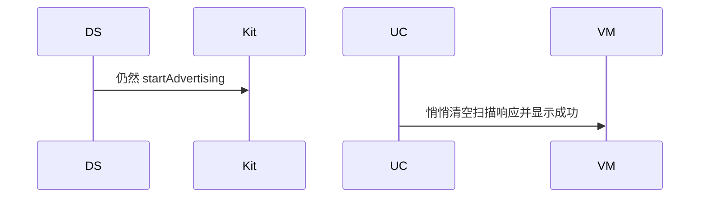

# BT-064 扩展广播遵守可连接与扫描响应互斥

## 1. 条目与非目标

**判定：** 支持

**Given** `isExtended` 为 true

**When** 同时要求可连接和非空扫描响应

**Then** 启动前拒绝该组合

**证据：** `AdvertisingParams 对 isExtended、connectable、advertisingResponse 的说明`。行为以已接受的研究笔记和清单为准，本文件不重开行业调查。

**本条输入：** API 26.0.0 起，扩展广播同时要求可连接和非空扫描响应。

**本条输出：** 启动前拒绝。不调用 `startAdvertising`。

**本条失败：** 该组合仍然启动并显示正在广播。

**本条所有者：** 组合检查在 `BleAdvertiseUseCase`。字段只有在 `BleAdvertiserDataSource` 确认 API 26.0.0 可用时才提交。更低版本不提供扩展广播成功路径。

**非目标：**

- 不在低版本模拟扩展广播。
- 不自动关掉扫描响应再显示用户原组合已成功。
- 不新增 `common/yobluetooth` 以外的蓝牙栈，不增加包装层或版本兼容层。版本判断留在本条调用点。

## 2. 模块边界与分层

本组是广播与 GATT 服务端。依赖方向是 `product/phone` → `features/bluetooth` → `common/yobluetooth`。权限、生命周期和系统设置走 `common/platform` 与 `common/debug_core`。字节与 `Result` 走 `common/core`。日志门面走 `common/yolog`。收藏、会话记录和导出走 `common/storage`。`common/youi_kit` 只提供通用控件，不解释蓝牙状态。

**调用点：** `isExtended` 的版本判断在 `BleAdvertiserDataSource`。互斥在它之前的用例。

| 包 | 类型 | 职责 |
| --- | --- | --- |
| common/yobluetooth | BleAdvertiseUseCase | 拒绝互斥组合 |
| common/yobluetooth | BleAdvertiserDataSource | API 26.0.0 才写 isExtended |
| features/bluetooth | 外围 ViewModel | 显示组合不被接受 |

**设计前：** 没有扩展字段时无法表达这条互斥。

**设计后：** 扩展、可连接、非空扫描响应三者冲突时停在用例。数据源看不到这次启动。

## 3. 架构图

本组总图在 [`BT-062.md`](BT-062.md)。下图只覆盖本条。

## 4. 序列图

### 成功路径

### 错误路径

## 5. 数据模型

领域模型放在 `common/yobluetooth`，持久化模型放在 `common/storage`，平台传输对象只出现在数据源调用点，跨层用 `common/core` 的 `Result` 与 `ResultError`。错误只带类别和结构化字段，不把界面句子塞进邻层错误。

| 模型 | 所在层 | 字段 | 来源 |
| --- | --- | --- | --- |
| AdvertisingRequest | 领域 | isExtended connectable response | API 26 字段 |

## 6. 层间接口

| 从 | 到 | 接口 | 成功 | 失败 |
| --- | --- | --- | --- | --- |
| BleAdvertiseUseCase | BleAdvertiserDataSource | start | 合法组合才调用 | 互斥不调用 |
| BleAdvertiserDataSource | AdvertisingParams | isExtended | 仅 API 26.0.0 | 低版本不提交扩展成功 |

下层不持有页面类型。结果用 `Result` 或已有观察者回传。`common/yobluetooth` 的 `Index.ets` 继续只导出用例、领域模型和必要门面，不把数据源具体类变成第二套公开栈。

## 7. 权限与生命周期

不涉及新权限。

拒绝不注册广播回调。

## 8. 日志

- ADV 日志记录 reject=extendedConnectableResponse。
- 领域标签加在已有 `BtLogTag`，不在 `common/yolog` 的 `YoLogTag` 里再开一套蓝牙标签。
- 日志走 `YoLog`，不在页面里直接写 hilog。

## 9. 反模式

- 互斥时自动改 connectable。
- 低版本忽略字段仍显示扩展已开启。
- 用新的蓝牙 HAR、适配器或 `ApiCompat` 把本条版本差异包起来。版本判断只留在上面写明的调用点。
- 页面或 `common/youi_kit` 直接调用 `ohos.bluetooth.*`。
