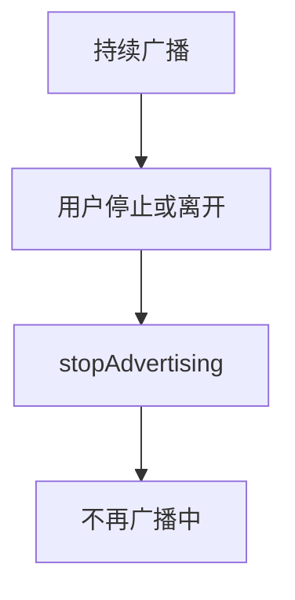
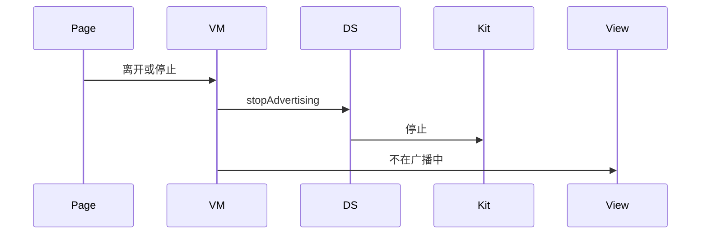
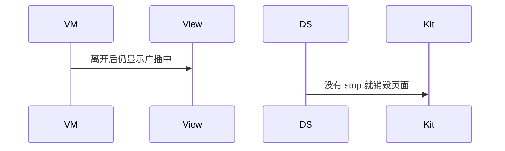

# BT-065 持续广播在离开场景时停止

## 1. 条目与非目标

**判定：** 支持

**Given** `duration` 未设或为 0（持续广播）

**When** 用户停止或离开

**Then** `stopAdvertising` 之后不再处于广播中

**证据：** `AdvertisingParams.duration；查找设备指南要求主动停止`。行为以已接受的研究笔记和清单为准，本文件不重开行业调查。

**本条输入：** 持续广播已经开始，用户停止或离开场景。

**本条输出：** 调用 `stopAdvertising` 后，状态不再是广播中。

**本条失败：** 离开后仍保持广播中。

**本条所有者：** 停止在 `BleAdvertiserDataSource.stopAdvertising`。离开由 `BleMainPage` 通知外围 ViewModel。相位在蓝牙领域，不放在页面。

**非目标：**

- 不把 duration 0 理解成马上停止。
- 不用长时任务维持用户已经离开的广播。
- 不新增 `common/yobluetooth` 以外的蓝牙栈，不增加包装层或版本兼容层。版本判断留在本条调用点。

## 2. 模块边界与分层

本组是广播与 GATT 服务端。依赖方向是 `product/phone` → `features/bluetooth` → `common/yobluetooth`。权限、生命周期和系统设置走 `common/platform` 与 `common/debug_core`。字节与 `Result` 走 `common/core`。日志门面走 `common/yolog`。收藏、会话记录和导出走 `common/storage`。`common/youi_kit` 只提供通用控件，不解释蓝牙状态。

**调用点：** `stopAdvertising` 与 start 在同一个 `BleAdvertiserDataSource`。

| 包 | 类型 | 职责 |
| --- | --- | --- |
| features/bluetooth | 外围 ViewModel | 停止或离开 |
| common/yobluetooth | BleAdvertiseUseCase | 请求停止 |
| common/yobluetooth | BleAdvertiserDataSource | stopAdvertising |
| product/phone | BleMainPage | 转发离开 |

**设计前：** 没有停止调用时，duration 0 会一直广播。

**设计后：** 用户停止或离开都调用 `stopAdvertising`。返回后相位为未广播。

## 3. 架构图

本组总图在 [`BT-062.md`](BT-062.md)。下图只覆盖本条。

## 4. 序列图

### 成功路径

### 错误路径

## 5. 数据模型

领域模型放在 `common/yobluetooth`，持久化模型放在 `common/storage`，平台传输对象只出现在数据源调用点，跨层用 `common/core` 的 `Result` 与 `ResultError`。错误只带类别和结构化字段，不把界面句子塞进邻层错误。

| 模型 | 所在层 | 字段 | 来源 |
| --- | --- | --- | --- |
| 广播相位 | 领域 | advertising 然后 idle | stop 之后 |
| duration | 领域 | 0 表示持续 | 不是已停止 |

## 6. 层间接口

| 从 | 到 | 接口 | 成功 | 失败 |
| --- | --- | --- | --- | --- |
| 外围 ViewModel | BleAdvertiseUseCase | stop | 调用停止 | 失败可见且不假装已停 |
| BleAdvertiserDataSource | ble | stopAdvertising | 相位 idle | 未调用则仍可能在广播 |

下层不持有页面类型。结果用 `Result` 或已有观察者回传。`common/yobluetooth` 的 `Index.ets` 继续只导出用例、领域模型和必要门面，不把数据源具体类变成第二套公开栈。

## 7. 权限与生命周期

停止不需要新权限。

离开场景取消广播回调。再次进入不自动恢复持续广播。

## 8. 日志

- ADV 日志记录 stopReason=user 或 leave。
- 领域标签加在已有 `BtLogTag`，不在 `common/yolog` 的 `YoLogTag` 里再开一套蓝牙标签。
- 日志走 `YoLog`，不在页面里直接写 hilog。

## 9. 反模式

- 只把 duration 改成 1 来代替 stop。
- 页面销毁但不停止广播。
- 用新的蓝牙 HAR、适配器或 `ApiCompat` 把本条版本差异包起来。版本判断只留在上面写明的调用点。
- 页面或 `common/youi_kit` 直接调用 `ohos.bluetooth.*`。
