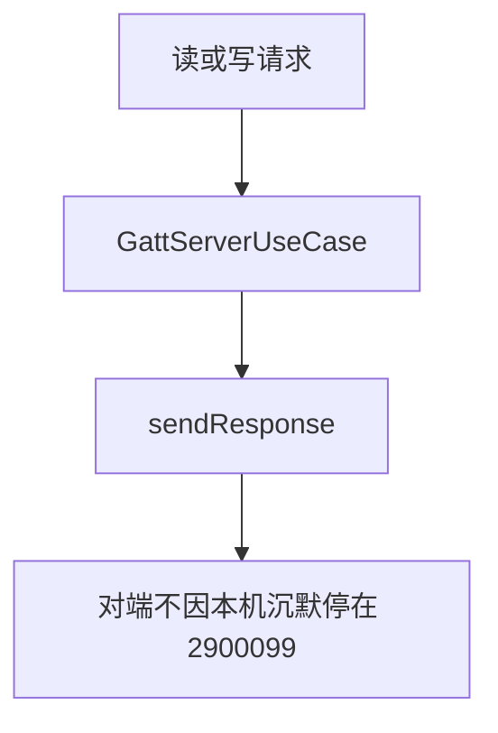
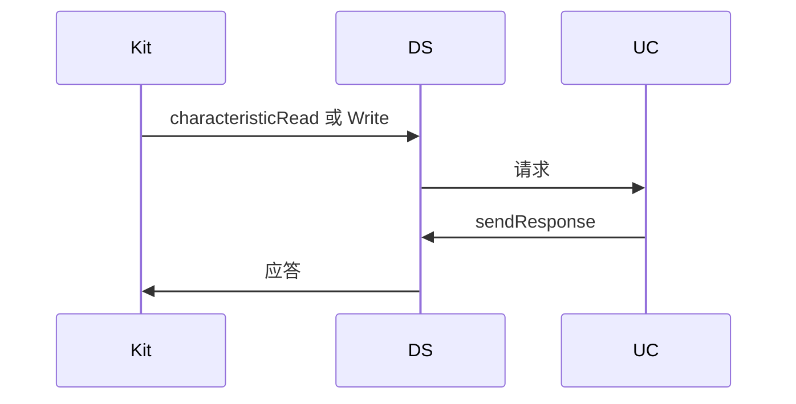
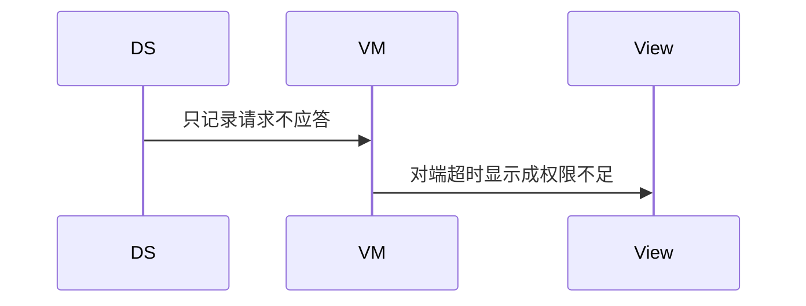

# BT-066 服务端必须应答读写请求

## 1. 条目与非目标

**判定：** 支持

**Given** 本机 GATT Server 已添加服务，对端读或写特征

**When** 收到 `characteristicRead` 或 `characteristicWrite`

**Then** 调用 `sendResponse`；否则对端订阅通知会停在 2900099

**证据：** `GattServer.sendResponse；指南「蓝牙接口调用报错 2900099」`。行为以已接受的研究笔记和清单为准，本文件不重开行业调查。

**本条输入：** GATT Server 已添加服务，收到读或写请求。

**本条输出：** 调用 `sendResponse`。请求与应答成对记入会话。

**本条失败：** 收到请求后不应答，或把不应答显示成对端权限不足。

**本条所有者：** 服务端调用点是 `common/yobluetooth` 的 `GattServerDataSource`。用例 `GattServerUseCase` 保证每个读或写请求都 `sendResponse`。页面状态在 `features/bluetooth`。

**非目标：**

- 不把客户端 `readCharacteristicValue` 用来应答服务端请求。
- 不新建 GATT 服务端包。
- 不新增 `common/yobluetooth` 以外的蓝牙栈，不增加包装层或版本兼容层。版本判断留在本条调用点。

## 2. 模块边界与分层

本组是广播与 GATT 服务端。依赖方向是 `product/phone` → `features/bluetooth` → `common/yobluetooth`。权限、生命周期和系统设置走 `common/platform` 与 `common/debug_core`。字节与 `Result` 走 `common/core`。日志门面走 `common/yolog`。收藏、会话记录和导出走 `common/storage`。`common/youi_kit` 只提供通用控件，不解释蓝牙状态。

**调用点：** `createGattServer`、`addService`、`sendResponse` 都在 `GattServerDataSource`。

| 包 | 类型 | 职责 |
| --- | --- | --- |
| common/yobluetooth | GattServerDataSource | 接收读或写并 sendResponse |
| common/yobluetooth | GattServerUseCase | 配对请求与应答 |
| features/bluetooth | 服务端 ViewModel | 显示未应答会让对端停在 2900099 |
| common/debug_core | 会话日志 | 分开记录请求和应答 |

**设计前：** 仓库只有 GATT 客户端，服务端请求没有应答路径。

**设计后：** 每个 `characteristicRead` 或 `characteristicWrite` 都经过应答。未应答在日志里可见，不伪装成 2901000。

## 3. 架构图

本组总图在 [`BT-062.md`](BT-062.md)。下图只覆盖本条。

## 4. 序列图

### 成功路径

### 错误路径

## 5. 数据模型

领域模型放在 `common/yobluetooth`，持久化模型放在 `common/storage`，平台传输对象只出现在数据源调用点，跨层用 `common/core` 的 `Result` 与 `ResultError`。错误只带类别和结构化字段，不把界面句子塞进邻层错误。

| 模型 | 所在层 | 字段 | 来源 |
| --- | --- | --- | --- |
| GattServerPeerRequest | 领域 | read 或 write 与 requestId | 回调 |
| 应答 | 数据源 | requestId 与状态 | sendResponse |

## 6. 层间接口

| 从 | 到 | 接口 | 成功 | 失败 |
| --- | --- | --- | --- | --- |
| GattServerDataSource | GattServerUseCase | 请求 | 必须返回应答 | 遗漏则记失败 |
| GattServerUseCase | GattServer | sendResponse | 已应答 | 失败可见 |

下层不持有页面类型。结果用 `Result` 或已有观察者回传。`common/yobluetooth` 的 `Index.ets` 继续只导出用例、领域模型和必要门面，不把数据源具体类变成第二套公开栈。

## 7. 权限与生命周期

服务端使用 `ACCESS_BLUETOOTH`。

Server 关闭前尽量应答已收到的请求。关闭后不再进入新回调。

## 8. 日志

- GATT 服务端标签记录 requestId 与 responded=1。
- 领域标签加在已有 `BtLogTag`，不在 `common/yolog` 的 `YoLogTag` 里再开一套蓝牙标签。
- 日志走 `YoLog`，不在页面里直接写 hilog。

## 9. 反模式

- 用通知代替读写应答。
- 把 2900099 统一映射成加密不足。
- 用新的蓝牙 HAR、适配器或 `ApiCompat` 把本条版本差异包起来。版本判断只留在上面写明的调用点。
- 页面或 `common/youi_kit` 直接调用 `ohos.bluetooth.*`。
