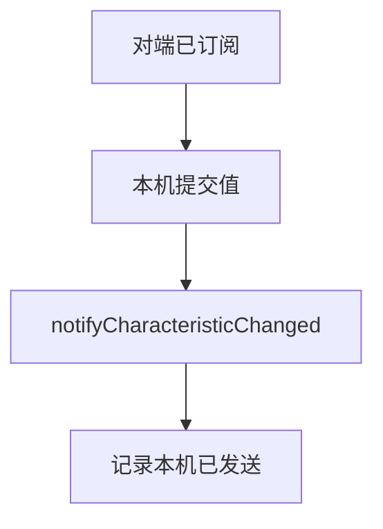
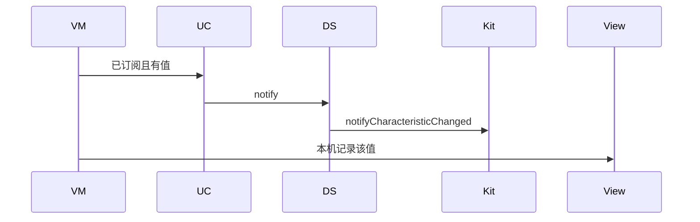
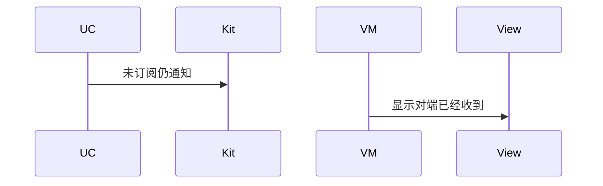

# BT-067 服务端可以发送通知

## 1. 条目与非目标

**判定：** 支持

**Given** 对端已订阅

**When** 本机 `notifyCharacteristicChanged`

**Then** 对端 `BLECharacteristicChange` 收到该值

**证据：** `GattServer.notifyCharacteristicChanged；低功耗蓝牙连接和传输数据指南`。行为以已接受的研究笔记和清单为准，本文件不重开行业调查。

**本条输入：** 对端已订阅，本机要通知一个值。

**本条输出：** 调用 `notifyCharacteristicChanged`。本机记录已发送的值。对端是否收到由对端回调体现，本机不编造对端日志。

**本条失败：** 未订阅仍显示通知已送达。

**本条所有者：** 发送在 `GattServerDataSource.notifyCharacteristicChanged`。订阅状态由服务端会话记录。展示在外围 ViewModel。

**非目标：**

- 不代替对端客户端的 `BLECharacteristicChange` 处理。
- 不把通知当成 `sendResponse`。
- 不新增 `common/yobluetooth` 以外的蓝牙栈，不增加包装层或版本兼容层。版本判断留在本条调用点。

## 2. 模块边界与分层

本组是广播与 GATT 服务端。依赖方向是 `product/phone` → `features/bluetooth` → `common/yobluetooth`。权限、生命周期和系统设置走 `common/platform` 与 `common/debug_core`。字节与 `Result` 走 `common/core`。日志门面走 `common/yolog`。收藏、会话记录和导出走 `common/storage`。`common/youi_kit` 只提供通用控件，不解释蓝牙状态。

**调用点：** `notifyCharacteristicChanged` 在 `GattServerDataSource`。

| 包 | 类型 | 职责 |
| --- | --- | --- |
| features/bluetooth | 服务端 ViewModel | 在已订阅时发送 |
| common/yobluetooth | GattServerUseCase | 校验已订阅 |
| common/yobluetooth | GattServerDataSource | notifyCharacteristicChanged |

**设计前：** 没有服务端数据源时，通知没有归属。

**设计后：** 只有会话认为对端已订阅才调用通知。发送结果以平台调用为准。

## 3. 架构图

本组总图在 [`BT-062.md`](BT-062.md)。下图只覆盖本条。

## 4. 序列图

### 成功路径

### 错误路径

## 5. 数据模型

领域模型放在 `common/yobluetooth`，持久化模型放在 `common/storage`，平台传输对象只出现在数据源调用点，跨层用 `common/core` 的 `Result` 与 `ResultError`。错误只带类别和结构化字段，不把界面句子塞进邻层错误。

| 模型 | 所在层 | 字段 | 来源 |
| --- | --- | --- | --- |
| 服务端订阅记录 | 领域 | 对端与特征 | 订阅事件 |
| 通知值 | 领域 | 字节 | 本机发送 |

## 6. 层间接口

| 从 | 到 | 接口 | 成功 | 失败 |
| --- | --- | --- | --- | --- |
| 服务端 ViewModel | GattServerUseCase | notify | 已订阅才发送 | 未订阅拒绝 |
| GattServerDataSource | GattServer | notifyCharacteristicChanged | 调用成功 | 失败可见 |

下层不持有页面类型。结果用 `Result` 或已有观察者回传。`common/yobluetooth` 的 `Index.ets` 继续只导出用例、领域模型和必要门面，不把数据源具体类变成第二套公开栈。

## 7. 权限与生命周期

不涉及新权限。

Server 关闭后不能再通知。

## 8. 日志

- 服务端日志记录 notifyBytes，不写 peerReceived，除非本机就是对端客户端会话。
- 领域标签加在已有 `BtLogTag`，不在 `common/yolog` 的 `YoLogTag` 里再开一套蓝牙标签。
- 日志走 `YoLog`，不在页面里直接写 hilog。

## 9. 反模式

- 用客户端通知订阅接口给本机服务端发通知。
- 未订阅返回成功。
- 用新的蓝牙 HAR、适配器或 `ApiCompat` 把本条版本差异包起来。版本判断只留在上面写明的调用点。
- 页面或 `common/youi_kit` 直接调用 `ohos.bluetooth.*`。
