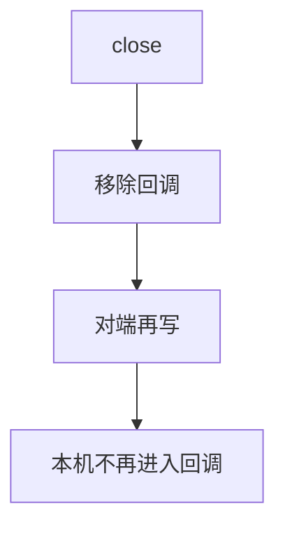
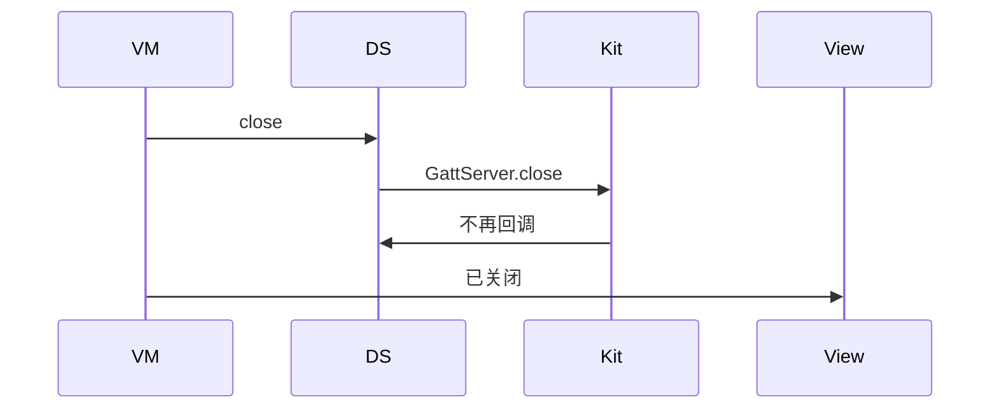
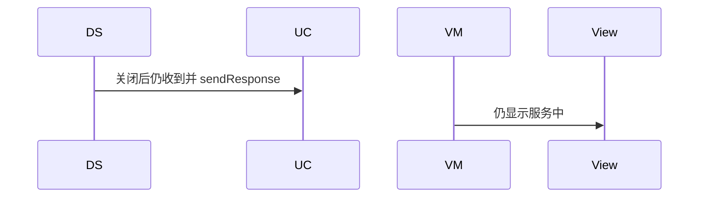

# BT-068 服务端关闭后不再接受请求

## 1. 条目与非目标

**判定：** 支持

**Given** Server 已 `close`

**When** 对端再写

**Then** 本机不再进入读写回调

**证据：** `GattServer.close`。行为以已接受的研究笔记和清单为准，本文件不重开行业调查。

**本条输入：** GATT Server 已 `close`，对端再写。

**本条输出：** 本机不再进入读写回调，也不再 `sendResponse`。

**本条失败：** 关闭后仍处理写请求。

**本条所有者：** `GattServerDataSource.close` 关闭并清掉回调。用例保证关闭后的事件被丢弃且不应答。页面显示已关闭。

**非目标：**

- 不在关闭后自动重建 Server 并继续应答。
- 不把关闭显示成仍在服务。
- 不新增 `common/yobluetooth` 以外的蓝牙栈，不增加包装层或版本兼容层。版本判断留在本条调用点。

## 2. 模块边界与分层

本组是广播与 GATT 服务端。依赖方向是 `product/phone` → `features/bluetooth` → `common/yobluetooth`。权限、生命周期和系统设置走 `common/platform` 与 `common/debug_core`。字节与 `Result` 走 `common/core`。日志门面走 `common/yolog`。收藏、会话记录和导出走 `common/storage`。`common/youi_kit` 只提供通用控件，不解释蓝牙状态。

**调用点：** `GattServer.close` 在 `GattServerDataSource`。

| 包 | 类型 | 职责 |
| --- | --- | --- |
| features/bluetooth | 服务端 ViewModel | 请求关闭 |
| common/yobluetooth | GattServerDataSource | close 并移除回调 |
| common/yobluetooth | GattServerUseCase | 关闭后拒绝新请求 |

**设计前：** 关闭若只改布尔值，回调仍可能应答。

**设计后：** 先 `close` 并取消订阅，再标关闭。之后的写不进入用例。

## 3. 架构图

本组总图在 [`BT-062.md`](BT-062.md)。下图只覆盖本条。

## 4. 序列图

### 成功路径

### 错误路径

## 5. 数据模型

领域模型放在 `common/yobluetooth`，持久化模型放在 `common/storage`，平台传输对象只出现在数据源调用点，跨层用 `common/core` 的 `Result` 与 `ResultError`。错误只带类别和结构化字段，不把界面句子塞进邻层错误。

| 模型 | 所在层 | 字段 | 来源 |
| --- | --- | --- | --- |
| 服务端相位 | 领域 | closed | close 之后 |

## 6. 层间接口

| 从 | 到 | 接口 | 成功 | 失败 |
| --- | --- | --- | --- | --- |
| GattServerUseCase | GattServerDataSource | close | 回调移除 | 失败可见 |
| 数据源 | 用例 | 关闭后的请求 | 不转发 | 不应答 |

下层不持有页面类型。结果用 `Result` 或已有观察者回传。`common/yobluetooth` 的 `Index.ets` 继续只导出用例、领域模型和必要门面，不把数据源具体类变成第二套公开栈。

## 7. 权限与生命周期

不涉及。

关闭与页面离开绑定，避免后台继续充当外设，除非另有明确的外围会话所有权。本条要求关闭后不再接受。

## 8. 日志

- 服务端日志记录 closed=1，之后没有 read 或 write。
- 领域标签加在已有 `BtLogTag`，不在 `common/yolog` 的 `YoLogTag` 里再开一套蓝牙标签。
- 日志走 `YoLog`，不在页面里直接写 hilog。

## 9. 反模式

- close 后立刻 create 并当作同一次服务没断。
- 只 `off` 页面不 close Server。
- 用新的蓝牙 HAR、适配器或 `ApiCompat` 把本条版本差异包起来。版本判断只留在上面写明的调用点。
- 页面或 `common/youi_kit` 直接调用 `ohos.bluetooth.*`。
