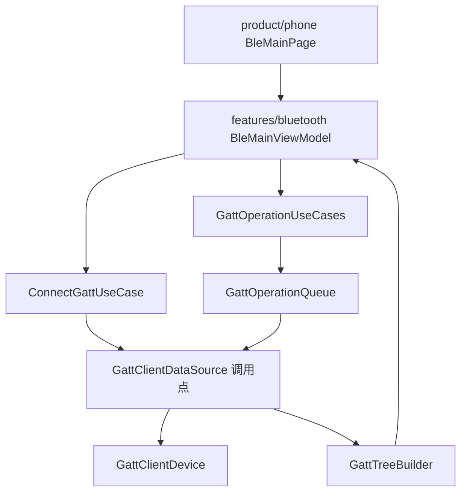
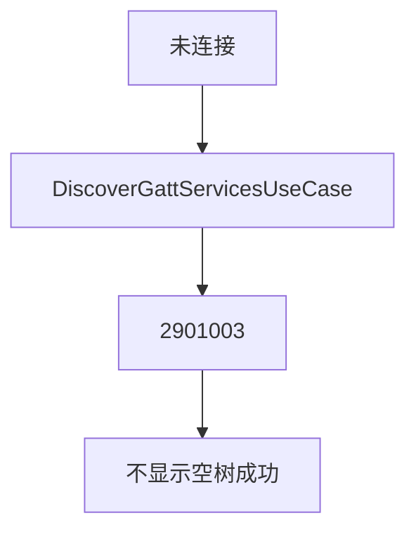
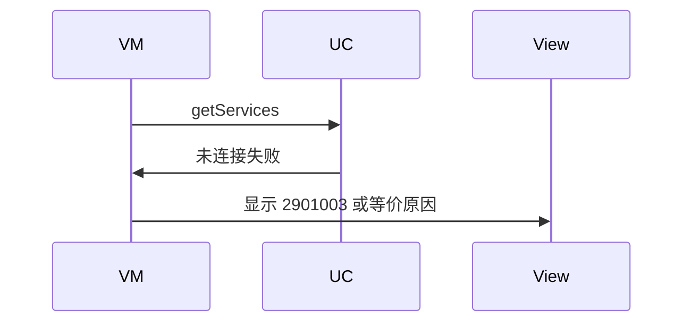
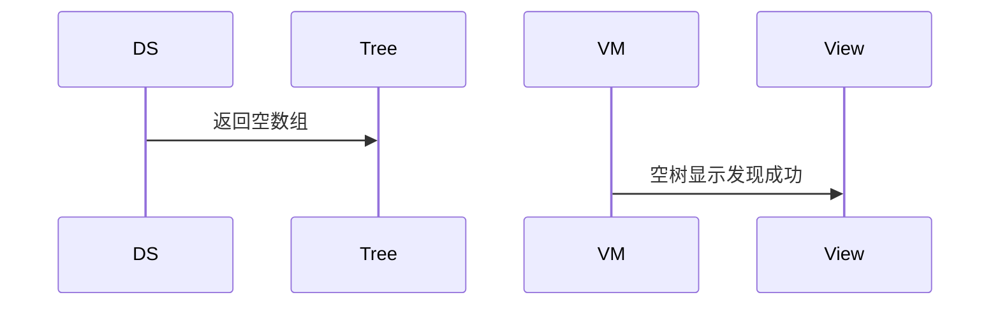

# BT-069 未连接不能发现服务

## 1. 条目与非目标

**判定：** 支持

**Given** GATT 未连接

**When** 调用 `getServices`

**Then** 失败（2901003 或等价）；不显示空服务树冒充成功

**证据：** `错误码 2901003；最佳实践要求先连上再 getServices`。行为以已接受的研究笔记和清单为准，本文件不重开行业调查。

**本条输入：** GATT 未连接时的发现服务请求。

**本条输出：** 失败可见，平台码 2901003 或等价未连接。服务树不变成空成功。

**本条失败：** 空树被显示成发现成功。

**本条所有者：** `DiscoverGattServicesUseCase` 先看连接状态。`GattClientDataSource.getServices` 识别 2901003。展示在 `BleMainViewModel`。树模型是 `GattServiceTreeSnapshot`。

**非目标：**

- 不自动连接后再发现并显示第一次就成功。
- 不缓存上一次连接的树当本次结果。
- 不新增 `common/yobluetooth` 以外的蓝牙栈，不增加包装层或版本兼容层。版本判断留在本条调用点。

## 2. 模块边界与分层

本组是GATT 客户端。依赖方向是 `product/phone` → `features/bluetooth` → `common/yobluetooth`。权限、生命周期和系统设置走 `common/platform` 与 `common/debug_core`。字节与 `Result` 走 `common/core`。日志门面走 `common/yolog`。收藏、会话记录和导出走 `common/storage`。`common/youi_kit` 只提供通用控件，不解释蓝牙状态。

**调用点：** `getServices` 在 `GattClientDataSource`。

| 包 | 类型 | 职责 |
| --- | --- | --- |
| features/bluetooth | BleMainViewModel | 未连接时展示失败 |
| common/yobluetooth | DiscoverGattServicesUseCase | 未连接不发请求 |
| common/yobluetooth | GattClientDataSource | 若平台返回则映射 2901003 |
| common/yobluetooth | GattTreeBuilder | 失败时不产出空成功树 |

**设计前：** `getServices` 失败若变成空数组，界面像是没有服务。

**设计后：** 未连接直接失败。空树只在连接且发现成功且确实没有服务时出现，并带成功标记。本条不产生该标记。

## 3. 架构图

本组总图放在本文件。GATT 客户端里其余条目各自再画本条链路，链接不能代替本条的输入、输出、失败和所有者。

本条链路：

## 4. 序列图

### 成功路径

### 错误路径

## 5. 数据模型

领域模型放在 `common/yobluetooth`，持久化模型放在 `common/storage`，平台传输对象只出现在数据源调用点，跨层用 `common/core` 的 `Result` 与 `ResultError`。错误只带类别和结构化字段，不把界面句子塞进邻层错误。

| 模型 | 所在层 | 字段 | 来源 |
| --- | --- | --- | --- |
| GattClientState | 领域 | disconnected | 发现前 |
| ResultError | 领域 | platformCode=2901003 | 未连接 |

## 6. 层间接口

| 从 | 到 | 接口 | 成功 | 失败 |
| --- | --- | --- | --- | --- |
| BleMainViewModel | DiscoverGattServicesUseCase | discover | 已连接才调用 | 未连接失败 |
| GattClientDataSource | GattTreeBuilder | 服务列表 | 本条不给成功列表 | 不建空树 |

下层不持有页面类型。结果用 `Result` 或已有观察者回传。`common/yobluetooth` 的 `Index.ets` 继续只导出用例、领域模型和必要门面，不把数据源具体类变成第二套公开栈。

## 7. 权限与生命周期

不因失败自动申请权限。

未连接不注册服务发现回调。

## 8. 日志

- GATT 标签记录 discoverRejected=notConnected。
- 领域标签加在已有 `BtLogTag`，不在 `common/yolog` 的 `YoLogTag` 里再开一套蓝牙标签。
- 日志走 `YoLog`，不在页面里直接写 hilog。

## 9. 反模式

- 失败后自动 connect 再 getServices。
- 用上次树填空。
- 用新的蓝牙 HAR、适配器或 `ApiCompat` 把本条版本差异包起来。版本判断只留在上面写明的调用点。
- 页面或 `common/youi_kit` 直接调用 `ohos.bluetooth.*`。
