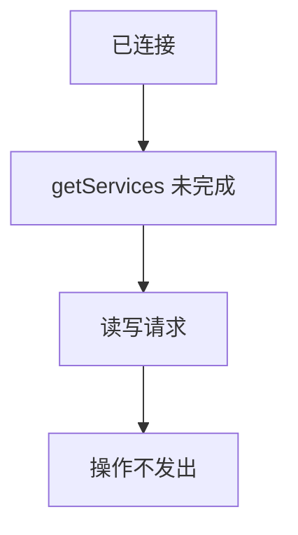
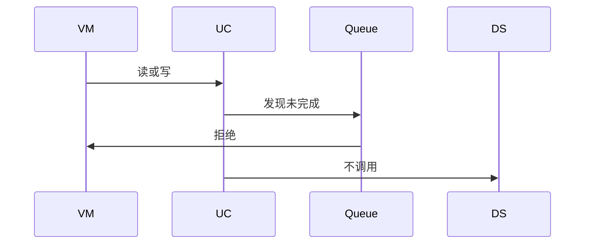
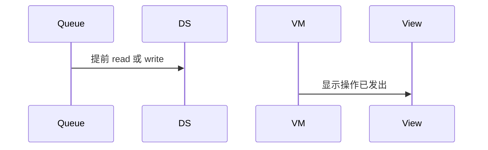

# BT-070 服务发现完成前不能读写

## 1. 条目与非目标

**判定：** 支持

**Given** 已连接但 `getServices` 未完成

**When** 读或写特征

**Then** 操作不发出

**证据：** `最佳实践「蓝牙数据传输报错失败」；2900099 指南中的调用顺序`。行为以已接受的研究笔记和清单为准，本文件不重开行业调查。

**本条输入：** 已连接，服务发现尚未完成，用户读或写。

**本条输出：** 读或写不发出。

**本条失败：** 发现完成前调用 `readCharacteristicValue` 或写。

**本条所有者：** `GattOperationQueue` 在发现完成前不接收读写。`ReadGattCharacteristicUseCase` 与 `WriteGattCharacteristicUseCase` 检查树是否就绪。

**非目标：**

- 不把拒绝排队到发现完成后自动执行。
- 不因此禁止发现完成后的操作。
- 不新增 `common/yobluetooth` 以外的蓝牙栈，不增加包装层或版本兼容层。版本判断留在本条调用点。

## 2. 模块边界与分层

本组是GATT 客户端。依赖方向是 `product/phone` → `features/bluetooth` → `common/yobluetooth`。权限、生命周期和系统设置走 `common/platform` 与 `common/debug_core`。字节与 `Result` 走 `common/core`。日志门面走 `common/yolog`。收藏、会话记录和导出走 `common/storage`。`common/youi_kit` 只提供通用控件，不解释蓝牙状态。

**调用点：** 读写方法在 `GattClientDataSource`，本条不进入。

| 包 | 类型 | 职责 |
| --- | --- | --- |
| common/yobluetooth | GattOperationQueue | 发现未完成则拒绝 |
| common/yobluetooth | ReadGattCharacteristicUseCase | 不调用读 |
| common/yobluetooth | WriteGattCharacteristicUseCase | 不调用写 |
| features/bluetooth | BleMainViewModel | 说明需先完成发现 |

**设计前：** 队列若只串行、不看发现状态，会在树就绪前发出读写。

**设计后：** 发现完成是队列开门条件。之前的读写在用例返回，不到数据源。

## 3. 架构图

本组总图在 [`BT-069.md`](BT-069.md)。下图只覆盖本条。

## 4. 序列图

### 成功路径

### 错误路径

## 5. 数据模型

领域模型放在 `common/yobluetooth`，持久化模型放在 `common/storage`，平台传输对象只出现在数据源调用点，跨层用 `common/core` 的 `Result` 与 `ResultError`。错误只带类别和结构化字段，不把界面句子塞进邻层错误。

| 模型 | 所在层 | 字段 | 来源 |
| --- | --- | --- | --- |
| GattServiceTreeSnapshot | 领域 | 未就绪 | 发现前 |
| GattOperationQueue | 领域服务 | 关闭 | 直到发现完成 |

## 6. 层间接口

| 从 | 到 | 接口 | 成功 | 失败 |
| --- | --- | --- | --- | --- |
| ReadGattCharacteristicUseCase | GattClientDataSource | read | 不调用 | 发现未完成 |
| WriteGattCharacteristicUseCase | GattClientDataSource | write | 不调用 | 发现未完成 |

下层不持有页面类型。结果用 `Result` 或已有观察者回传。`common/yobluetooth` 的 `Index.ets` 继续只导出用例、领域模型和必要门面，不把数据源具体类变成第二套公开栈。

## 7. 权限与生命周期

不涉及。

连接保持。拒绝不取消发现。

## 8. 日志

- GATT 日志记录 opRejected=servicesPending。
- 领域标签加在已有 `BtLogTag`，不在 `common/yolog` 的 `YoLogTag` 里再开一套蓝牙标签。
- 日志走 `YoLog`，不在页面里直接写 hilog。

## 9. 反模式

- 用 2900099 之后再自动补发并显示第一次成功。
- 用新的蓝牙 HAR、适配器或 `ApiCompat` 把本条版本差异包起来。版本判断只留在上面写明的调用点。
- 页面或 `common/youi_kit` 直接调用 `ohos.bluetooth.*`。
