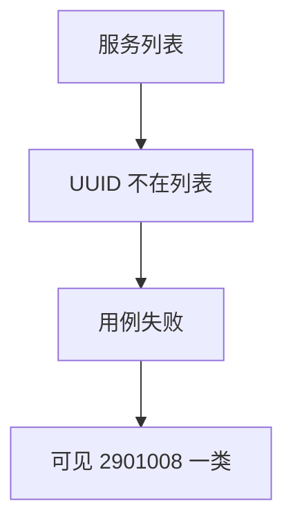
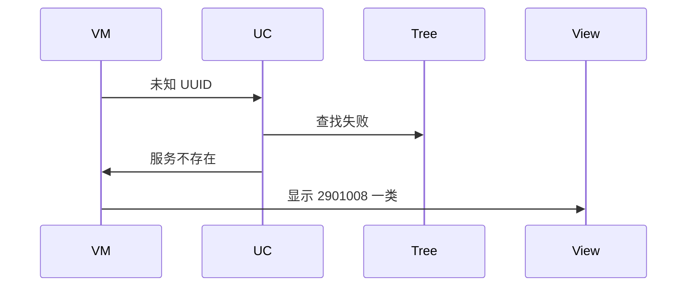
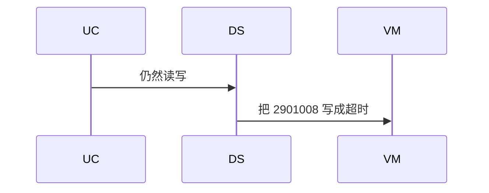

# BT-071 特征必须属于已发现服务

## 1. 条目与非目标

**判定：** 支持

**Given** 服务列表已返回

**When** 读写一个不在列表中的 UUID

**Then** 失败可见（2901008 服务不存在一类）

**证据：** `低功耗蓝牙连接和传输数据指南；错误码 2901008`。行为以已接受的研究笔记和清单为准，本文件不重开行业调查。

**本条输入：** 已发现服务列表，以及不在其中的特征 UUID。

**本条输出：** 失败可见，包含 2901008 一类服务不存在。不发出无效读写。

**本条失败：** 未知 UUID 仍调用平台并显示成功。

**本条所有者：** `GattTreeBuilder` 提供查找。用例在树上找不到则失败。若平台仍返回 2901008，`GattClientDataSource` 映射该码。

**非目标：**

- 不刷新服务来凑这个 UUID。
- 不把 2901008 收成通用超时。
- 不新增 `common/yobluetooth` 以外的蓝牙栈，不增加包装层或版本兼容层。版本判断留在本条调用点。

## 2. 模块边界与分层

本组是GATT 客户端。依赖方向是 `product/phone` → `features/bluetooth` → `common/yobluetooth`。权限、生命周期和系统设置走 `common/platform` 与 `common/debug_core`。字节与 `Result` 走 `common/core`。日志门面走 `common/yolog`。收藏、会话记录和导出走 `common/storage`。`common/youi_kit` 只提供通用控件，不解释蓝牙状态。

**调用点：** 真正的读写调用点仍是 `GattClientDataSource`，本条在找不到时不到达。

| 包 | 类型 | 职责 |
| --- | --- | --- |
| common/yobluetooth | GattTreeBuilder | 按 UUID 查找 |
| common/yobluetooth | 读写用例 | 不在树上则失败 |
| common/yobluetooth | GattClientDataSource | 平台 2901008 原样上抛 |
| features/bluetooth | BleMainViewModel | 显示服务不存在 |

**设计前：** 手输 UUID 会绕过树直接打到平台。

**设计后：** 用例先查树。不在列表中就失败。平台若返回 2901008，文案用该码。

## 3. 架构图

本组总图在 [`BT-069.md`](BT-069.md)。下图只覆盖本条。

## 4. 序列图

### 成功路径

### 错误路径

## 5. 数据模型

领域模型放在 `common/yobluetooth`，持久化模型放在 `common/storage`，平台传输对象只出现在数据源调用点，跨层用 `common/core` 的 `Result` 与 `ResultError`。错误只带类别和结构化字段，不把界面句子塞进邻层错误。

| 模型 | 所在层 | 字段 | 来源 |
| --- | --- | --- | --- |
| GattCharacteristicRef | 领域 | 必须来自树 | 已发现 |
| ResultError | 领域 | platformCode=2901008 | 服务不存在 |

## 6. 层间接口

| 从 | 到 | 接口 | 成功 | 失败 |
| --- | --- | --- | --- | --- |
| 读写用例 | GattTreeBuilder | find | 命中才继续 | 未命中失败 |
| GattClientDataSource | 用例 | 2901008 | 上抛该码 | 不改成 2900007 |

下层不持有页面类型。结果用 `Result` 或已有观察者回传。`common/yobluetooth` 的 `Index.ets` 继续只导出用例、领域模型和必要门面，不把数据源具体类变成第二套公开栈。

## 7. 权限与生命周期

不涉及。

失败不改变连接。

## 8. 日志

- GATT 日志记录 missingCharacteristic=1 platformCode。
- 领域标签加在已有 `BtLogTag`，不在 `common/yolog` 的 `YoLogTag` 里再开一套蓝牙标签。
- 日志走 `YoLog`，不在页面里直接写 hilog。

## 9. 反模式

- 自动再 getServices 直到 UUID 出现并显示原操作成功。
- 用新的蓝牙 HAR、适配器或 `ApiCompat` 把本条版本差异包起来。版本判断只留在上面写明的调用点。
- 页面或 `common/youi_kit` 直接调用 `ohos.bluetooth.*`。
