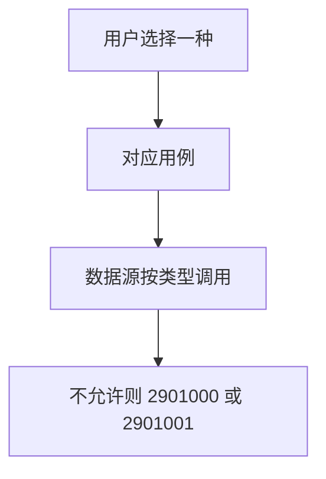
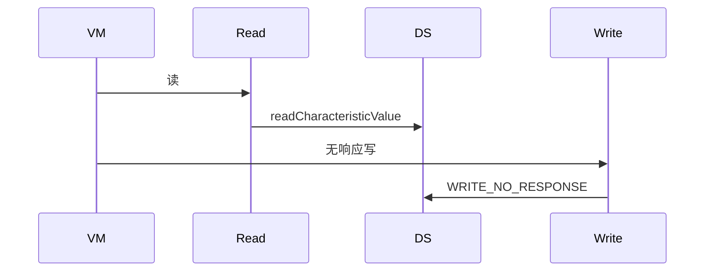
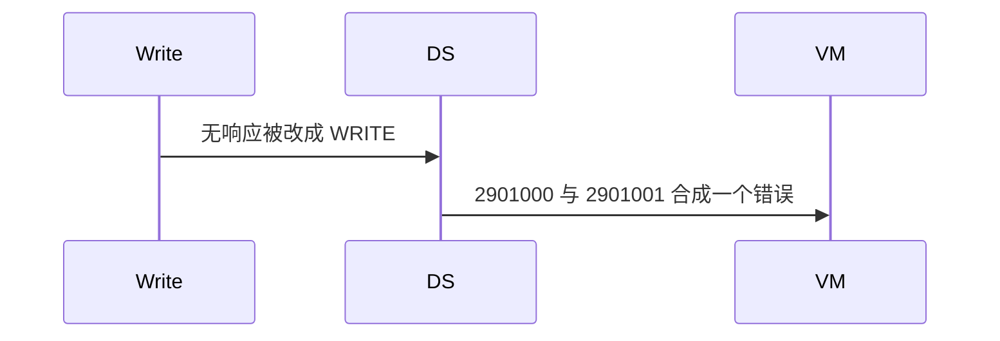

# BT-072 读与两种写分开

## 1. 条目与非目标

**判定：** 支持

**Given** 特征同时允许读、写、无响应写中的若干种

**When** 用户选择其中一种

**Then** 读走 `readCharacteristicValue`；写走 `GattWriteType.WRITE`；无响应写走 `WRITE_NO_RESPONSE`。不允许的属性对应 2901000 或 2901001

**证据：** `GattWriteType；错误码 2901000、2901001`。行为以已接受的研究笔记和清单为准，本文件不重开行业调查。

**本条输入：** 用户选择读、写或无响应写。

**本条输出：** 三种调用分开。属性不允许时显示 2901000 或 2901001。

**本条失败：** 无响应写被发成带响应写，或读失败显示成写不允许。

**本条所有者：** 选择在 BLE 页面状态。`ReadGattCharacteristicUseCase` 与 `WriteGattCharacteristicUseCase` 分开。写类型进入 `GattClientDataSource`。属性来自 `GattCharacteristicNode`。

**非目标：**

- 不在属性不允许时换一种写并显示用户所选已成功。
- 不合并成一个万能 write。
- 不新增 `common/yobluetooth` 以外的蓝牙栈，不增加包装层或版本兼容层。版本判断留在本条调用点。

## 2. 模块边界与分层

本组是GATT 客户端。依赖方向是 `product/phone` → `features/bluetooth` → `common/yobluetooth`。权限、生命周期和系统设置走 `common/platform` 与 `common/debug_core`。字节与 `Result` 走 `common/core`。日志门面走 `common/yolog`。收藏、会话记录和导出走 `common/storage`。`common/youi_kit` 只提供通用控件，不解释蓝牙状态。

**调用点：** Kit 方法选择在 `GattClientDataSource`。

| 包 | 类型 | 职责 |
| --- | --- | --- |
| features/bluetooth | BleMainViewModel | 三种动作分开 |
| common/yobluetooth | ReadGattCharacteristicUseCase | 只读 |
| common/yobluetooth | WriteGattCharacteristicUseCase | 携带 WRITE 或 WRITE_NO_RESPONSE |
| common/yobluetooth | GattClientDataSource | 按类型调用 |

**设计前：** 写用例若固定一种 `GattWriteType`，用户选择会丢失。

**设计后：** 读不走写接口。两种写类型原样到达调用点。2901000 与 2901001 分别表示读不允许和写不允许。

## 3. 架构图

本组总图在 [`BT-069.md`](BT-069.md)。下图只覆盖本条。

## 4. 序列图

### 成功路径

### 错误路径

## 5. 数据模型

领域模型放在 `common/yobluetooth`，持久化模型放在 `common/storage`，平台传输对象只出现在数据源调用点，跨层用 `common/core` 的 `Result` 与 `ResultError`。错误只带类别和结构化字段，不把界面句子塞进邻层错误。

| 模型 | 所在层 | 字段 | 来源 |
| --- | --- | --- | --- |
| GattCharacteristicNode | 领域 | 属性 | 发现结果 |
| 写类型 | 领域 | WRITE 或 WRITE_NO_RESPONSE | 用户选择 |

## 6. 层间接口

| 从 | 到 | 接口 | 成功 | 失败 |
| --- | --- | --- | --- | --- |
| BleMainViewModel | ReadGattCharacteristicUseCase | read | 读接口 | 2901000 |
| BleMainViewModel | WriteGattCharacteristicUseCase | write 带类型 | 对应 GattWriteType | 2901001 |

下层不持有页面类型。结果用 `Result` 或已有观察者回传。`common/yobluetooth` 的 `Index.ets` 继续只导出用例、领域模型和必要门面，不把数据源具体类变成第二套公开栈。

## 7. 权限与生命周期

不涉及。

操作失败不断开连接。

## 8. 日志

- GATT 日志记录 op=read、write 或 writeNoRsp 与平台码。
- 领域标签加在已有 `BtLogTag`，不在 `common/yolog` 的 `YoLogTag` 里再开一套蓝牙标签。
- 日志走 `YoLog`，不在页面里直接写 hilog。

## 9. 反模式

- 无响应失败后自动改带响应。
- 一个按钮依次尝试三种直到成功。
- 用新的蓝牙 HAR、适配器或 `ApiCompat` 把本条版本差异包起来。版本判断只留在上面写明的调用点。
- 页面或 `common/youi_kit` 直接调用 `ohos.bluetooth.*`。
