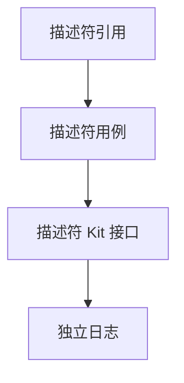
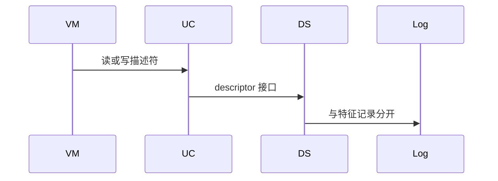
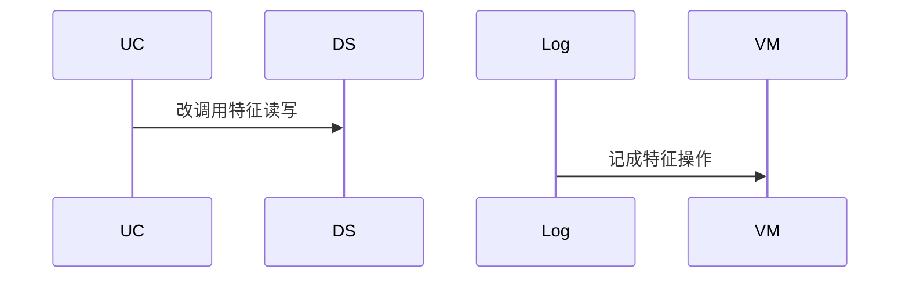

# BT-073 描述符可单独读写

## 1. 条目与非目标

**判定：** 支持

**Given** 特征下有描述符

**When** 用户读或写该描述符

**Then** 使用描述符接口，结果与特征读写分开记录

**证据：** `readDescriptorValue、writeDescriptorValue`。行为以已接受的研究笔记和清单为准，本文件不重开行业调查。

**本条输入：** 已发现特征下的一个描述符，用户读或写它。

**本条输出：** 调用描述符读或写。日志与特征读写分开。

**本条失败：** 描述符操作被记成特征读写。

**本条所有者：** 已有 `ReadGattDescriptorUseCase` 与 `WriteGattDescriptorUseCase`。调用在 `GattClientDataSource`。记录用 `common/debug_core` 的日志类型区分描述符。

**非目标：**

- 不通过写特征来改描述符。
- 不把 CCCD 订阅当成普通描述符写成功的唯一形式。
- 不新增 `common/yobluetooth` 以外的蓝牙栈，不增加包装层或版本兼容层。版本判断留在本条调用点。

## 2. 模块边界与分层

本组是GATT 客户端。依赖方向是 `product/phone` → `features/bluetooth` → `common/yobluetooth`。权限、生命周期和系统设置走 `common/platform` 与 `common/debug_core`。字节与 `Result` 走 `common/core`。日志门面走 `common/yolog`。收藏、会话记录和导出走 `common/storage`。`common/youi_kit` 只提供通用控件，不解释蓝牙状态。

**调用点：** `readDescriptorValue` 与 `writeDescriptorValue` 在 `GattClientDataSource`。

| 包 | 类型 | 职责 |
| --- | --- | --- |
| common/yobluetooth | ReadGattDescriptorUseCase | 读描述符 |
| common/yobluetooth | WriteGattDescriptorUseCase | 写描述符 |
| common/yobluetooth | GattClientDataSource | 描述符 Kit 接口 |
| common/debug_core | LogCaptureService | 分开记录 |

**设计前：** 描述符用例已存在，但日志若复用特征记录类型，结果无法区分。

**设计后：** 调用点使用描述符接口。会话日志的协议或记录类型标明 descriptor。

## 3. 架构图

本组总图在 [`BT-069.md`](BT-069.md)。下图只覆盖本条。

## 4. 序列图

### 成功路径

### 错误路径

## 5. 数据模型

领域模型放在 `common/yobluetooth`，持久化模型放在 `common/storage`，平台传输对象只出现在数据源调用点，跨层用 `common/core` 的 `Result` 与 `ResultError`。错误只带类别和结构化字段，不把界面句子塞进邻层错误。

| 模型 | 所在层 | 字段 | 来源 |
| --- | --- | --- | --- |
| GattDescriptorRef | 领域 | 特征下的描述符 | 服务树 |
| DebugLogRecord | debug_core | descriptor 标记 | 独立记录 |

## 6. 层间接口

| 从 | 到 | 接口 | 成功 | 失败 |
| --- | --- | --- | --- | --- |
| ReadGattDescriptorUseCase | GattClientDataSource | readDescriptorValue | 描述符值 | 失败可见 |
| WriteGattDescriptorUseCase | GattClientDataSource | writeDescriptorValue | 写结果 | 不走特征写 |

下层不持有页面类型。结果用 `Result` 或已有观察者回传。`common/yobluetooth` 的 `Index.ets` 继续只导出用例、领域模型和必要门面，不把数据源具体类变成第二套公开栈。

## 7. 权限与生命周期

不涉及。

与其他 GATT 操作一样串行，未完成不发下一次。

## 8. 日志

- GATT 日志记录 target=descriptor。
- 领域标签加在已有 `BtLogTag`，不在 `common/yolog` 的 `YoLogTag` 里再开一套蓝牙标签。
- 日志走 `YoLog`，不在页面里直接写 hilog。

## 9. 反模式

- 写 CCCD 时改走 `writeCharacteristicValue`。
- 用新的蓝牙 HAR、适配器或 `ApiCompat` 把本条版本差异包起来。版本判断只留在上面写明的调用点。
- 页面或 `common/youi_kit` 直接调用 `ohos.bluetooth.*`。
