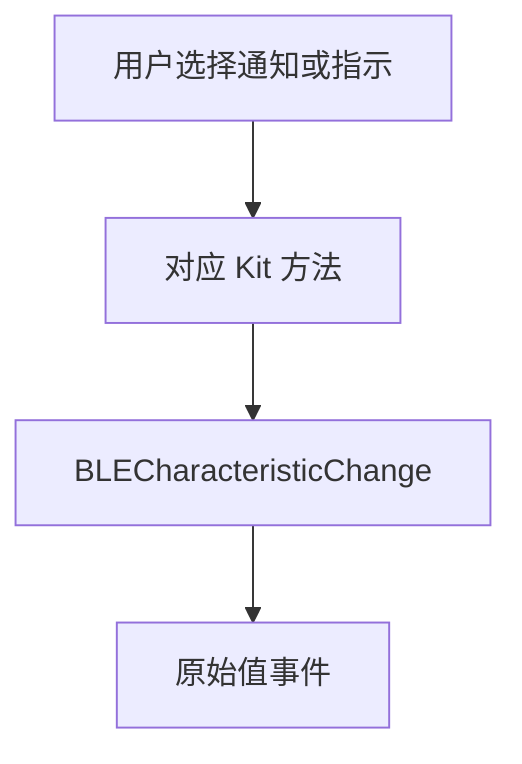
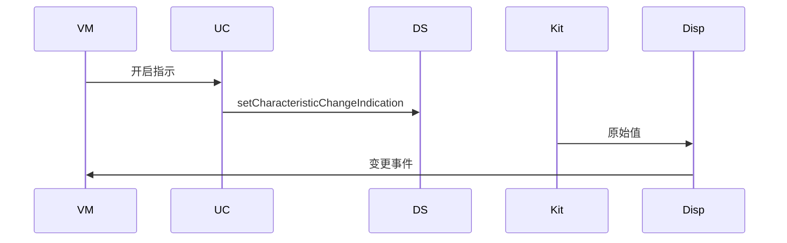
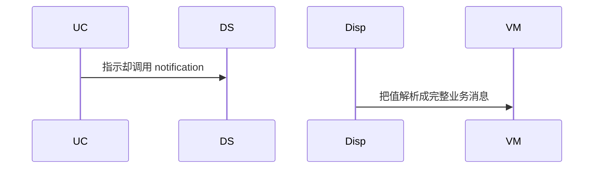

# BT-074 通知与指示分开订阅

## 1. 条目与非目标

**判定：** 支持

**Given** 特征支持 notify 或 indicate

**When** 用户开启其中一种

**Then** 分别调用 `setCharacteristicChangeNotification` 或 `setCharacteristicChangeIndication`；随后 `BLECharacteristicChange` 带原始值

**证据：** `GATT 客户端对应方法；FAQ 2900099 的顺序：先 MTU，再 getServices，再订阅`。行为以已接受的研究笔记和清单为准，本文件不重开行业调查。

**本条输入：** 用户开启通知或指示。

**本条输出：** 两种方法分开调用。之后 `BLECharacteristicChange` 的原始值进入 `GattCharacteristicChangeEvent`。

**本条失败：** 指示走通知接口，或变更回调被解析成业务消息。

**本条所有者：** `SetGattNotificationUseCase` 按种类调用 `GattClientDataSource`。分发在 `GattNotificationDispatcher`。顺序上订阅晚于 MTU 与发现，由队列保证。

**非目标：**

- 不在本条重新定义 MTU。
- 不把通知值组包。
- 不新增 `common/yobluetooth` 以外的蓝牙栈，不增加包装层或版本兼容层。版本判断留在本条调用点。

## 2. 模块边界与分层

本组是GATT 客户端。依赖方向是 `product/phone` → `features/bluetooth` → `common/yobluetooth`。权限、生命周期和系统设置走 `common/platform` 与 `common/debug_core`。字节与 `Result` 走 `common/core`。日志门面走 `common/yolog`。收藏、会话记录和导出走 `common/storage`。`common/youi_kit` 只提供通用控件，不解释蓝牙状态。

**调用点：** 两个订阅方法都在 `GattClientDataSource`。

| 包 | 类型 | 职责 |
| --- | --- | --- |
| common/yobluetooth | GattOperationQueue | 发现与 MTU 之后才订阅 |
| common/yobluetooth | SetGattNotificationUseCase | 通知或指示分支 |
| common/yobluetooth | GattClientDataSource | 两个不同 Kit 方法 |
| common/yobluetooth | GattNotificationDispatcher | 原始值事件 |

**设计前：** 一个订阅方法若总是调用 notification，指示会被写错。

**设计后：** 页面选择决定 Kit 方法。变更事件保留原始字节。

## 3. 架构图

本组总图在 [`BT-069.md`](BT-069.md)。下图只覆盖本条。

## 4. 序列图

### 成功路径

### 错误路径

## 5. 数据模型

领域模型放在 `common/yobluetooth`，持久化模型放在 `common/storage`，平台传输对象只出现在数据源调用点，跨层用 `common/core` 的 `Result` 与 `ResultError`。错误只带类别和结构化字段，不把界面句子塞进邻层错误。

| 模型 | 所在层 | 字段 | 来源 |
| --- | --- | --- | --- |
| GattNotifyState | 领域 | notify 与 indicate 分开 | 用户选择 |
| GattCharacteristicChangeEvent | 领域 | 原始字节 | 回调 |

## 6. 层间接口

| 从 | 到 | 接口 | 成功 | 失败 |
| --- | --- | --- | --- | --- |
| SetGattNotificationUseCase | GattClientDataSource | notification 或 indication | 与选择一致 | 失败可见 |
| GattNotificationDispatcher | BleMainViewModel | 事件 | 原始值 | 不组包 |

下层不持有页面类型。结果用 `Result` 或已有观察者回传。`common/yobluetooth` 的 `Index.ets` 继续只导出用例、领域模型和必要门面，不把数据源具体类变成第二套公开栈。

## 7. 权限与生命周期

不涉及。

断开或关闭订阅时取消对应回调，避免重复订阅条目里的多播。

## 8. 日志

- GATT 日志记录 subscribe=notify 或 indicate。
- 领域标签加在已有 `BtLogTag`，不在 `common/yolog` 的 `YoLogTag` 里再开一套蓝牙标签。
- 日志走 `YoLog`，不在页面里直接写 hilog。

## 9. 反模式

- 两种都写 CCCD 却只调用其中一个方法还显示另一种成功。
- 在发现完成前订阅。
- 用新的蓝牙 HAR、适配器或 `ApiCompat` 把本条版本差异包起来。版本判断只留在上面写明的调用点。
- 页面或 `common/youi_kit` 直接调用 `ohos.bluetooth.*`。
