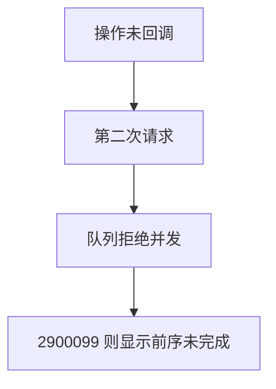
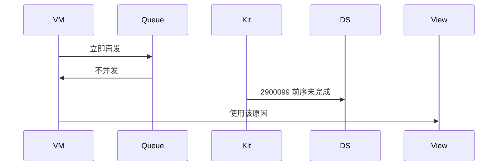
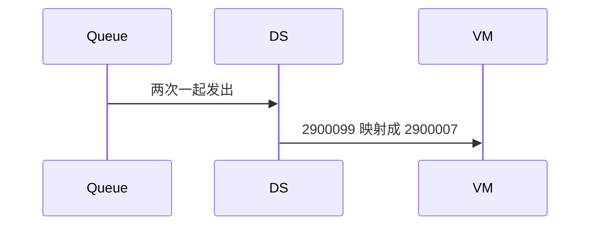

# BT-075 前一次 GATT 操作未完成时拒绝下一次

## 1. 条目与非目标

**判定：** 支持

**Given** 读、写或订阅尚未回调

**When** 用户立即再发一次

**Then** 第二次不并发发出；若平台返回 2900099「前序未完成」，文案使用该原因

**证据：** `错误码 2900099 子原因；2900007 超时`。行为以已接受的研究笔记和清单为准，本文件不重开行业调查。

**本条输入：** 上一次读、写或订阅尚未回调。

**本条输出：** 第二次不并发发出。若平台返回前序未完成，文案用 2900099 该原因，不改成超时，除非平台码就是 2900007。

**本条失败：** 两次 GATT 操作并发，或 2900099 被写成 2900007。

**本条所有者：** 串行由 `GattOperationQueue`。平台码映射在 `GattClientDataSource`。页面在 `BleMainViewModel` 禁用重复按钮。

**非目标：**

- 不把第二次请求缓存成自动补发。
- 不把超时和前序未完成合成一个码。
- 不新增 `common/yobluetooth` 以外的蓝牙栈，不增加包装层或版本兼容层。版本判断留在本条调用点。

## 2. 模块边界与分层

本组是GATT 客户端。依赖方向是 `product/phone` → `features/bluetooth` → `common/yobluetooth`。权限、生命周期和系统设置走 `common/platform` 与 `common/debug_core`。字节与 `Result` 走 `common/core`。日志门面走 `common/yolog`。收藏、会话记录和导出走 `common/storage`。`common/youi_kit` 只提供通用控件，不解释蓝牙状态。

**调用点：** Kit 调用仍在 `GattClientDataSource`，由队列决定何时进入。

| 包 | 类型 | 职责 |
| --- | --- | --- |
| common/yobluetooth | GattOperationQueue | 未完成时拒绝下一次 |
| common/yobluetooth | GattClientDataSource | 保留 2900099 子原因 |
| features/bluetooth | BleMainViewModel | 使用该原因 |
| common/core | ResultError | 平台码字段 |

**设计前：** 队列若只延迟不拒绝，用户会以为第二次已经发出。

**设计后：** 未完成时第二次在队列边界失败。平台若仍返回 2900099，文案使用前序未完成。2900007 只在平台给出超时时使用。

## 3. 架构图

本组总图在 [`BT-069.md`](BT-069.md)。下图只覆盖本条。

## 4. 序列图

### 成功路径

### 错误路径

## 5. 数据模型

领域模型放在 `common/yobluetooth`，持久化模型放在 `common/storage`，平台传输对象只出现在数据源调用点，跨层用 `common/core` 的 `Result` 与 `ResultError`。错误只带类别和结构化字段，不把界面句子塞进邻层错误。

| 模型 | 所在层 | 字段 | 来源 |
| --- | --- | --- | --- |
| 队列项 | GattOperationQueue | inFlight | 一次一个 |
| ResultError | 领域 | platformCode 与子原因 | 不合并 |

## 6. 层间接口

| 从 | 到 | 接口 | 成功 | 失败 |
| --- | --- | --- | --- | --- |
| BleMainViewModel | GattOperationQueue | enqueue | 空闲才发出 | 忙则拒绝 |
| GattClientDataSource | ViewModel | 2900099 | 前序未完成 | 不改写为超时 |

下层不持有页面类型。结果用 `Result` 或已有观察者回传。`common/yobluetooth` 的 `Index.ets` 继续只导出用例、领域模型和必要门面，不把数据源具体类变成第二套公开栈。

## 7. 权限与生命周期

不涉及。

断开时清空 inFlight，避免下一次连接被旧操作堵住。

## 8. 日志

- GATT 日志记录 busy=1 与平台子原因。
- 领域标签加在已有 `BtLogTag`，不在 `common/yolog` 的 `YoLogTag` 里再开一套蓝牙标签。
- 日志走 `YoLog`，不在页面里直接写 hilog。

## 9. 反模式

- 用延时重试把第二次补发出去。
- 捕获异常后忽略 inFlight。
- 用新的蓝牙 HAR、适配器或 `ApiCompat` 把本条版本差异包起来。版本判断只留在上面写明的调用点。
- 页面或 `common/youi_kit` 直接调用 `ohos.bluetooth.*`。
