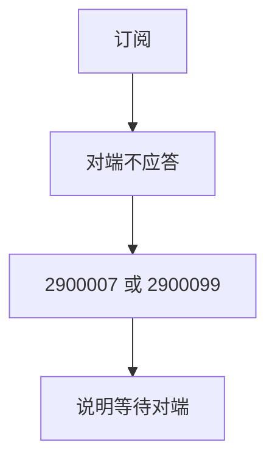
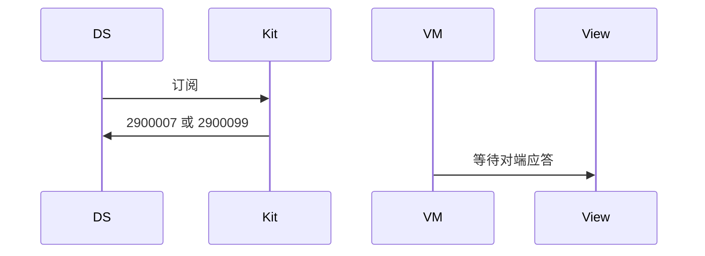
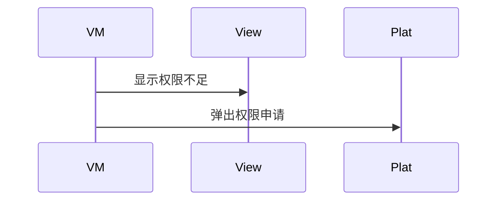

# BT-076 订阅失败区分服务端未应答

## 1. 条目与非目标

**判定：** 支持

**Given** 对端 GATT Server 不 `sendResponse`

**When** 订阅通知

**Then** 失败为 2900007 或 2900099，并说明等待对端应答，而不是「权限不足」

**证据：** `FAQ「setCharacteristicChangeNotification 报错 2900007 或 2900099」`。行为以已接受的研究笔记和清单为准，本文件不重开行业调查。

**本条输入：** 订阅通知时对端不应答。

**本条输出：** 失败码是 2900007 或 2900099。文案说明等待对端应答，不是权限不足。

**本条失败：** 显示成 2901000 或权限被拒绝。

**本条所有者：** 映射在 `GattClientDataSource`。文案选择在 `BleMainViewModel`。权限不足仍留给 2901005 至 2901007。

**非目标：**

- 不自动重试订阅直到成功。
- 不因此弹权限框。
- 不新增 `common/yobluetooth` 以外的蓝牙栈，不增加包装层或版本兼容层。版本判断留在本条调用点。

## 2. 模块边界与分层

本组是GATT 客户端。依赖方向是 `product/phone` → `features/bluetooth` → `common/yobluetooth`。权限、生命周期和系统设置走 `common/platform` 与 `common/debug_core`。字节与 `Result` 走 `common/core`。日志门面走 `common/yolog`。收藏、会话记录和导出走 `common/storage`。`common/youi_kit` 只提供通用控件，不解释蓝牙状态。

**调用点：** 码的识别在 `GattClientDataSource` 的订阅失败处。

| 包 | 类型 | 职责 |
| --- | --- | --- |
| common/yobluetooth | GattClientDataSource | 识别 2900007 与 2900099 |
| features/bluetooth | BleMainViewModel | 文案为等待对端应答 |
| common/yobluetooth | SetGattNotificationUseCase | 失败不改码 |

**设计前：** 订阅失败若进通用失败，会和权限错误相混。

**设计后：** 这两个码固定表示等待对端。权限类码不从这里产生。

## 3. 架构图

本组总图在 [`BT-069.md`](BT-069.md)。下图只覆盖本条。

## 4. 序列图

### 成功路径

### 错误路径

## 5. 数据模型

领域模型放在 `common/yobluetooth`，持久化模型放在 `common/storage`，平台传输对象只出现在数据源调用点，跨层用 `common/core` 的 `Result` 与 `ResultError`。错误只带类别和结构化字段，不把界面句子塞进邻层错误。

| 模型 | 所在层 | 字段 | 来源 |
| --- | --- | --- | --- |
| ResultError | 领域 | platformCode | 2900007 或 2900099 |

## 6. 层间接口

| 从 | 到 | 接口 | 成功 | 失败 |
| --- | --- | --- | --- | --- |
| GattClientDataSource | SetGattNotificationUseCase | 失败 | 保留平台码 | 不是 2901000 |
| BleMainViewModel | 权限用例 | 申请 | 本条不调用 | 禁止 |

下层不持有页面类型。结果用 `Result` 或已有观察者回传。`common/yobluetooth` 的 `Index.ets` 继续只导出用例、领域模型和必要门面，不把数据源具体类变成第二套公开栈。

## 7. 权限与生命周期

本失败不触发 `ACCESS_BLUETOOTH` 再申请。

失败后订阅状态保持未开启。不留半订阅。

## 8. 日志

- GATT 日志记录 waitPeerResponse=1。
- 领域标签加在已有 `BtLogTag`，不在 `common/yolog` 的 `YoLogTag` 里再开一套蓝牙标签。
- 日志走 `YoLog`，不在页面里直接写 hilog。

## 9. 反模式

- 把 2900099 全部映射成权限。
- 自动 close 重连并显示订阅已成功。
- 用新的蓝牙 HAR、适配器或 `ApiCompat` 把本条版本差异包起来。版本判断只留在上面写明的调用点。
- 页面或 `common/youi_kit` 直接调用 `ohos.bluetooth.*`。
