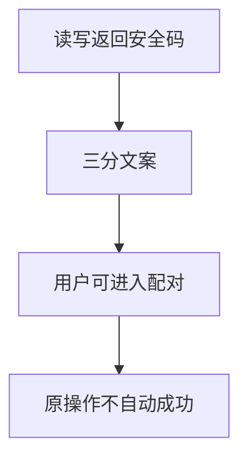
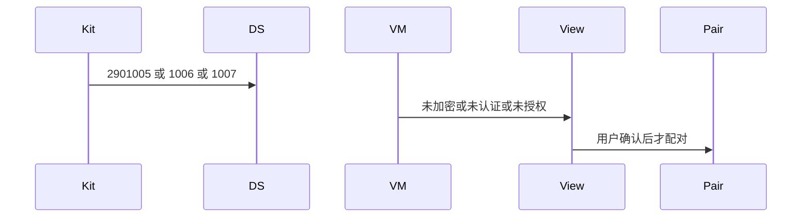
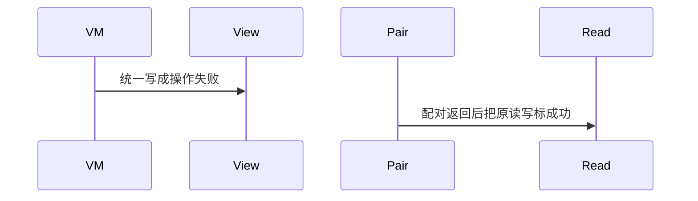

# BT-077 加密不足时显示 GATT 安全错误

## 1. 条目与非目标

**判定：** 支持

**Given** 特征需要加密或认证

**When** 读写返回 2901005、2901006 或 2901007

**Then** 文案分别为未加密、未认证、未授权，并提供配对入口

**证据：** `错误码 2901005–2901007`。行为以已接受的研究笔记和清单为准，本文件不重开行业调查。

**本条输入：** 读写返回 2901005、2901006 或 2901007。

**本条输出：** 三个码分别显示未加密、未认证、未授权，并提供配对入口。

**本条失败：** 三个码合成一个操作失败，或自动配对后把原操作标成成功。

**本条所有者：** 映射在 `GattClientDataSource`。配对入口调用已有 `PairBluetoothDeviceUseCase`，由用户确认。展示在 `BleMainViewModel`。

**非目标：**

- 不自动配对。
- 不把安全错误当成属性不允许。
- 不新增 `common/yobluetooth` 以外的蓝牙栈，不增加包装层或版本兼容层。版本判断留在本条调用点。

## 2. 模块边界与分层

本组是GATT 客户端。依赖方向是 `product/phone` → `features/bluetooth` → `common/yobluetooth`。权限、生命周期和系统设置走 `common/platform` 与 `common/debug_core`。字节与 `Result` 走 `common/core`。日志门面走 `common/yolog`。收藏、会话记录和导出走 `common/storage`。`common/youi_kit` 只提供通用控件，不解释蓝牙状态。

**调用点：** 码表在 `GattClientDataSource`。

| 包 | 类型 | 职责 |
| --- | --- | --- |
| common/yobluetooth | GattClientDataSource | 三分平台码 |
| features/bluetooth | BleMainViewModel | 三分文案和配对入口 |
| common/yobluetooth | PairBluetoothDeviceUseCase | 只在用户确认后 |

**设计前：** GATT 错误若共用一句操作失败，安全原因不可见。

**设计后：** 三个码三种文案。配对按钮只发起配对，不重放失败的读写为成功。

## 3. 架构图

本组总图在 [`BT-069.md`](BT-069.md)。下图只覆盖本条。

## 4. 序列图

### 成功路径

### 错误路径

## 5. 数据模型

领域模型放在 `common/yobluetooth`，持久化模型放在 `common/storage`，平台传输对象只出现在数据源调用点，跨层用 `common/core` 的 `Result` 与 `ResultError`。错误只带类别和结构化字段，不把界面句子塞进邻层错误。

| 模型 | 所在层 | 字段 | 来源 |
| --- | --- | --- | --- |
| ResultError | 领域 | platformCode 三值 | 安全类别 |

## 6. 层间接口

| 从 | 到 | 接口 | 成功 | 失败 |
| --- | --- | --- | --- | --- |
| GattClientDataSource | BleMainViewModel | 失败 | 三个不同码 | 不合并 |
| BleMainViewModel | PairBluetoothDeviceUseCase | 配对 | 用户确认 | 不自动重放读写 |

下层不持有页面类型。结果用 `Result` 或已有观察者回传。`common/yobluetooth` 的 `Index.ets` 继续只导出用例、领域模型和必要门面，不把数据源具体类变成第二套公开栈。

## 7. 权限与生命周期

配对仍用 `ACCESS_BLUETOOTH`，不申请系统配对确认权限。

错误不断开页面订阅。配对订阅另按配对条目管理。

## 8. 日志

- GATT 日志记录 securityCode。
- 领域标签加在已有 `BtLogTag`，不在 `common/yolog` 的 `YoLogTag` 里再开一套蓝牙标签。
- 日志走 `YoLog`，不在页面里直接写 hilog。

## 9. 反模式

- 收到 2901005 后循环配对。
- 文案写成权限弹窗被拒绝。
- 用新的蓝牙 HAR、适配器或 `ApiCompat` 把本条版本差异包起来。版本判断只留在上面写明的调用点。
- 页面或 `common/youi_kit` 直接调用 `ohos.bluetooth.*`。
