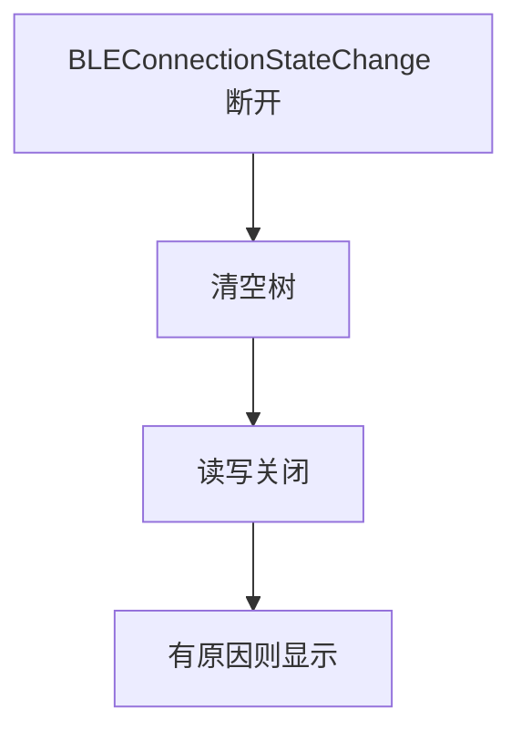
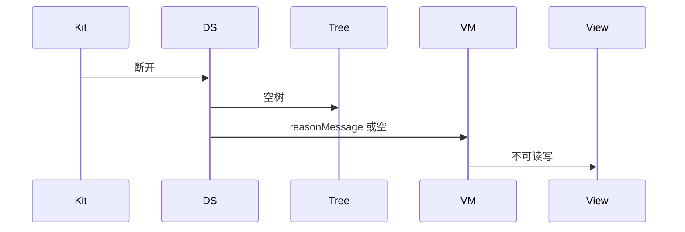
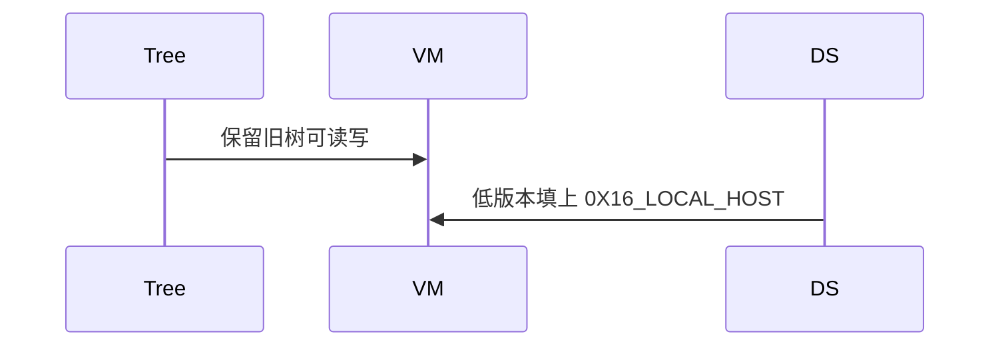

# BT-078 断开后服务树清空

## 1. 条目与非目标

**判定：** 支持

**Given** 已有服务树

**When** `BLEConnectionStateChange` 变为断开

**Then** 树不再可读写；断开原因字符串（若有，如 `0X16_LOCAL_HOST`）可见

**证据：** `BLEConnectionChangeState.reasonMessage（26.0.0）`。行为以已接受的研究笔记和清单为准，本文件不重开行业调查。

**本条输入：** 已有服务树，连接状态变为断开。

**本条输出：** 树不可读写。API 26.0.0 有 `reasonMessage` 时显示，例如 `0X16_LOCAL_HOST`。没有该字段时原因留空。

**本条失败：** 断开后树仍可读写，或没有原因时显示编造字符串。

**本条所有者：** 状态回调在 `GattClientDataSource`。清树在 `GattTreeBuilder` 的空快照。`reasonMessage` 仅在调用点 API 26.0.0 读取。展示在 `BleMainViewModel`。

**非目标：**

- 不在断开后自动重连。
- 不把空原因写成对端主动断开。
- 不新增 `common/yobluetooth` 以外的蓝牙栈，不增加包装层或版本兼容层。版本判断留在本条调用点。

## 2. 模块边界与分层

本组是GATT 客户端。依赖方向是 `product/phone` → `features/bluetooth` → `common/yobluetooth`。权限、生命周期和系统设置走 `common/platform` 与 `common/debug_core`。字节与 `Result` 走 `common/core`。日志门面走 `common/yolog`。收藏、会话记录和导出走 `common/storage`。`common/youi_kit` 只提供通用控件，不解释蓝牙状态。

**调用点：** `reasonMessage` 的版本判断在 `GattClientDataSource` 的状态回调。

| 包 | 类型 | 职责 |
| --- | --- | --- |
| common/yobluetooth | GattClientDataSource | 断开事件与可选 reasonMessage |
| common/yobluetooth | GattTreeBuilder | 替换为空树 |
| common/yobluetooth | GattOperationQueue | 拒绝后续读写 |
| features/bluetooth | BleMainViewModel | 显示原因或空 |

**设计前：** 断开若只改连接灯，服务树按钮仍然可点。

**设计后：** 断开事件清空树并关闭队列。原因字段缺失就显示空，不填假文案。

## 3. 架构图

本组总图在 [`BT-069.md`](BT-069.md)。下图只覆盖本条。

## 4. 序列图

### 成功路径

### 错误路径

## 5. 数据模型

领域模型放在 `common/yobluetooth`，持久化模型放在 `common/storage`，平台传输对象只出现在数据源调用点，跨层用 `common/core` 的 `Result` 与 `ResultError`。错误只带类别和结构化字段，不把界面句子塞进邻层错误。

| 模型 | 所在层 | 字段 | 来源 |
| --- | --- | --- | --- |
| GattServiceTreeSnapshot | 领域 | 空 | 断开后 |
| 断开原因 | 领域 | 可空字符串 | 仅平台提供时 |

## 6. 层间接口

| 从 | 到 | 接口 | 成功 | 失败 |
| --- | --- | --- | --- | --- |
| GattClientDataSource | GattTreeBuilder | clear | 空树 | 不清则违规 |
| BleMainViewModel | 读写用例 | 操作 | 拒绝 | 不调用 Kit |

下层不持有页面类型。结果用 `Result` 或已有观察者回传。`common/yobluetooth` 的 `Index.ets` 继续只导出用例、领域模型和必要门面，不把数据源具体类变成第二套公开栈。

## 7. 权限与生命周期

不涉及。

断开时 `off` 特征回调。原因读取不增加第二条状态订阅。

## 8. 日志

- GATT 日志记录 disconnected 与 reasonPresent。
- 领域标签加在已有 `BtLogTag`，不在 `common/yolog` 的 `YoLogTag` 里再开一套蓝牙标签。
- 日志走 `YoLog`，不在页面里直接写 hilog。

## 9. 反模式

- 用本地主机原因作为所有断开的默认值。
- 断开后继续显示旧特征值。
- 用新的蓝牙 HAR、适配器或 `ApiCompat` 把本条版本差异包起来。版本判断只留在上面写明的调用点。
- 页面或 `common/youi_kit` 直接调用 `ohos.bluetooth.*`。
