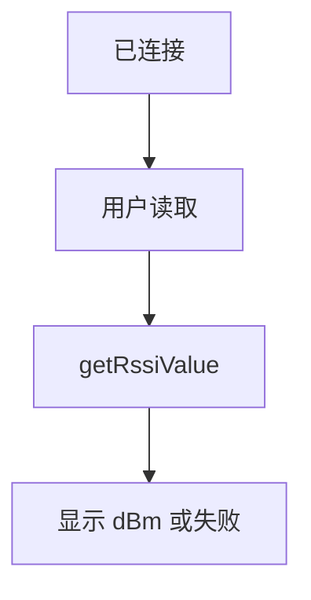
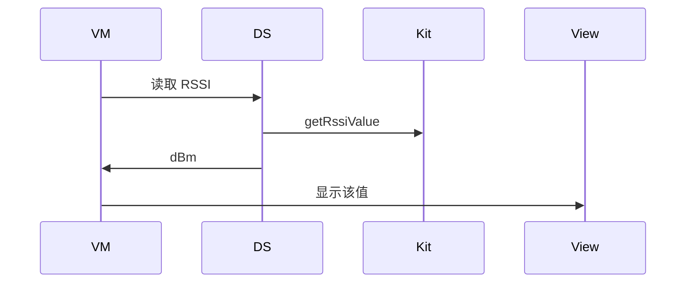
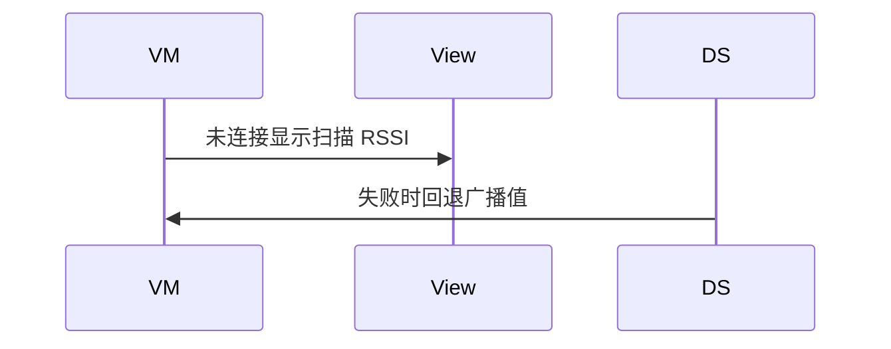

# BT-079 连接后可读 RSSI

## 1. 条目与非目标

**判定：** 支持

**Given** GATT 已连接

**When** 用户读取 RSSI

**Then** `getRssiValue` 的结果以 dBm 显示；失败可见

**证据：** `GattClientDevice.getRssiValue`。行为以已接受的研究笔记和清单为准，本文件不重开行业调查。

**本条输入：** GATT 已连接时的 RSSI 读取。

**本条输出：** 成功则显示 dBm。失败可见，不沿用扫描 RSSI 冒充本次读取。

**本条失败：** 未连接仍显示一个 dBm，或用扫描值代替 `getRssiValue`。

**本条所有者：** 读取加在 `GattClientDataSource.getRssiValue`。结果模型复用 `RssiSample`。未连接由连接状态拦住。展示在 `BleMainViewModel`。

**非目标：**

- 不把扫描 RSSI 写进连接 RSSI。
- 不周期自动读到耗电而不由用户触发。
- 不新增 `common/yobluetooth` 以外的蓝牙栈，不增加包装层或版本兼容层。版本判断留在本条调用点。

## 2. 模块边界与分层

本组是GATT 客户端。依赖方向是 `product/phone` → `features/bluetooth` → `common/yobluetooth`。权限、生命周期和系统设置走 `common/platform` 与 `common/debug_core`。字节与 `Result` 走 `common/core`。日志门面走 `common/yolog`。收藏、会话记录和导出走 `common/storage`。`common/youi_kit` 只提供通用控件，不解释蓝牙状态。

**调用点：** `getRssiValue` 在 `GattClientDataSource`。

| 包 | 类型 | 职责 |
| --- | --- | --- |
| features/bluetooth | BleMainViewModel | 用户触发读取 |
| common/yobluetooth | GattClientDataSource | getRssiValue |
| common/yobluetooth | RssiSample | 保存 dBm |

**设计前：** 列表 RSSI 来自广播，连接后没有独立读取。

**设计后：** 连接 RSSI 只来自 `getRssiValue`。失败不回退到广播值。

## 3. 架构图

本组总图在 [`BT-069.md`](BT-069.md)。下图只覆盖本条。

## 4. 序列图

### 成功路径

### 错误路径

## 5. 数据模型

领域模型放在 `common/yobluetooth`，持久化模型放在 `common/storage`，平台传输对象只出现在数据源调用点，跨层用 `common/core` 的 `Result` 与 `ResultError`。错误只带类别和结构化字段，不把界面句子塞进邻层错误。

| 模型 | 所在层 | 字段 | 来源 |
| --- | --- | --- | --- |
| RssiSample | 领域 | dbm 与来源=connection | getRssiValue |

## 6. 层间接口

| 从 | 到 | 接口 | 成功 | 失败 |
| --- | --- | --- | --- | --- |
| BleMainViewModel | GattClientDataSource | getRssiValue | dBm | 失败可见 |
| 扫描报文 | 连接 RSSI | 回退 | 禁止 | 不采用 |

下层不持有页面类型。结果用 `Result` 或已有观察者回传。`common/yobluetooth` 的 `Index.ets` 继续只导出用例、领域模型和必要门面，不把数据源具体类变成第二套公开栈。

## 7. 权限与生命周期

已连接会话的既有权限。

读取是一次操作，占用 GATT 队列，避免和读写并发。

## 8. 日志

- GATT 日志记录 rssiRead 成功或失败，不记录成扫描 rssi。
- 领域标签加在已有 `BtLogTag`，不在 `common/yolog` 的 `YoLogTag` 里再开一套蓝牙标签。
- 日志走 `YoLog`，不在页面里直接写 hilog。

## 9. 反模式

- 定时器轮询 RSSI 且失败时保持旧数字不加说明。
- 用新的蓝牙 HAR、适配器或 `ApiCompat` 把本条版本差异包起来。版本判断只留在上面写明的调用点。
- 页面或 `common/youi_kit` 直接调用 `ohos.bluetooth.*`。
