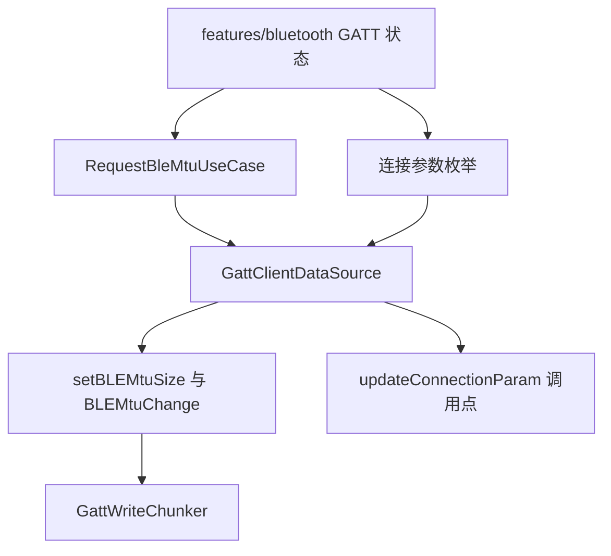
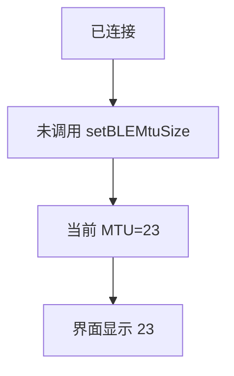
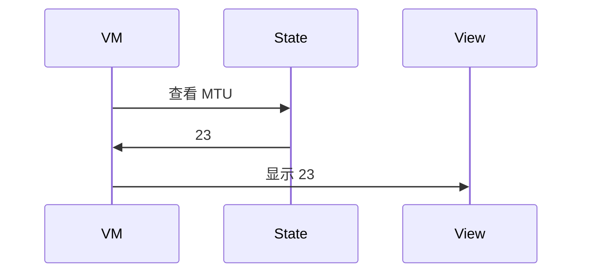
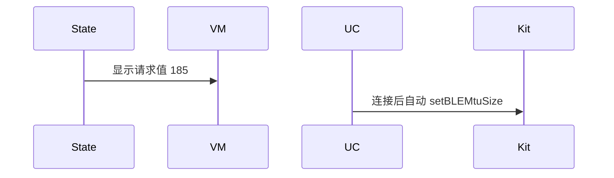

# BT-080 未协商 MTU 按 23 字节

## 1. 条目与非目标

**判定：** 支持

**Given** 已连接且未调用 `setBLEMtuSize`

**When** 查看 MTU

**Then** 显示 23

**证据：** `setBLEMtuSize 说明`。行为以已接受的研究笔记和清单为准，本文件不重开行业调查。

**本条输入：** 已连接且尚未协商 MTU。

**本条输出：** 界面显示 23。常量是 `BluetoothConstants.BLE_DEFAULT_MTU`。

**本条失败：** 未协商时显示 185 或 512。

**本条所有者：** 默认值在 `BluetoothConstants`。状态在 GATT 会话。`RequestBleMtuUseCase` 未被调用前，`BleMainViewModel` 显示 23。

**非目标：**

- 不在连接成功时自动协商。
- 不把 23 减 3 显示成 MTU。
- 不新增 `common/yobluetooth` 以外的蓝牙栈，不增加包装层或版本兼容层。版本判断留在本条调用点。

## 2. 模块边界与分层

本组是MTU、PHY 与连接参数。依赖方向是 `product/phone` → `features/bluetooth` → `common/yobluetooth`。权限、生命周期和系统设置走 `common/platform` 与 `common/debug_core`。字节与 `Result` 走 `common/core`。日志门面走 `common/yolog`。收藏、会话记录和导出走 `common/storage`。`common/youi_kit` 只提供通用控件，不解释蓝牙状态。

**调用点：** 没有 `setBLEMtuSize` 调用。

| 包 | 类型 | 职责 |
| --- | --- | --- |
| common/yobluetooth | BluetoothConstants | BLE_DEFAULT_MTU=23 |
| common/yobluetooth | Gatt 会话状态 | 未协商用默认 |
| features/bluetooth | BleMainViewModel | 显示 23 |

**设计前：** 连接结果若把期望 MTU 写进当前值，未协商也会显示目标值。

**设计后：** 当前 MTU 与请求值分开。未协商当前值是 23。

## 3. 架构图

本组总图放在本文件。MTU、PHY 与连接参数里其余条目各自再画本条链路，链接不能代替本条的输入、输出、失败和所有者。

本条链路：

## 4. 序列图

### 成功路径

### 错误路径

## 5. 数据模型

领域模型放在 `common/yobluetooth`，持久化模型放在 `common/storage`，平台传输对象只出现在数据源调用点，跨层用 `common/core` 的 `Result` 与 `ResultError`。错误只带类别和结构化字段，不把界面句子塞进邻层错误。

| 模型 | 所在层 | 字段 | 来源 |
| --- | --- | --- | --- |
| 当前 MTU | 领域 | 23 | 默认 |
| 请求 MTU | 领域 | 空 | 尚未请求 |

## 6. 层间接口

| 从 | 到 | 接口 | 成功 | 失败 |
| --- | --- | --- | --- | --- |
| BleMainViewModel | GATT 状态 | getMtu | 23 | 不返回期望值 |
| ConnectGattUseCase | RequestBleMtuUseCase | 自动执行 | 本条不调用 | 禁止 |

下层不持有页面类型。结果用 `Result` 或已有观察者回传。`common/yobluetooth` 的 `Index.ets` 继续只导出用例、领域模型和必要门面，不把数据源具体类变成第二套公开栈。

## 7. 权限与生命周期

不涉及。

断开后回到未协商。重连不继承上一次协商值。

## 8. 日志

- GATT 日志记录 mtu=23 source=default。
- 领域标签加在已有 `BtLogTag`，不在 `common/yolog` 的 `YoLogTag` 里再开一套蓝牙标签。
- 日志走 `YoLog`，不在页面里直接写 hilog。

## 9. 反模式

- 把 ATT 载荷 20 显示成 MTU。
- 连接成功即请求 512。
- 用新的蓝牙 HAR、适配器或 `ApiCompat` 把本条版本差异包起来。版本判断只留在上面写明的调用点。
- 页面或 `common/youi_kit` 直接调用 `ohos.bluetooth.*`。
