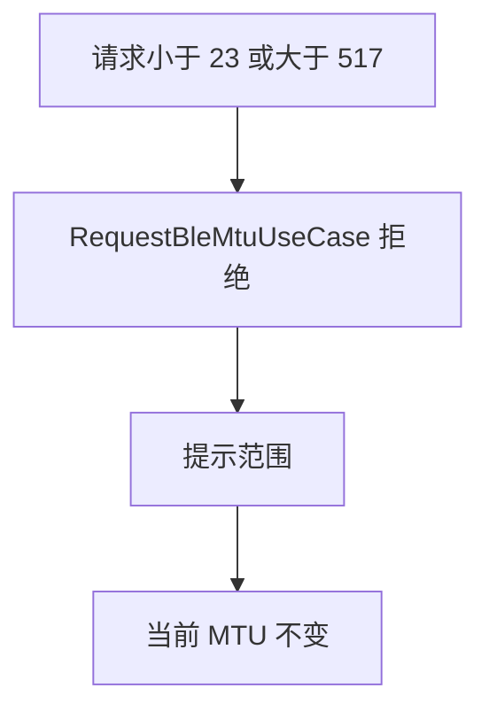
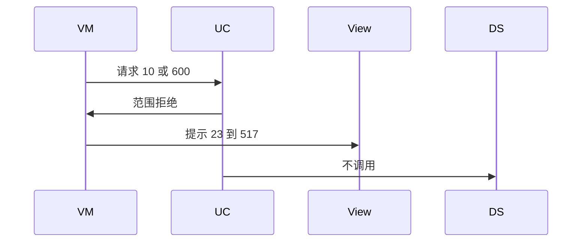
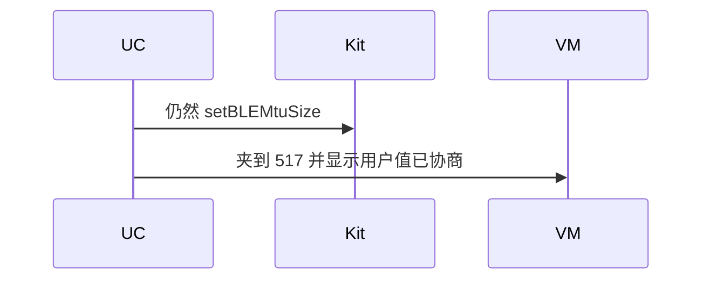

# BT-081 MTU 超出范围被拒绝

## 1. 条目与非目标

**判定：** 支持

**Given** 已连接

**When** 请求小于 23 或大于 517

**Then** 不发起协商；提示范围

**证据：** `参数说明；FAQ「协商 MTU 参数失败」`。行为以已接受的研究笔记和清单为准，本文件不重开行业调查。

**本条输入：** 已连接，请求小于 23 或大于 517。

**本条输出：** 不调用 `setBLEMtuSize`。提示范围。当前 MTU 不变。

**本条失败：** 超范围仍然协商，或把失败显示成已协商。

**本条所有者：** 范围检查在 `RequestBleMtuUseCase`。合法请求才进入 `GattClientDataSource`。提示在 `BleMainViewModel`。

**非目标：**

- 不把超范围夹到 23 或 517 再协商。
- 不把平台失败说成范围检查已通过。
- 不新增 `common/yobluetooth` 以外的蓝牙栈，不增加包装层或版本兼容层。版本判断留在本条调用点。

## 2. 模块边界与分层

本组是MTU、PHY 与连接参数。依赖方向是 `product/phone` → `features/bluetooth` → `common/yobluetooth`。权限、生命周期和系统设置走 `common/platform` 与 `common/debug_core`。字节与 `Result` 走 `common/core`。日志门面走 `common/yolog`。收藏、会话记录和导出走 `common/storage`。`common/youi_kit` 只提供通用控件，不解释蓝牙状态。

**调用点：** 本条没有 `setBLEMtuSize` 调用点。

| 包 | 类型 | 职责 |
| --- | --- | --- |
| features/bluetooth | BleMainViewModel | 提交数值 |
| common/yobluetooth | RequestBleMtuUseCase | 拒绝范围外 |
| common/yobluetooth | GattClientDataSource | 本条不调用 |

**设计前：** 用例若直接把用户数字传给平台，范围错误要等平台失败。

**设计后：** 小于 23 或大于 517 在用例返回。数据源不被调用。当前值保持。

## 3. 架构图

本组总图在 [`BT-080.md`](BT-080.md)。下图只覆盖本条。

## 4. 序列图

### 成功路径

### 错误路径

## 5. 数据模型

领域模型放在 `common/yobluetooth`，持久化模型放在 `common/storage`，平台传输对象只出现在数据源调用点，跨层用 `common/core` 的 `Result` 与 `ResultError`。错误只带类别和结构化字段，不把界面句子塞进邻层错误。

| 模型 | 所在层 | 字段 | 来源 |
| --- | --- | --- | --- |
| MTU 请求 | 领域 | 整数 | 范围外无平台请求 |
| 当前 MTU | 领域 | 保持原值 | 不改变 |

## 6. 层间接口

| 从 | 到 | 接口 | 成功 | 失败 |
| --- | --- | --- | --- | --- |
| BleMainViewModel | RequestBleMtuUseCase | request | 23..517 才继续 | 超出拒绝 |
| RequestBleMtuUseCase | GattClientDataSource | setBLEMtuSize | 本条不调用 | 禁止 |

下层不持有页面类型。结果用 `Result` 或已有观察者回传。`common/yobluetooth` 的 `Index.ets` 继续只导出用例、领域模型和必要门面，不把数据源具体类变成第二套公开栈。

## 7. 权限与生命周期

不涉及。

拒绝不注册 MTU 回调。

## 8. 日志

- GATT 日志记录 mtuRejected=range。
- 领域标签加在已有 `BtLogTag`，不在 `common/yolog` 的 `YoLogTag` 里再开一套蓝牙标签。
- 日志走 `YoLog`，不在页面里直接写 hilog。

## 9. 反模式

- 自动改为 185。
- 平台拒绝后把当前值改成请求值。
- 用新的蓝牙 HAR、适配器或 `ApiCompat` 把本条版本差异包起来。版本判断只留在上面写明的调用点。
- 页面或 `common/youi_kit` 直接调用 `ohos.bluetooth.*`。
