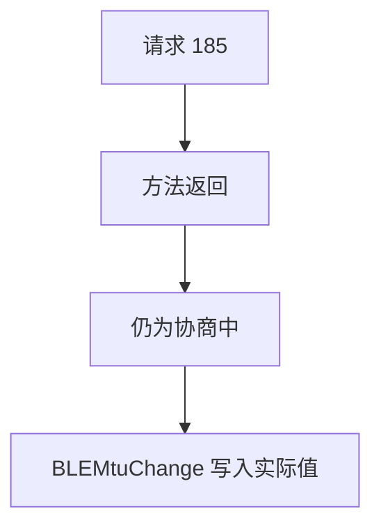
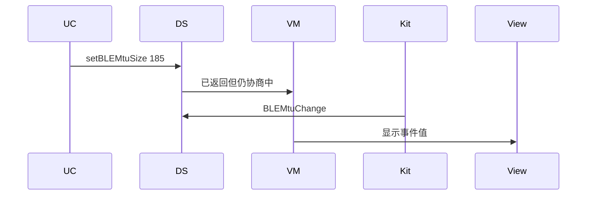
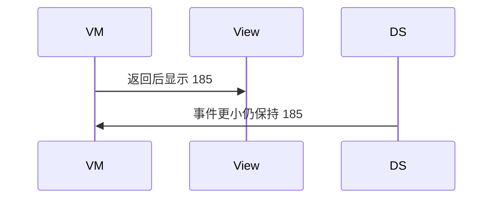

# BT-082 协商结果以 MTU 事件为准

## 1. 条目与非目标

**判定：** 支持

**Given** 请求 185

**When** `setBLEMtuSize` 已返回但 `BLEMtuChange` 尚未到

**Then** 界面仍为协商中；事件到达后显示事件里的值，可能小于请求值

**证据：** `on('BLEMtuChange')；FAQ 要求连接成功之后再协商`。行为以已接受的研究笔记和清单为准，本文件不重开行业调查。

**本条输入：** 请求 185，方法已返回，事件未到。

**本条输出：** 界面保持协商中。事件值成为当前 MTU，即使小于 185。

**本条失败：** 方法返回就把当前 MTU 改成 185。

**本条所有者：** 请求在 `RequestBleMtuUseCase`。事件在 `GattClientDataSource` 的 `BLEMtuChange`。当前值只由事件更新。展示在 `BleMainViewModel`。

**非目标：**

- 不保证 185 一定协商成功。
- 不在未连接时协商。
- 不新增 `common/yobluetooth` 以外的蓝牙栈，不增加包装层或版本兼容层。版本判断留在本条调用点。

## 2. 模块边界与分层

本组是MTU、PHY 与连接参数。依赖方向是 `product/phone` → `features/bluetooth` → `common/yobluetooth`。权限、生命周期和系统设置走 `common/platform` 与 `common/debug_core`。字节与 `Result` 走 `common/core`。日志门面走 `common/yolog`。收藏、会话记录和导出走 `common/storage`。`common/youi_kit` 只提供通用控件，不解释蓝牙状态。

**调用点：** `setBLEMtuSize` 与 `BLEMtuChange` 都在 `GattClientDataSource`。

| 包 | 类型 | 职责 |
| --- | --- | --- |
| common/yobluetooth | RequestBleMtuUseCase | 已连接才请求 |
| common/yobluetooth | GattClientDataSource | setBLEMtuSize 与事件 |
| features/bluetooth | BleMainViewModel | 事件前保持协商中 |

**设计前：** Promise 成功会被写成 MTU 已是 185。

**设计后：** 返回只表示请求已提交。`BLEMtuChange` 的数值写入当前 MTU。

## 3. 架构图

本组总图在 [`BT-080.md`](BT-080.md)。下图只覆盖本条。

## 4. 序列图

### 成功路径

### 错误路径

## 5. 数据模型

领域模型放在 `common/yobluetooth`，持久化模型放在 `common/storage`，平台传输对象只出现在数据源调用点，跨层用 `common/core` 的 `Result` 与 `ResultError`。错误只带类别和结构化字段，不把界面句子塞进邻层错误。

| 模型 | 所在层 | 字段 | 来源 |
| --- | --- | --- | --- |
| MTU 相位 | 领域 | negotiating | 事件前 |
| 当前 MTU | 领域 | 事件中的值 | 可小于请求 |

## 6. 层间接口

| 从 | 到 | 接口 | 成功 | 失败 |
| --- | --- | --- | --- | --- |
| RequestBleMtuUseCase | GattClientDataSource | setBLEMtuSize | 提交成功不等于值已生效 | 未连接不调用 |
| GattClientDataSource | BleMainViewModel | BLEMtuChange | 更新为事件值 | 缺失则保持协商中 |

下层不持有页面类型。结果用 `Result` 或已有观察者回传。`common/yobluetooth` 的 `Index.ets` 继续只导出用例、领域模型和必要门面，不把数据源具体类变成第二套公开栈。

## 7. 权限与生命周期

不涉及。

断开时取消 MTU 订阅并离开协商中。

## 8. 日志

- GATT 日志记录 mtuRequested=185 mtuEvent=实际值。
- 领域标签加在已有 `BtLogTag`，不在 `common/yolog` 的 `YoLogTag` 里再开一套蓝牙标签。
- 日志走 `YoLog`，不在页面里直接写 hilog。

## 9. 反模式

- 用定时器在返回后把 185 写成当前值。
- 忽略更小的事件值。
- 用新的蓝牙 HAR、适配器或 `ApiCompat` 把本条版本差异包起来。版本判断只留在上面写明的调用点。
- 页面或 `common/youi_kit` 直接调用 `ohos.bluetooth.*`。
