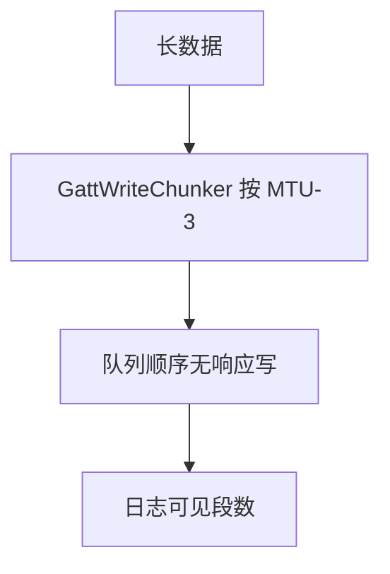
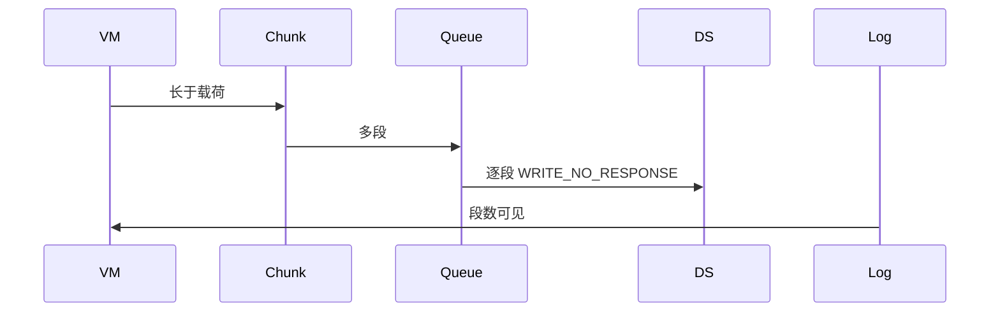
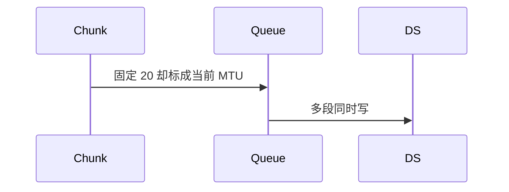

# BT-083 无响应写按当前 MTU 分片

## 1. 条目与非目标

**判定：** 支持

**Given** 已协商 MTU，用户发送长于单包载荷的数据

**When** 选择无响应写

**Then** 按载荷上限分段顺序发送，段间不并发；日志能看到段数

**证据：** `平台单次 ATT 受 MTU 约束。分片长度来自当前 MTU 减开销`。行为以已接受的研究笔记和清单为准，本文件不重开行业调查。

**本条输入：** 当前 MTU 已知道，无响应写的数据长于单包载荷。

**本条输出：** 按 `MTU - BLE_GATT_OVERHEAD_BYTES` 分段，顺序发送。日志有段数。

**本条失败：** 按固定 20 字节分片却显示使用了当前 MTU，或段间并发。

**本条所有者：** 分片在已有 `GattWriteChunker`。开销常量 `BLE_GATT_OVERHEAD_BYTES`。顺序由 `GattOperationQueue`。日志经 `LogCaptureService`。未协商时按默认 MTU 23。

**非目标：**

- 不在分片时改成带响应写。
- 不把段数隐藏成一次写。
- 不新增 `common/yobluetooth` 以外的蓝牙栈，不增加包装层或版本兼容层。版本判断留在本条调用点。

## 2. 模块边界与分层

本组是MTU、PHY 与连接参数。依赖方向是 `product/phone` → `features/bluetooth` → `common/yobluetooth`。权限、生命周期和系统设置走 `common/platform` 与 `common/debug_core`。字节与 `Result` 走 `common/core`。日志门面走 `common/yolog`。收藏、会话记录和导出走 `common/storage`。`common/youi_kit` 只提供通用控件，不解释蓝牙状态。

**调用点：** 单次写仍进 `GattClientDataSource`。块大小不在 Kit 层再包一层。

| 包 | 类型 | 职责 |
| --- | --- | --- |
| common/yobluetooth | GattWriteChunker | 按当前 MTU 减 3 |
| common/yobluetooth | GattOperationQueue | 段间不并发 |
| common/yobluetooth | WriteGattCharacteristicUseCase | 类型保持无响应 |
| common/debug_core | LogCaptureService | 记录段序号与段数 |

**设计前：** 分片长度若写死，协商后的 MTU 不会生效。

**设计后：** 块大小来自当前 MTU。每一段走无响应写，上一回调后才下一段。日志含段数。

## 3. 架构图

本组总图在 [`BT-080.md`](BT-080.md)。下图只覆盖本条。

## 4. 序列图

### 成功路径

### 错误路径

## 5. 数据模型

领域模型放在 `common/yobluetooth`，持久化模型放在 `common/storage`，平台传输对象只出现在数据源调用点，跨层用 `common/core` 的 `Result` 与 `ResultError`。错误只带类别和结构化字段，不把界面句子塞进邻层错误。

| 模型 | 所在层 | 字段 | 来源 |
| --- | --- | --- | --- |
| 当前 MTU | 领域 | 事件值或 23 | 分片输入 |
| 段记录 | debug_core | index 与 count | 日志 |

## 6. 层间接口

| 从 | 到 | 接口 | 成功 | 失败 |
| --- | --- | --- | --- | --- |
| WriteGattCharacteristicUseCase | GattWriteChunker | chunk | 每段不超过载荷 | 类型不变 |
| GattOperationQueue | GattClientDataSource | 下一段 | 上一段完成后 | 不并发 |

下层不持有页面类型。结果用 `Result` 或已有观察者回传。`common/yobluetooth` 的 `Index.ets` 继续只导出用例、领域模型和必要门面，不把数据源具体类变成第二套公开栈。

## 7. 权限与生命周期

不涉及。

断开取消尚未发送的段，已发送段数保留在日志。

## 8. 日志

- GATT 日志记录 chunkCount 与 mtu。
- 领域标签加在已有 `BtLogTag`，不在 `common/yolog` 的 `YoLogTag` 里再开一套蓝牙标签。
- 日志走 `YoLog`，不在页面里直接写 hilog。

## 9. 反模式

- 吞吐和普通写各写一个分片器。
- 只记录最后一段。
- 用新的蓝牙 HAR、适配器或 `ApiCompat` 把本条版本差异包起来。版本判断只留在上面写明的调用点。
- 页面或 `common/youi_kit` 直接调用 `ohos.bluetooth.*`。
