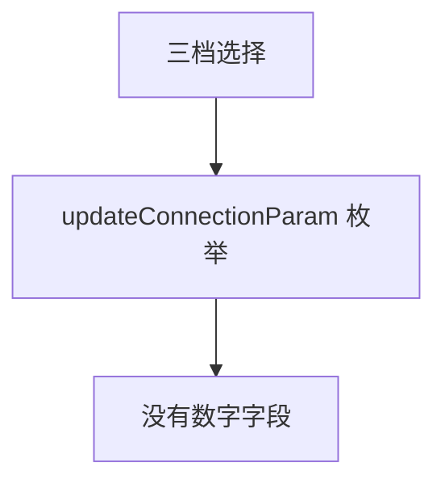
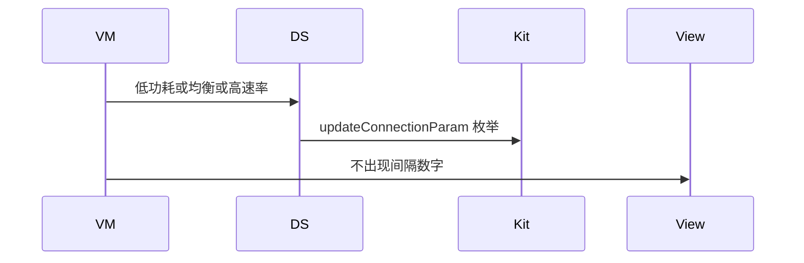
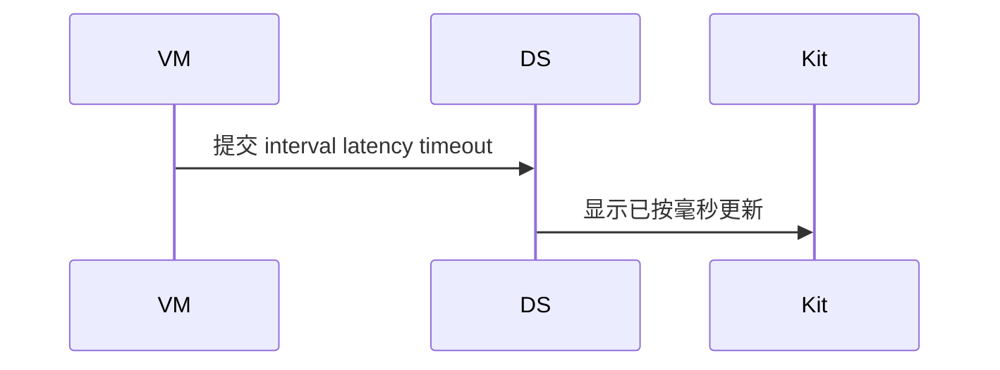

# BT-084 连接参数只有三档

## 1. 条目与非目标

**判定：** 缺口

**Given** API 22+ 且已连接

**When** 用户选择低功耗、均衡或高速率

**Then** 调用 `updateConnectionParam` 的对应枚举。没有连接间隔、从机延迟、监督超时的数字输入

**证据：** `ConnectionParam22+ 只有 LOW_POWER、BALANCED、HIGH`。行为以已接受的研究笔记和清单为准，本文件不重开行业调查。

**本条输入：** API 22+ 已连接，用户要低功耗、均衡或高速率，或试图输入间隔数字。

**本条输出：** 三档调用 `updateConnectionParam`。数字间隔、从机延迟、监督超时没有输入，也没有对应调用。

**本条失败：** 提供三个数字并显示已按毫秒更新。

**本条所有者：** 枚举调用在 `GattClientDataSource.updateConnectionParam`，仅 API 22+。领域只有三档，没有数字字段。`BleMainViewModel` 不渲染数字输入。

本条按缺口设计。完成态只包含清单允许看见的结果，不包含把缺口做成已成功的路径。

**非目标：**

- 不发明 interval、latency、timeout 参数。
- 不把三档解释成具体毫秒并显示成平台返回值。
- 不新增 `common/yobluetooth` 以外的蓝牙栈，不增加包装层或版本兼容层。版本判断留在本条调用点。

## 2. 模块边界与分层

本组是MTU、PHY 与连接参数。依赖方向是 `product/phone` → `features/bluetooth` → `common/yobluetooth`。权限、生命周期和系统设置走 `common/platform` 与 `common/debug_core`。字节与 `Result` 走 `common/core`。日志门面走 `common/yolog`。收藏、会话记录和导出走 `common/storage`。`common/youi_kit` 只提供通用控件，不解释蓝牙状态。

**调用点：** `updateConnectionParam` 在 `GattClientDataSource`。没有数字重载。

| 包 | 类型 | 职责 |
| --- | --- | --- |
| features/bluetooth | BleMainViewModel | 只提供三档 |
| common/yobluetooth | 连接参数用例 | 枚举 |
| common/yobluetooth | GattClientDataSource | API 22+ updateConnectionParam |

**设计前：** 若模型预留毫秒字段，后续会把缺口做成输入框。

**设计后：** 模型只有三档。数据源只传平台枚举。数字请求没有接口。

## 3. 架构图

本组总图在 [`BT-080.md`](BT-080.md)。下图只覆盖本条。

## 4. 序列图

### 成功路径

缺口条目的成功路径是用户看见限制。缺失能力没有被画成已经成功。

### 错误路径

错误路径把缺口做成了成功。这条路径不进入目标分层。

## 5. 数据模型

领域模型放在 `common/yobluetooth`，持久化模型放在 `common/storage`，平台传输对象只出现在数据源调用点，跨层用 `common/core` 的 `Result` 与 `ResultError`。错误只带类别和结构化字段，不把界面句子塞进邻层错误。

| 模型 | 所在层 | 字段 | 来源 |
| --- | --- | --- | --- |
| 连接参数 | 领域 | LOW_POWER BALANCED HIGH | 无数字字段 |

## 6. 层间接口

| 从 | 到 | 接口 | 成功 | 失败 |
| --- | --- | --- | --- | --- |
| BleMainViewModel | GattClientDataSource | updateConnectionParam | 三档之一 | 数字无接口 |
| 页面 | 数据源 | 设置间隔毫秒 | 不存在 | 禁止成功 |

下层不持有页面类型。结果用 `Result` 或已有观察者回传。`common/yobluetooth` 的 `Index.ets` 继续只导出用例、领域模型和必要门面，不把数据源具体类变成第二套公开栈。

## 7. 权限与生命周期

不涉及新权限。

API 22 以下不调用该方法，也不显示已切换。

## 8. 日志

- GATT 日志记录 connParam=枚举名。不记录假毫秒。
- 领域标签加在已有 `BtLogTag`，不在 `common/yolog` 的 `YoLogTag` 里再开一套蓝牙标签。
- 日志走 `YoLog`，不在页面里直接写 hilog。

## 9. 反模式

- 三档旁边加高级数字框。
- 把 HIGH 写成 7.5ms 并当作读回值。
- 用新的蓝牙 HAR、适配器或 `ApiCompat` 把本条版本差异包起来。版本判断只留在上面写明的调用点。
- 页面或 `common/youi_kit` 直接调用 `ohos.bluetooth.*`。
