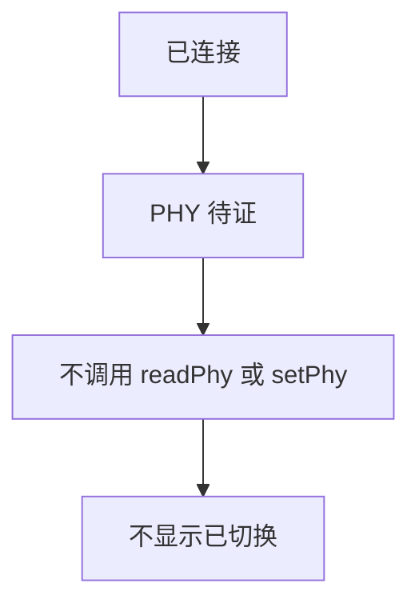
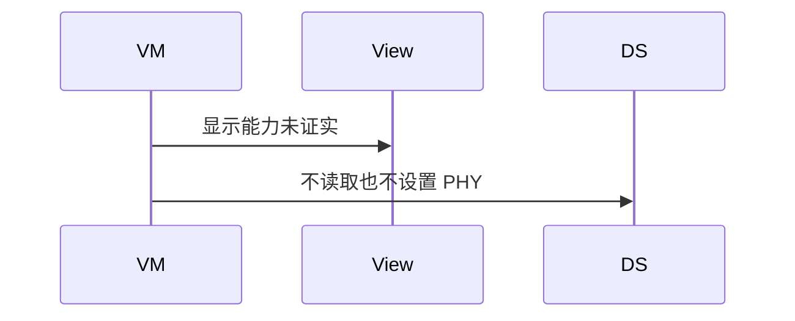
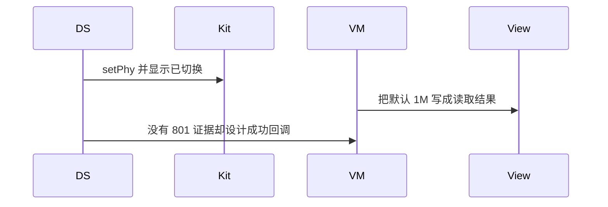

# BT-085 PHY 读写失败时显示能力不支持

## 1. 条目与非目标

**判定：** 待证

**Given** API 23+ 且已连接

**When** `readPhy` 或 `setPhy` 返回 801

**Then** 显示当前设备不支持，不把 PHY 显示成已切换

**证据：** `readPhy23+ 与 setPhy23+ 错误码 801；BlePhy23+`。行为以已接受的研究笔记和清单为准，本文件不重开行业调查。

**本条输入：** 没有设备证据证明当前设备的 PHY 调用结果。

**本条输出：** PHY 保持未证实。不显示已切换。不新增一套 PHY 成功流程。

**本条失败：** 在真机证据出现前把 PHY 显示成 2M 或已切换，或发明 801 以外的成功规则。

**本条所有者：** 页面状态放在 `BleMainViewModel`，显示待证。`GattClientDataSource` 在证据出现前不提供会返回成功的 PHY 方法。已有文档中的 801 只作为将来证据的失败类别，不在本条被调用。

本条停在设备证据。不发明接口，也不把文档符号写成目标设备已经可用。

**非目标：**

- 不发明 PHY 查询或设置的成功序列。
- 不把 `ScanDuty` 或广播 PHY 当成连接 PHY 已切换。
- 不预写 `setPhy` 包装来等真机。
- 不新增 `common/yobluetooth` 以外的蓝牙栈，不增加包装层或版本兼容层。版本判断留在本条调用点。

## 2. 模块边界与分层

本组是MTU、PHY 与连接参数。依赖方向是 `product/phone` → `features/bluetooth` → `common/yobluetooth`。权限、生命周期和系统设置走 `common/platform` 与 `common/debug_core`。字节与 `Result` 走 `common/core`。日志门面走 `common/yolog`。收藏、会话记录和导出走 `common/storage`。`common/youi_kit` 只提供通用控件，不解释蓝牙状态。

**调用点：** 本条不设 `readPhy` 或 `setPhy` 调用点。

| 包 | 类型 | 职责 |
| --- | --- | --- |
| features/bluetooth | BleMainViewModel | 显示 PHY 待设备证据 |
| common/yobluetooth | GattClientDataSource | 本条不调用 readPhy 或 setPhy |
| product/phone | BleMainPage | 不增加已切换的 PHY 控件结果 |

**设计前：** 若先加 PHY 控件并默认 1M 已生效，会把未证实写成已切换。

**设计后：** 没有设备证据之前，没有 PHY 调用点。界面明确未证实。将来若证据给出 801，也只显示不支持，不显示已切换。

## 3. 架构图

本组总图在 [`BT-080.md`](BT-080.md)。下图只覆盖本条。

## 4. 序列图

### 成功路径

待证条目的成功路径是保持未证实：不发起该调用，也不显示已经生效。

### 错误路径

错误路径是在没有设备证据时发明结果，或把失败显示成已生效。

## 5. 数据模型

领域模型放在 `common/yobluetooth`，持久化模型放在 `common/storage`，平台传输对象只出现在数据源调用点，跨层用 `common/core` 的 `Result` 与 `ResultError`。错误只带类别和结构化字段，不把界面句子塞进邻层错误。

| 模型 | 所在层 | 字段 | 来源 |
| --- | --- | --- | --- |
| PHY 状态 | 领域 | unverified | 无设备证据 |

## 6. 层间接口

| 从 | 到 | 接口 | 成功 | 失败 |
| --- | --- | --- | --- | --- |
| BleMainViewModel | GattClientDataSource | readPhy | 不调用 | 不能返回已切换 |
| BleMainViewModel | GattClientDataSource | setPhy | 不调用 | 不能返回成功 |

下层不持有页面类型。结果用 `Result` 或已有观察者回传。`common/yobluetooth` 的 `Index.ets` 继续只导出用例、领域模型和必要门面，不把数据源具体类变成第二套公开栈。

## 7. 权限与生命周期

不申请额外权限来探测 PHY。

没有 PHY 回调要注册。

## 8. 日志

- GATT 日志记录 phy=unverified。不记录 phyUpdated。
- 领域标签加在已有 `BtLogTag`，不在 `common/yolog` 的 `YoLogTag` 里再开一套蓝牙标签。
- 日志走 `YoLog`，不在页面里直接写 hilog。

## 9. 反模式

- 用扫描 PHY 填充连接 PHY。
- 捕获任意错误都显示已切换到 2M。
- 在架构里写一套尚未证实的成功时序。
- 用新的蓝牙 HAR、适配器或 `ApiCompat` 把本条版本差异包起来。版本判断只留在上面写明的调用点。
- 页面或 `common/youi_kit` 直接调用 `ohos.bluetooth.*`。
