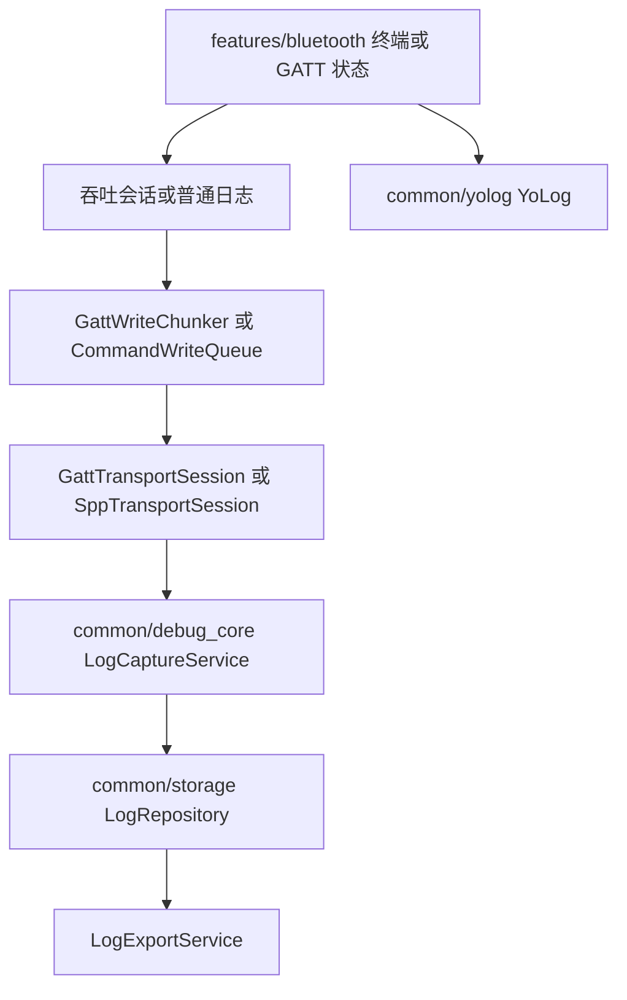
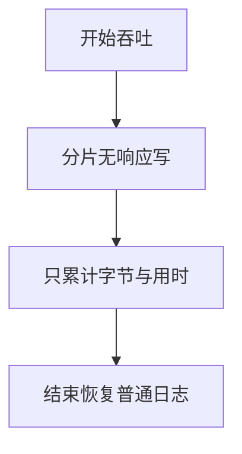
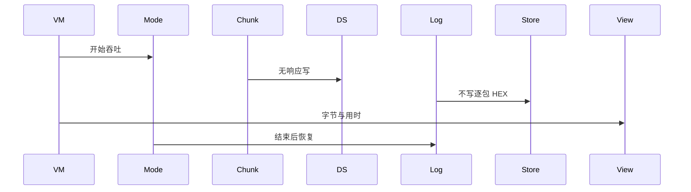
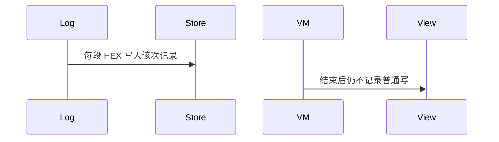

# BT-086 吞吐会话暂停逐包日志

## 1. 条目与非目标

**判定：** 支持

**Given** 用户对选定可写特征开始吞吐

**When** 测试进行

**Then** 界面显示已发送字节与用时；逐包十六进制不写入该次记录。结束后恢复普通日志

**证据：** `平台无单独吞吐 API。计时期间不写逐包十六进制`。行为以已接受的研究笔记和清单为准，本文件不重开行业调查。

**本条输入：** 用户对选定可写特征开始吞吐。

**本条输出：** 界面有已发送字节和用时。该次记录没有逐包十六进制。结束后普通日志恢复。

**本条失败：** 吞吐期间仍把每段 HEX 写入该次记录。

**本条所有者：** 吞吐状态在 `common/yobluetooth` 的写路径上加会话模式，由 `GattWriteChunker` 继续分片。`LogCaptureService` 在该模式下不收逐包字节。计时用 `common/core` 的单调时钟。展示在 BLE 页面状态。

**非目标：**

- 不内置某一家的吞吐特征 UUID。
- 不新建吞吐传输栈。
- 不新增 `common/yobluetooth` 以外的蓝牙栈，不增加包装层或版本兼容层。版本判断留在本条调用点。

## 2. 模块边界与分层

本组是吞吐、报文与日志。依赖方向是 `product/phone` → `features/bluetooth` → `common/yobluetooth`。权限、生命周期和系统设置走 `common/platform` 与 `common/debug_core`。字节与 `Result` 走 `common/core`。日志门面走 `common/yolog`。收藏、会话记录和导出走 `common/storage`。`common/youi_kit` 只提供通用控件，不解释蓝牙状态。

**调用点：** 写仍走 `GattClientDataSource`。没有平台吞吐 API 可调用。

| 包 | 类型 | 职责 |
| --- | --- | --- |
| features/bluetooth | BleMainViewModel | 显示字节与用时 |
| common/yobluetooth | GattWriteChunker | 仍按 MTU 分片 |
| common/debug_core | LogCaptureService | 吞吐模式跳过逐包 |
| common/core | IMonotonicClock | 计算用时 |
| common/yolog | YoLog | 只记摘要，不记每包 HEX |

**设计前：** 每段写都会 `captureBytes`，吞吐时记录会被十六进制淹没。

**设计后：** 吞吐模式只更新计数和用时。结束时退出该模式，随后的普通写恢复逐包记录。

## 3. 架构图

本组总图放在本文件。吞吐、报文与日志里其余条目各自再画本条链路，链接不能代替本条的输入、输出、失败和所有者。

本条链路：

## 4. 序列图

### 成功路径

### 错误路径

## 5. 数据模型

领域模型放在 `common/yobluetooth`，持久化模型放在 `common/storage`，平台传输对象只出现在数据源调用点，跨层用 `common/core` 的 `Result` 与 `ResultError`。错误只带类别和结构化字段，不把界面句子塞进邻层错误。

| 模型 | 所在层 | 字段 | 来源 |
| --- | --- | --- | --- |
| 吞吐计数 | 领域 | bytes 与 elapsedMs | 会话 |
| DebugLogRecord | debug_core | 该次无逐包 payload | 模式 |

## 6. 层间接口

| 从 | 到 | 接口 | 成功 | 失败 |
| --- | --- | --- | --- | --- |
| BleMainViewModel | WriteGattCharacteristicUseCase | 吞吐写 | 计数增加 | 失败可见且停止累计成功字节 |
| LogCaptureService | LogRepository | 逐包 | 吞吐中不写 | 结束后恢复 |

下层不持有页面类型。结果用 `Result` 或已有观察者回传。`common/yobluetooth` 的 `Index.ets` 继续只导出用例、领域模型和必要门面，不把数据源具体类变成第二套公开栈。

## 7. 权限与生命周期

不涉及。

离开页面或断开结束吞吐模式，避免后台继续写。

## 8. 日志

- `YoLog` 只记录 throughputStart、bytes 与 elapsed。HEX 不进入该次 `LogRepository` 记录。
- 领域标签加在已有 `BtLogTag`，不在 `common/yolog` 的 `YoLogTag` 里再开一套蓝牙标签。
- 日志走 `YoLog`，不在页面里直接写 hilog。

## 9. 反模式

- 绑定固定 Nordic 吞吐 UUID 才允许开始。
- 用第二套日志器把 HEX 写到旁边文件。
- 用新的蓝牙 HAR、适配器或 `ApiCompat` 把本条版本差异包起来。版本判断只留在上面写明的调用点。
- 页面或 `common/youi_kit` 直接调用 `ohos.bluetooth.*`。
