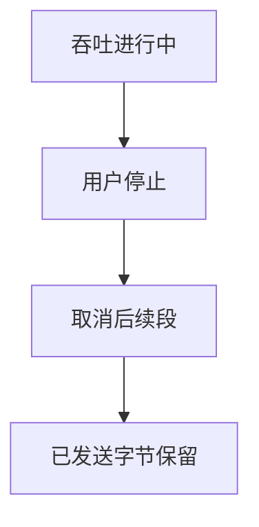
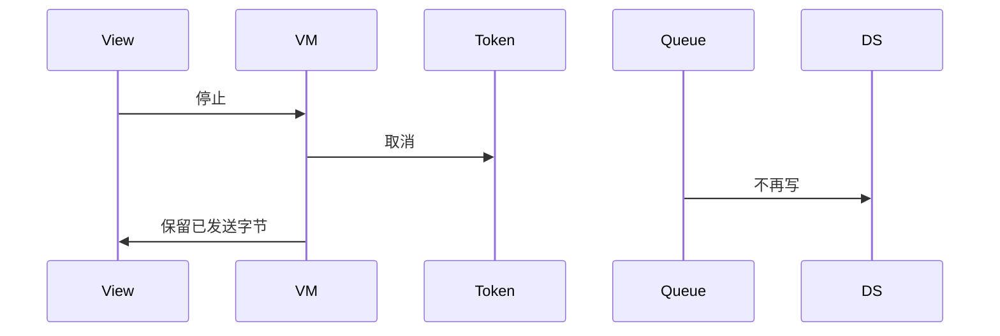
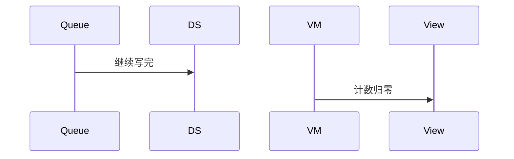

# BT-087 吞吐可被用户停止

## 1. 条目与非目标

**判定：** 支持

**Given** 吞吐进行中

**When** 用户停止

**Then** 不再继续写；已发送字节保留

**证据：** `应用层吞吐没有平台停止 API，停止就是不再继续写`。行为以已接受的研究笔记和清单为准，本文件不重开行业调查。

**本条输入：** 进行中的吞吐，用户停止。

**本条输出：** 后续段不再写。已发送字节数保留在界面和摘要里。

**本条失败：** 停止后继续写完缓冲，或把计数清零。

**本条所有者：** 停止用 `common/core` 的 `CancellationToken`。队列是 `GattOperationQueue`。计数留在吞吐状态。`BleMainViewModel` 提供停止。

**非目标：**

- 不把停止当成断开 GATT。
- 不回滚已发送计数。
- 不新增 `common/yobluetooth` 以外的蓝牙栈，不增加包装层或版本兼容层。版本判断留在本条调用点。

## 2. 模块边界与分层

本组是吞吐、报文与日志。依赖方向是 `product/phone` → `features/bluetooth` → `common/yobluetooth`。权限、生命周期和系统设置走 `common/platform` 与 `common/debug_core`。字节与 `Result` 走 `common/core`。日志门面走 `common/yolog`。收藏、会话记录和导出走 `common/storage`。`common/youi_kit` 只提供通用控件，不解释蓝牙状态。

**调用点：** 后续 `write` 不再进入 `GattClientDataSource`。

| 包 | 类型 | 职责 |
| --- | --- | --- |
| features/bluetooth | BleMainViewModel | 停止 |
| common/core | CancellationToken | 取消后续段 |
| common/yobluetooth | GattOperationQueue | 不再取下一段 |
| common/yobluetooth | 吞吐计数 | 保留 bytes |

**设计前：** 没有取消令牌时，分片循环会写完才回到界面。

**设计后：** 停止后队列不再发送剩余段。计数保持停止时刻的值。连接仍在。

## 3. 架构图

本组总图在 [`BT-086.md`](BT-086.md)。下图只覆盖本条。

## 4. 序列图

### 成功路径

### 错误路径

## 5. 数据模型

领域模型放在 `common/yobluetooth`，持久化模型放在 `common/storage`，平台传输对象只出现在数据源调用点，跨层用 `common/core` 的 `Result` 与 `ResultError`。错误只带类别和结构化字段，不把界面句子塞进邻层错误。

| 模型 | 所在层 | 字段 | 来源 |
| --- | --- | --- | --- |
| 吞吐计数 | 领域 | bytes 保持 | 停止后 |
| CancellationToken | common/core | 已取消 | 用户 |

## 6. 层间接口

| 从 | 到 | 接口 | 成功 | 失败 |
| --- | --- | --- | --- | --- |
| BleMainViewModel | GattOperationQueue | cancel | 不再下发 | 当前段失败则可见 |
| 停止 | DisconnectGattUseCase | 断开 | 本条不调用 | 连接保留 |

下层不持有页面类型。结果用 `Result` 或已有观察者回传。`common/yobluetooth` 的 `Index.ets` 继续只导出用例、领域模型和必要门面，不把数据源具体类变成第二套公开栈。

## 7. 权限与生命周期

不涉及。

页面离开也取消吞吐，计数仍可在会话摘要里看到。

## 8. 日志

- 摘要记录 stopped=1 bytes。不补写未发送段。
- 领域标签加在已有 `BtLogTag`，不在 `common/yolog` 的 `YoLogTag` 里再开一套蓝牙标签。
- 日志走 `YoLog`，不在页面里直接写 hilog。

## 9. 反模式

- 停止时 clear 计数。
- 停止时 close GATT 却显示只是停测。
- 用新的蓝牙 HAR、适配器或 `ApiCompat` 把本条版本差异包起来。版本判断只留在上面写明的调用点。
- 页面或 `common/youi_kit` 直接调用 `ohos.bluetooth.*`。
