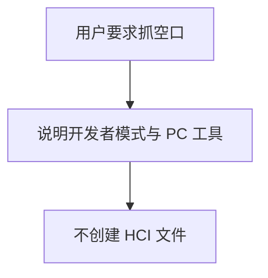
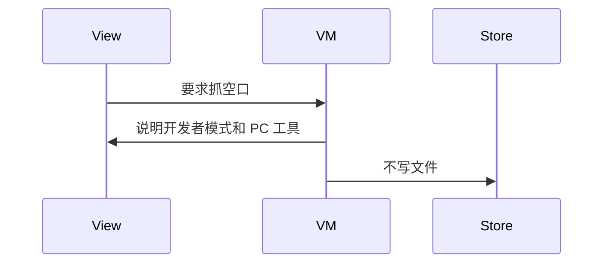
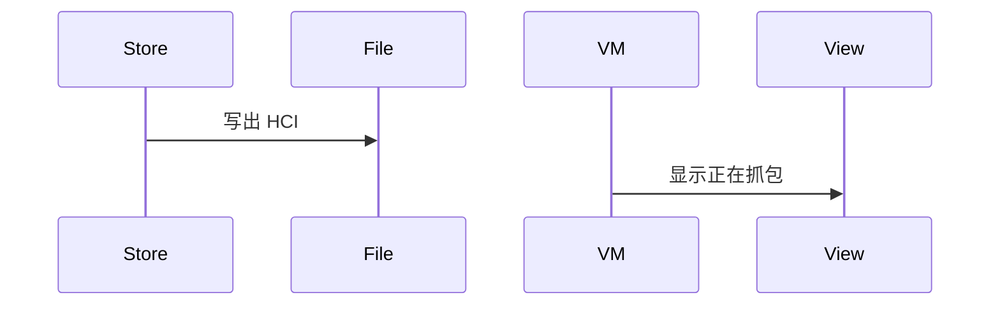

# BT-088 应用内不能抓空口 HCI

## 1. 条目与非目标

**判定：** 缺口

**Given** 普通应用会话

**When** 用户要求抓空口包

**Then** 不出现应用内 HCI 文件；说明需开发者模式采集，再用 PC 工具打开

**证据：** `开发/指南/系统/网络/Connectivity Kit（短距通信服务）/蓝牙/蓝牙常见问题/如何抓取蓝牙HCI日志/如何抓取蓝牙HCI日志.md`。行为以已接受的研究笔记和清单为准，本文件不重开行业调查。

**本条输入：** 普通应用里用户要求抓空口包。

**本条输出：** 没有应用内 HCI 文件。说明使用开发者模式采集，再用 PC 工具打开。

**本条失败：** 应用生成 HCI 文件或显示正在抓空口。

**本条所有者：** 说明放在 `features/bluetooth` 的诊断状态。`common/storage` 不写 HCI。`common/yobluetooth` 不增加抓包数据源。`product/phone` 不声明抓包能力。

本条按缺口设计。完成态只包含清单允许看见的结果，不包含把缺口做成已成功的路径。

**非目标：**

- 不启动开发者模式采集。
- 不集成 Wireshark 或 Ellisys。
- 不新增 `common/yobluetooth` 以外的蓝牙栈，不增加包装层或版本兼容层。版本判断留在本条调用点。

## 2. 模块边界与分层

本组是吞吐、报文与日志。依赖方向是 `product/phone` → `features/bluetooth` → `common/yobluetooth`。权限、生命周期和系统设置走 `common/platform` 与 `common/debug_core`。字节与 `Result` 走 `common/core`。日志门面走 `common/yolog`。收藏、会话记录和导出走 `common/storage`。`common/youi_kit` 只提供通用控件，不解释蓝牙状态。

**调用点：** 没有 HCI 调用点。

| 包 | 类型 | 职责 |
| --- | --- | --- |
| features/bluetooth | 诊断 ViewModel | 说明缺口 |
| common/storage | ExportFileWriter | 不生成 HCI |
| common/yobluetooth | 数据源 | 无 HCI 套接字 |
| product/phone | 页面 | 只展示说明 |

**设计前：** 导出菜单若叫抓包，会让人以为会话日志就是 HCI。

**设计后：** 诊断入口只说明开发者模式和 PC 工具。仓库没有 HCI 文件输出。

## 3. 架构图

本组总图在 [`BT-086.md`](BT-086.md)。下图只覆盖本条。

## 4. 序列图

### 成功路径

缺口条目的成功路径是用户看见限制。缺失能力没有被画成已经成功。

### 错误路径

错误路径把缺口做成了成功。这条路径不进入目标分层。

## 5. 数据模型

领域模型放在 `common/yobluetooth`，持久化模型放在 `common/storage`，平台传输对象只出现在数据源调用点，跨层用 `common/core` 的 `Result` 与 `ResultError`。错误只带类别和结构化字段，不把界面句子塞进邻层错误。

| 模型 | 所在层 | 字段 | 来源 |
| --- | --- | --- | --- |
| 诊断说明 | features/bluetooth | 无文件路径 | 缺口 |

## 6. 层间接口

| 从 | 到 | 接口 | 成功 | 失败 |
| --- | --- | --- | --- | --- |
| 诊断 ViewModel | LogExportService | 导出 HCI | 无此接口 | 禁止 |
| 诊断 ViewModel | yobluetooth | openHci | 不存在 | 不添加 |

下层不持有页面类型。结果用 `Result` 或已有观察者回传。`common/yobluetooth` 的 `Index.ets` 继续只导出用例、领域模型和必要门面，不把数据源具体类变成第二套公开栈。

## 7. 权限与生命周期

不申请抓包权限。

不创建抓包任务，也不因此申请长时任务。

## 8. 日志

- 不记录 hciCaptureStarted。
- 领域标签加在已有 `BtLogTag`，不在 `common/yolog` 的 `YoLogTag` 里再开一套蓝牙标签。
- 日志走 `YoLog`，不在页面里直接写 hilog。

## 9. 反模式

- 把会话 HEX 日志改扩展名为 hci。
- 用调试接口读系统 HCI 缓冲。
- 用新的蓝牙 HAR、适配器或 `ApiCompat` 把本条版本差异包起来。版本判断只留在上面写明的调用点。
- 页面或 `common/youi_kit` 直接调用 `ohos.bluetooth.*`。
