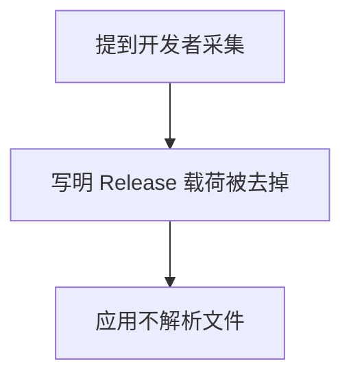
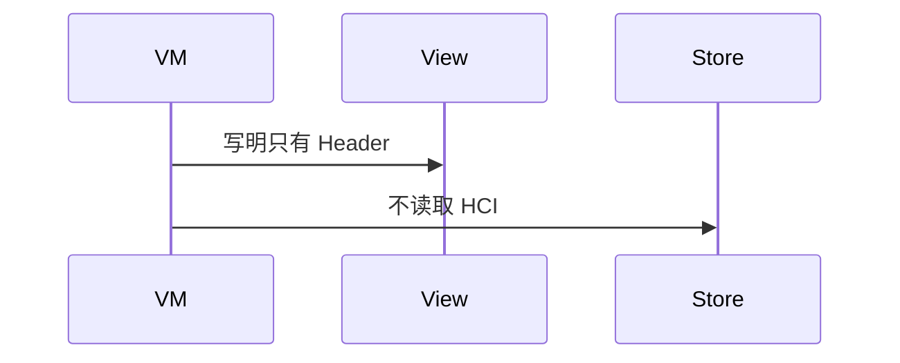
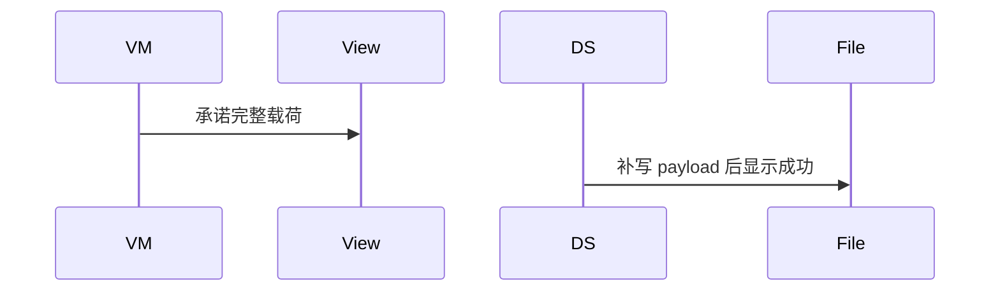

# BT-089 Release 的 HCI 日志没有载荷

## 1. 条目与非目标

**判定：** 缺口

**Given** Release 版本上的开发者 HCI 采集

**When** 用 Wireshark 或 Ellisys 打开

**Then** 预期只有 Header；界面若引导抓包，写明载荷被去掉

**证据：** `如何抓取蓝牙 HCI 日志`。行为以已接受的研究笔记和清单为准，本文件不重开行业调查。

**本条输入：** Release 上的开发者 HCI 采集被外部工具打开。

**本条输出：** 若界面提到该采集，写明载荷被去掉，预期只有 Header。应用不解析、不补载荷。

**本条失败：** 界面暗示 Release 抓包含完整载荷，或应用试图填回 payload。

**本条所有者：** 文案在 `features/bluetooth` 诊断状态。应用不读取 HCI 文件，因此 `common/storage` 与 `common/yobluetooth` 都没有解析器。

本条按缺口设计。完成态只包含清单允许看见的结果，不包含把缺口做成已成功的路径。

**非目标：**

- 不实现 HCI 载荷还原。
- 不区分用户手机是否真的开了开发者采集并假装读到结果。
- 不新增 `common/yobluetooth` 以外的蓝牙栈，不增加包装层或版本兼容层。版本判断留在本条调用点。

## 2. 模块边界与分层

本组是吞吐、报文与日志。依赖方向是 `product/phone` → `features/bluetooth` → `common/yobluetooth`。权限、生命周期和系统设置走 `common/platform` 与 `common/debug_core`。字节与 `Result` 走 `common/core`。日志门面走 `common/yolog`。收藏、会话记录和导出走 `common/storage`。`common/youi_kit` 只提供通用控件，不解释蓝牙状态。

**调用点：** 没有读取 HCI 的调用点。

| 包 | 类型 | 职责 |
| --- | --- | --- |
| features/bluetooth | 诊断 ViewModel | 写明 Release 只有 Header |
| common/yobluetooth | 无解析器 | 不读取 HCI |
| common/storage | 无 HCI 记录 | 不补载荷 |

**设计前：** 引导文案若只说去 PC 打开，会漏掉 Release 无载荷。

**设计后：** 引导同时说明开发者模式、PC 工具，以及 Release 去掉载荷。应用不打开该文件。

## 3. 架构图

本组总图在 [`BT-086.md`](BT-086.md)。下图只覆盖本条。

## 4. 序列图

### 成功路径

缺口条目的成功路径是用户看见限制。缺失能力没有被画成已经成功。

### 错误路径

错误路径把缺口做成了成功。这条路径不进入目标分层。

## 5. 数据模型

领域模型放在 `common/yobluetooth`，持久化模型放在 `common/storage`，平台传输对象只出现在数据源调用点，跨层用 `common/core` 的 `Result` 与 `ResultError`。错误只带类别和结构化字段，不把界面句子塞进邻层错误。

| 模型 | 所在层 | 字段 | 来源 |
| --- | --- | --- | --- |
| 引导文案 | features/bluetooth | releasePayload=false | 说明 |

## 6. 层间接口

| 从 | 到 | 接口 | 成功 | 失败 |
| --- | --- | --- | --- | --- |
| 诊断 ViewModel | 文件读取 | 打开 HCI | 不调用 | 不能显示载荷已恢复 |

下层不持有页面类型。结果用 `Result` 或已有观察者回传。`common/yobluetooth` 的 `Index.ets` 继续只导出用例、领域模型和必要门面，不把数据源具体类变成第二套公开栈。

## 7. 权限与生命周期

不涉及。

无文件监听。

## 8. 日志

- 不把外部 HCI Header 打进应用日志。
- 领域标签加在已有 `BtLogTag`，不在 `common/yolog` 的 `YoLogTag` 里再开一套蓝牙标签。
- 日志走 `YoLog`，不在页面里直接写 hilog。

## 9. 反模式

- 在应用里嵌 Wireshark 解析并显示还原的 ATT。
- Debug 与 Release 各做一套抓包成功路径。
- 用新的蓝牙 HAR、适配器或 `ApiCompat` 把本条版本差异包起来。版本判断只留在上面写明的调用点。
- 页面或 `common/youi_kit` 直接调用 `ohos.bluetooth.*`。
