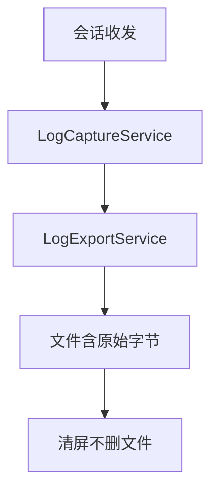
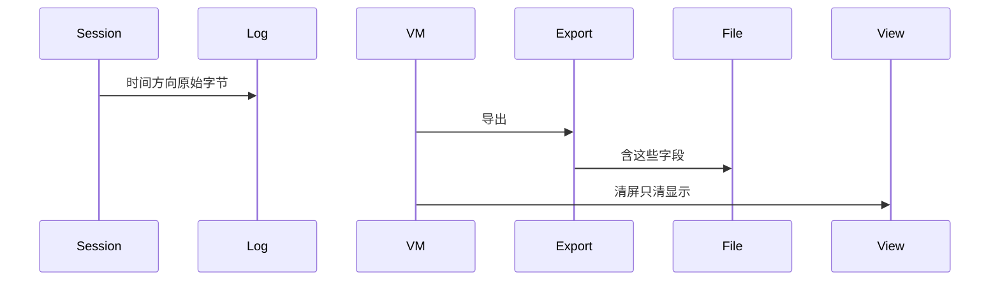
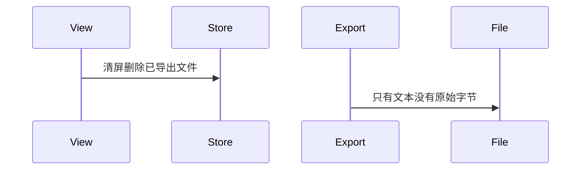

# BT-090 会话日志可按条导出且含原始值

## 1. 条目与非目标

**判定：** 支持

**Given** 一次 SPP 或 GATT 会话中有收发

**When** 用户导出

**Then** 导出含时间、方向、原始字节；导出失败可见。清屏只影响显示，不删已导出文件

**证据：** `应用层会话日志。平台不提供该导出`。行为以已接受的研究笔记和清单为准，本文件不重开行业调查。

**本条输入：** 一次 SPP 或 GATT 会话中已有收发，用户导出或清屏。

**本条输出：** 导出文件含时间、方向、原始字节。失败可见。清屏只清界面，不删已导出文件，也不删已持久化记录。

**本条失败：** 清屏删除导出文件，或导出没有原始字节。

**本条所有者：** 记录在 `common/debug_core` 的 `LogCaptureService` 与 `common/storage` 的 `LogRepository`。导出在 `LogExportService`。清屏只重置 `SppTerminalViewModel` 或 GATT 页面的显示列表。

**非目标：**

- 不清屏时删除数据库。
- 不把导出变成 HCI。
- 不新增 `common/yobluetooth` 以外的蓝牙栈，不增加包装层或版本兼容层。版本判断留在本条调用点。

## 2. 模块边界与分层

本组是吞吐、报文与日志。依赖方向是 `product/phone` → `features/bluetooth` → `common/yobluetooth`。权限、生命周期和系统设置走 `common/platform` 与 `common/debug_core`。字节与 `Result` 走 `common/core`。日志门面走 `common/yolog`。收藏、会话记录和导出走 `common/storage`。`common/youi_kit` 只提供通用控件，不解释蓝牙状态。

**调用点：** 没有蓝牙 Kit 调用。导出在 `common/storage`。

| 包 | 类型 | 职责 |
| --- | --- | --- |
| common/debug_core | LogCaptureService | 保存时间方向和原始字节 |
| common/storage | LogRepository | 持久化 |
| common/storage | LogExportService | 导出 |
| features/bluetooth | 终端 ViewModel | 清屏只清显示 |
| product/phone | 页面 | 转发导出与清屏 |

**设计前：** 清屏若调用删除接口，已导出文件和历史会一起消失。

**设计后：** 导出读取持久化记录。清屏不调用删除。导出失败以 `Result` 可见。

## 3. 架构图

本组总图在 [`BT-086.md`](BT-086.md)。下图只覆盖本条。

## 4. 序列图

### 成功路径

### 错误路径

## 5. 数据模型

领域模型放在 `common/yobluetooth`，持久化模型放在 `common/storage`，平台传输对象只出现在数据源调用点，跨层用 `common/core` 的 `Result` 与 `ResultError`。错误只带类别和结构化字段，不把界面句子塞进邻层错误。

| 模型 | 所在层 | 字段 | 来源 |
| --- | --- | --- | --- |
| DebugLogRecord | debug_core | 时间 方向 原始字节 | 捕获 |
| LogExportJsonRow | storage | 导出行 | 同一内容 |

## 6. 层间接口

| 从 | 到 | 接口 | 成功 | 失败 |
| --- | --- | --- | --- | --- |
| 终端 ViewModel | LogExportService | export | 文件 | 失败可见 |
| 终端 ViewModel | LogRepository | 清屏删除 | 不调用 | 文件仍在 |

下层不持有页面类型。结果用 `Result` 或已有观察者回传。`common/yobluetooth` 的 `Index.ets` 继续只导出用例、领域模型和必要门面，不把数据源具体类变成第二套公开栈。

## 7. 权限与生命周期

导出走应用文件，不需要蓝牙权限。

导出不依赖页面仍连接。断开后已记录的字节仍可导出。

## 8. 日志

- `YoLogTag.SESSION` 记录 exportOk 或失败码。原始字节在文件里，不重复打进 HiLog。
- 领域标签加在已有 `BtLogTag`，不在 `common/yolog` 的 `YoLogTag` 里再开一套蓝牙标签。
- 日志走 `YoLog`，不在页面里直接写 hilog。

## 9. 反模式

- 清屏调用 `PayloadFileDeleter`。
- 导出前把原始字节译成字符串并丢掉原值。
- 用新的蓝牙 HAR、适配器或 `ApiCompat` 把本条版本差异包起来。版本判断只留在上面写明的调用点。
- 页面或 `common/youi_kit` 直接调用 `ohos.bluetooth.*`。
