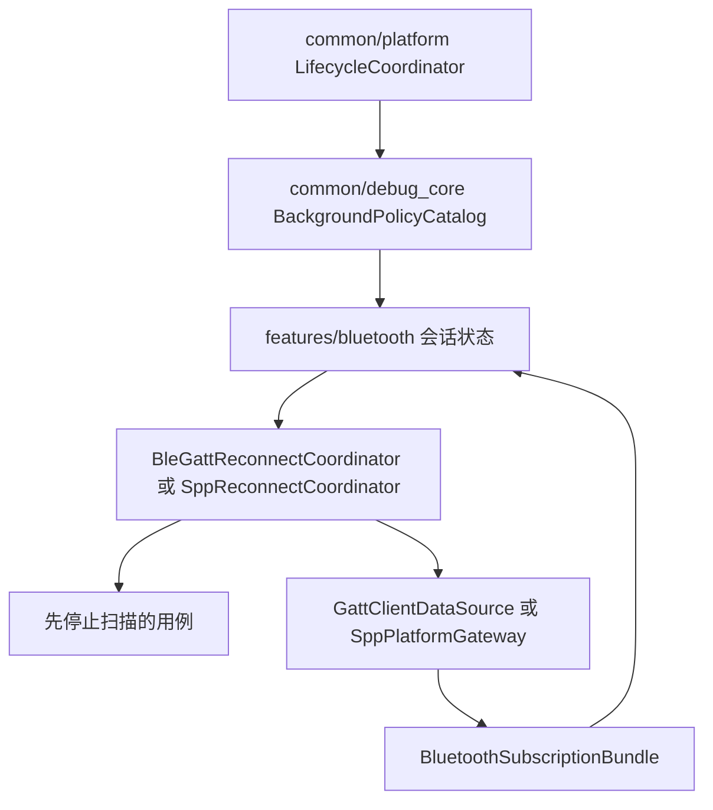
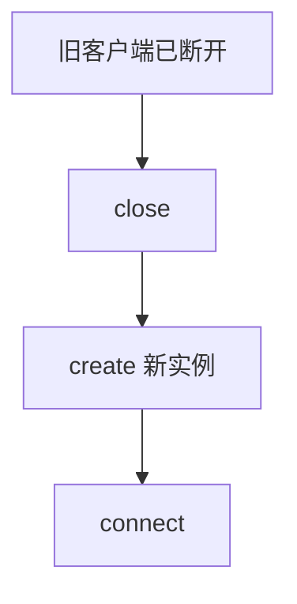
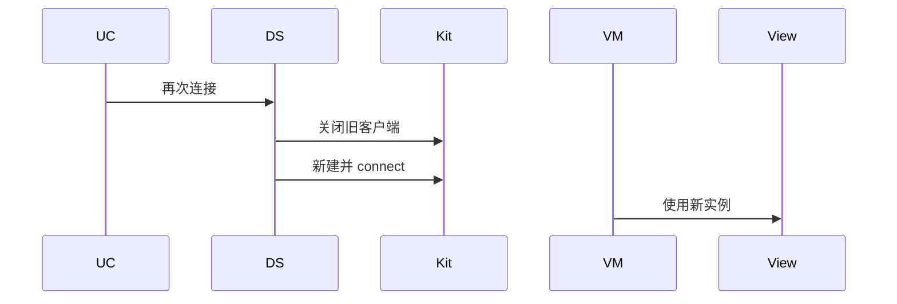
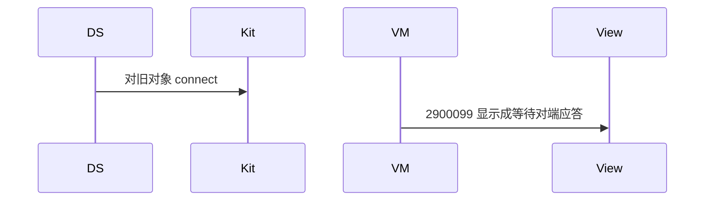

# BT-091 重连前销毁旧的 GATT 客户端

## 1. 条目与非目标

**判定：** 支持

**Given** 同一设备的 `GattClientDevice` 曾经连接后断开

**When** 再次连接

**Then** 使用新的客户端实例；若仍用旧对象导致 2900099，提示为客户端未销毁

**证据：** `错误码 2900099 子原因「GATT 设备重连后接口调用失败-gattClient 对象未及时销毁」`。行为以已接受的研究笔记和清单为准，本文件不重开行业调查。

**本条输入：** 同一设备的旧客户端已断开，用户再次连接。

**本条输出：** 先销毁旧实例，再创建新客户端。若平台仍因旧对象返回 2900099，文案是客户端未销毁。

**本条失败：** 复用旧 `GattClientDevice` 连接。

**本条所有者：** `BleGattReconnectCoordinator` 与 `ConnectGattUseCase` 要求 `GattClientDataSource` 先 close 再 create。错误映射保留该子原因。

**非目标：**

- 不在销毁失败时继续用旧对象。
- 不把该 2900099 说成服务端未应答。
- 不新增 `common/yobluetooth` 以外的蓝牙栈，不增加包装层或版本兼容层。版本判断留在本条调用点。

## 2. 模块边界与分层

本组是回连、后台与诊断。依赖方向是 `product/phone` → `features/bluetooth` → `common/yobluetooth`。权限、生命周期和系统设置走 `common/platform` 与 `common/debug_core`。字节与 `Result` 走 `common/core`。日志门面走 `common/yolog`。收藏、会话记录和导出走 `common/storage`。`common/youi_kit` 只提供通用控件，不解释蓝牙状态。

**调用点：** create 与 close 在 `GattClientDataSource`。

| 包 | 类型 | 职责 |
| --- | --- | --- |
| common/yobluetooth | GattClientDataSource | close 旧客户端再 create |
| common/yobluetooth | ConnectGattUseCase | 只拿新实例连接 |
| common/yobluetooth | BleGattReconnectCoordinator | 重连走同一规则 |
| features/bluetooth | BleMainViewModel | 子原因可见 |

**设计前：** 重连若缓存客户端对象，会触发未销毁子原因。

**设计后：** 数据源不保存可复用的已断开客户端。每次连接都是新实例。旧对象导致的 2900099 单独提示。

## 3. 架构图

本组总图放在本文件。回连、后台与诊断里其余条目各自再画本条链路，链接不能代替本条的输入、输出、失败和所有者。

本条链路：

## 4. 序列图

### 成功路径

### 错误路径

## 5. 数据模型

领域模型放在 `common/yobluetooth`，持久化模型放在 `common/storage`，平台传输对象只出现在数据源调用点，跨层用 `common/core` 的 `Result` 与 `ResultError`。错误只带类别和结构化字段，不把界面句子塞进邻层错误。

| 模型 | 所在层 | 字段 | 来源 |
| --- | --- | --- | --- |
| Gatt 客户端代际 | 数据源 | 新实例 | 每次连接 |
| ResultError | 领域 | 子原因=客户端未销毁 | 2900099 |

## 6. 层间接口

| 从 | 到 | 接口 | 成功 | 失败 |
| --- | --- | --- | --- | --- |
| ConnectGattUseCase | GattClientDataSource | connect | 新实例 | 旧对象则失败并提示 |
| BleGattReconnectCoordinator | GattClientDataSource | 重连 | 同样新建 | 不复用 |

下层不持有页面类型。结果用 `Result` 或已有观察者回传。`common/yobluetooth` 的 `Index.ets` 继续只导出用例、领域模型和必要门面，不把数据源具体类变成第二套公开栈。

## 7. 权限与生命周期

不涉及。

销毁时取消旧客户端的全部回调，避免旧事件打进新会话。

## 8. 日志

- GATT 日志记录 clientGeneration 递增。
- 领域标签加在已有 `BtLogTag`，不在 `common/yolog` 的 `YoLogTag` 里再开一套蓝牙标签。
- 日志走 `YoLog`，不在页面里直接写 hilog。

## 9. 反模式

- 用 Map 按地址缓存永远不关闭的客户端。
- 捕获 2900099 后不提示直接再试旧对象。
- 用新的蓝牙 HAR、适配器或 `ApiCompat` 把本条版本差异包起来。版本判断只留在上面写明的调用点。
- 页面或 `common/youi_kit` 直接调用 `ohos.bluetooth.*`。
