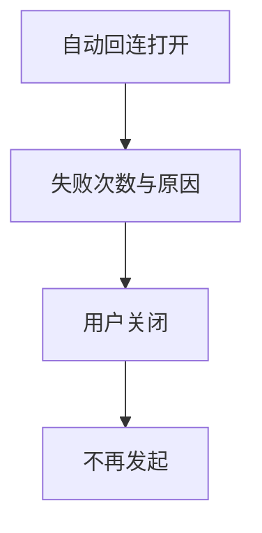
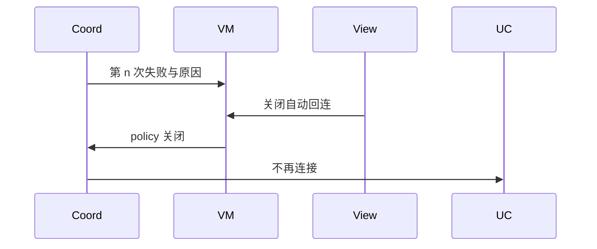
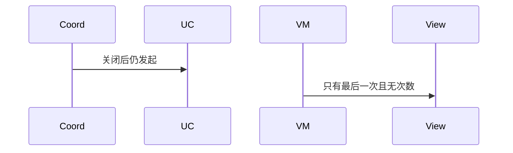

# BT-092 回连失败次数可见且能停止

## 1. 条目与非目标

**判定：** 支持

**Given** 用户打开自动回连，对端不可达

**When** 连续失败

**Then** 每次失败有次数与原因；用户可关闭自动回连，之后不再发起

**证据：** `应用层自动回连。平台没有统一回连器`。行为以已接受的研究笔记和清单为准，本文件不重开行业调查。

**本条输入：** 自动回连打开，对端不可达，连续失败。

**本条输出：** 每次失败显示次数和原因。用户关闭后不再发起。

**本条失败：** 关闭后仍在后台连接，或失败没有次数。

**本条所有者：** GATT 侧是 `BleGattReconnectCoordinator`，SPP 侧是 `SppReconnectCoordinator`。策略模型是 `ReconnectPolicy`。关闭动作在对应 ViewModel。

**非目标：**

- 不新增第三个重连器。
- 不在失败后无限加速重试。
- 不新增 `common/yobluetooth` 以外的蓝牙栈，不增加包装层或版本兼容层。版本判断留在本条调用点。

## 2. 模块边界与分层

本组是回连、后台与诊断。依赖方向是 `product/phone` → `features/bluetooth` → `common/yobluetooth`。权限、生命周期和系统设置走 `common/platform` 与 `common/debug_core`。字节与 `Result` 走 `common/core`。日志门面走 `common/yolog`。收藏、会话记录和导出走 `common/storage`。`common/youi_kit` 只提供通用控件，不解释蓝牙状态。

**调用点：** 连接仍用原数据源。回连不是新的 Kit API。

| 包 | 类型 | 职责 |
| --- | --- | --- |
| common/yobluetooth | ReconnectPolicy | 是否自动与次数 |
| common/yobluetooth | BleGattReconnectCoordinator | GATT 失败计数 |
| common/yobluetooth | SppReconnectCoordinator | SPP 失败计数 |
| features/bluetooth | 会话 ViewModel | 关闭后停止调度 |

**设计前：** 两个协调器若只在内部重试，界面看不到次数，也无法一次关掉。

**设计后：** 每次失败把次数和原因交给页面。`ReconnectPolicy` 关闭后协调器不再 `execute` 连接。

## 3. 架构图

本组总图在 [`BT-091.md`](BT-091.md)。下图只覆盖本条。

## 4. 序列图

### 成功路径

### 错误路径

## 5. 数据模型

领域模型放在 `common/yobluetooth`，持久化模型放在 `common/storage`，平台传输对象只出现在数据源调用点，跨层用 `common/core` 的 `Result` 与 `ResultError`。错误只带类别和结构化字段，不把界面句子塞进邻层错误。

| 模型 | 所在层 | 字段 | 来源 |
| --- | --- | --- | --- |
| ReconnectPolicy | 领域 | enabled 与 attempt | 用户与协调器 |

## 6. 层间接口

| 从 | 到 | 接口 | 成功 | 失败 |
| --- | --- | --- | --- | --- |
| ViewModel | 重连协调器 | disable | 停止调度 | 进行中的一次失败仍可见 |
| 协调器 | 连接用例 | 再次连接 | 仅 enabled | 关闭后不调用 |

下层不持有页面类型。结果用 `Result` 或已有观察者回传。`common/yobluetooth` 的 `Index.ets` 继续只导出用例、领域模型和必要门面，不把数据源具体类变成第二套公开栈。

## 7. 权限与生命周期

回连不新增权限。未配对地址仍按地址条目处理。

页面可关策略。应用退后台是否继续，受长时任务条目约束，不在本条偷偷继续。

## 8. 日志

- `SppReconnectEventLogger` 与 GATT 日志记录 attempt 与 reason。
- 领域标签加在已有 `BtLogTag`，不在 `common/yolog` 的 `YoLogTag` 里再开一套蓝牙标签。
- 日志走 `YoLog`，不在页面里直接写 hilog。

## 9. 反模式

- GATT 与 SPP 各写一套不可关闭的定时重连。
- 失败原因一律写成超时。
- 用新的蓝牙 HAR、适配器或 `ApiCompat` 把本条版本差异包起来。版本判断只留在上面写明的调用点。
- 页面或 `common/youi_kit` 直接调用 `ohos.bluetooth.*`。
