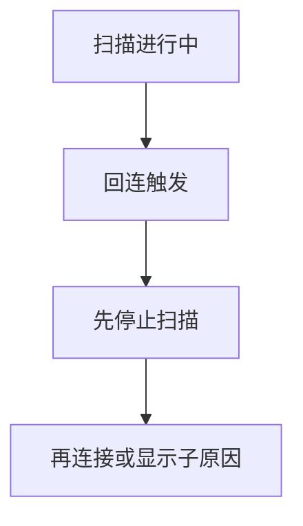
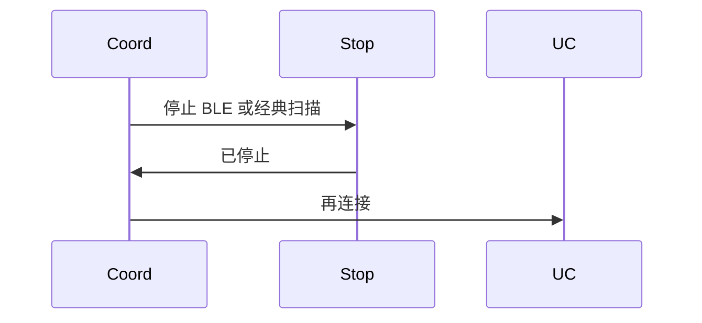
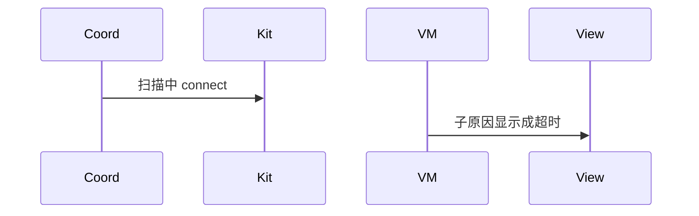

# BT-093 扫描未停时不回连

## 1. 条目与非目标

**判定：** 支持

**Given** BLE 或经典扫描仍在进行

**When** 自动回连触发

**Then** 先停扫描再连接；若返回「扫描期间不允许连接」，显示该原因

**证据：** `错误码 2900099 子原因`。行为以已接受的研究笔记和清单为准，本文件不重开行业调查。

**本条输入：** BLE 或经典扫描仍在进行时触发自动回连。

**本条输出：** 先停止对应扫描，再连接。平台若返回扫描期间不允许连接，显示该原因。

**本条失败：** 扫描中直接连接，或该子原因被写成超时。

**本条所有者：** 协调器先调用 `StopBleScanUseCase` 或 `StopClassicScanUseCase`。连接用例保持 BT-014 的前置。错误映射在对应数据源。

**非目标：**

- 不跳过停止直接连接。
- 不把停止失败吞掉。
- 不新增 `common/yobluetooth` 以外的蓝牙栈，不增加包装层或版本兼容层。版本判断留在本条调用点。

## 2. 模块边界与分层

本组是回连、后台与诊断。依赖方向是 `product/phone` → `features/bluetooth` → `common/yobluetooth`。权限、生命周期和系统设置走 `common/platform` 与 `common/debug_core`。字节与 `Result` 走 `common/core`。日志门面走 `common/yolog`。收藏、会话记录和导出走 `common/storage`。`common/youi_kit` 只提供通用控件，不解释蓝牙状态。

**调用点：** 停止在各自扫描数据源，连接在 GATT 或 SPP 数据源。

| 包 | 类型 | 职责 |
| --- | --- | --- |
| common/yobluetooth | 重连协调器 | 先停扫描 |
| common/yobluetooth | StopBleScanUseCase | 停 BLE |
| common/yobluetooth | StopClassicScanUseCase | 停经典发现 |
| features/bluetooth | ViewModel | 显示扫描期间不允许连接 |

**设计前：** 自动回连可能不看扫描相位。

**设计后：** 任一扫描进行时，回连先停再连。平台子原因原样展示。

## 3. 架构图

本组总图在 [`BT-091.md`](BT-091.md)。下图只覆盖本条。

## 4. 序列图

### 成功路径

### 错误路径

## 5. 数据模型

领域模型放在 `common/yobluetooth`，持久化模型放在 `common/storage`，平台传输对象只出现在数据源调用点，跨层用 `common/core` 的 `Result` 与 `ResultError`。错误只带类别和结构化字段，不把界面句子塞进邻层错误。

| 模型 | 所在层 | 字段 | 来源 |
| --- | --- | --- | --- |
| 扫描相位 | 领域 | 必须先 idle | 回连前 |
| ResultError | 领域 | 子原因=扫描期间不允许连接 | 2900099 |

## 6. 层间接口

| 从 | 到 | 接口 | 成功 | 失败 |
| --- | --- | --- | --- | --- |
| 重连协调器 | 停止用例 | stop | 完成才连接 | 停止失败则不连接 |
| 数据源 | ViewModel | 2900099 | 该子原因 | 不映射成 2900007 |

下层不持有页面类型。结果用 `Result` 或已有观察者回传。`common/yobluetooth` 的 `Index.ets` 继续只导出用例、领域模型和必要门面，不把数据源具体类变成第二套公开栈。

## 7. 权限与生命周期

不涉及。

停止扫描会取消扫描订阅。连接订阅随后另建。

## 8. 日志

- 扫描日志记录 stopReason=reconnect，连接日志记录子原因。
- 领域标签加在已有 `BtLogTag`，不在 `common/yolog` 的 `YoLogTag` 里再开一套蓝牙标签。
- 日志走 `YoLog`，不在页面里直接写 hilog。

## 9. 反模式

- 停扫描用固定延时代替完成回调。
- 只停 BLE 不停经典发现。
- 用新的蓝牙 HAR、适配器或 `ApiCompat` 把本条版本差异包起来。版本判断只留在上面写明的调用点。
- 页面或 `common/youi_kit` 直接调用 `ohos.bluetooth.*`。
