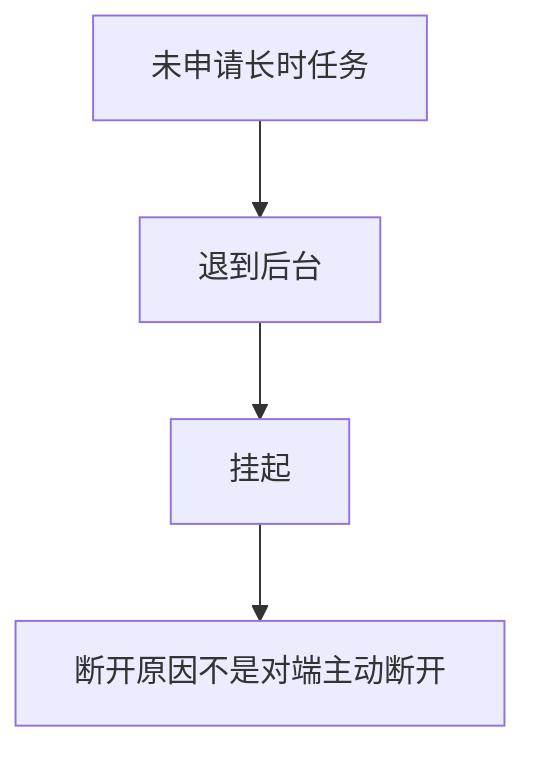
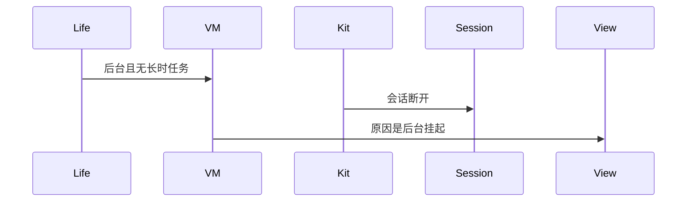
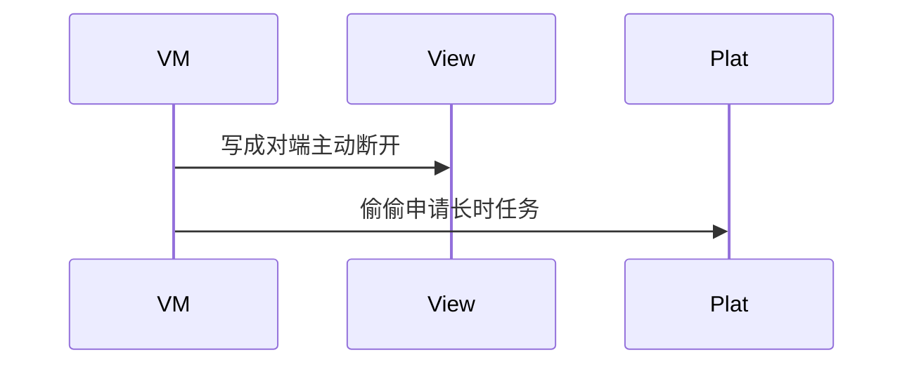

# BT-094 未申请长时任务时，退后台可能断开

## 1. 条目与非目标

**判定：** 支持

**Given** 未申请 `BLUETOOTH_INTERACTION` 长时任务

**When** 应用退到后台并被挂起

**Then** 会话可变为断开，且原因不是「对端主动断开」的误导文案

**证据：** `FAQ「应用长期在后台会不会被杀掉」；长时任务注意事项`。行为以已接受的研究笔记和清单为准，本文件不重开行业调查。

**本条输入：** 没有蓝牙交互长时任务，应用退到后台并被挂起。

**本条输出：** 会话可以断开。原因归为后台挂起，不写成对端主动断开。

**本条失败：** 挂起导致的断开显示成对端主动断开。

**本条所有者：** 后台状态来自 `common/platform` 的 `LifecycleCoordinator`。建议来自 `common/debug_core` 的 `BackgroundPolicyCatalog`：未开启后台连接时是 PAUSE。断开文案在会话 ViewModel。

**非目标：**

- 不在本条申请长时任务。
- 不保证后台一定断开或一定保持。
- 不新增 `common/yobluetooth` 以外的蓝牙栈，不增加包装层或版本兼容层。版本判断留在本条调用点。

## 2. 模块边界与分层

本组是回连、后台与诊断。依赖方向是 `product/phone` → `features/bluetooth` → `common/yobluetooth`。权限、生命周期和系统设置走 `common/platform` 与 `common/debug_core`。字节与 `Result` 走 `common/core`。日志门面走 `common/yolog`。收藏、会话记录和导出走 `common/storage`。`common/youi_kit` 只提供通用控件，不解释蓝牙状态。

**调用点：** 本条不调用长时任务 Kit。蓝牙断开仍由原会话数据源观察。

| 包 | 类型 | 职责 |
| --- | --- | --- |
| common/platform | LifecycleCoordinator | 进入后台 |
| common/debug_core | BackgroundPolicyCatalog | 未开长时任务则不 REQUEST |
| features/bluetooth | 会话 ViewModel | 断开原因用后台挂起 |
| common/yobluetooth | 会话账本 | 可以变为断开 |

**设计前：** 任何断开都可能套用 `reasonMessage` 的对端文案。

**设计后：** 没有长时任务且生命周期已后台时，随后的断开原因优先标为挂起，不用对端主动断开。

## 3. 架构图

本组总图在 [`BT-091.md`](BT-091.md)。下图只覆盖本条。

## 4. 序列图

### 成功路径

### 错误路径

## 5. 数据模型

领域模型放在 `common/yobluetooth`，持久化模型放在 `common/storage`，平台传输对象只出现在数据源调用点，跨层用 `common/core` 的 `Result` 与 `ResultError`。错误只带类别和结构化字段，不把界面句子塞进邻层错误。

| 模型 | 所在层 | 字段 | 来源 |
| --- | --- | --- | --- |
| AppLifecycleState | platform | background | 生命周期 |
| 断开原因 | 领域 | suspended | 不是对端 |

## 6. 层间接口

| 从 | 到 | 接口 | 成功 | 失败 |
| --- | --- | --- | --- | --- |
| LifecycleCoordinator | 会话 ViewModel | onBackground | 标记无长时任务 | 不申请任务 |
| 会话 | 视图 | 断开 | 挂起文案 | 不用对端文案 |

下层不持有页面类型。结果用 `Result` 或已有观察者回传。`common/yobluetooth` 的 `Index.ets` 继续只导出用例、领域模型和必要门面，不把数据源具体类变成第二套公开栈。

## 7. 权限与生命周期

本条明确不使用 `KEEP_BACKGROUND_RUNNING`。

扫描按目录仍是 STOP。连接可断开且不自动重连来掩盖挂起。

## 8. 日志

- `YoLogTag.LIFE` 记录 background longTask=0。断开日志 reason=suspend。
- 领域标签加在已有 `BtLogTag`，不在 `common/yolog` 的 `YoLogTag` 里再开一套蓝牙标签。
- 日志走 `YoLog`，不在页面里直接写 hilog。

## 9. 反模式

- 后台断开后立即重连并显示从未断开。
- 一律显示 0X16 对端原因。
- 用新的蓝牙 HAR、适配器或 `ApiCompat` 把本条版本差异包起来。版本判断只留在上面写明的调用点。
- 页面或 `common/youi_kit` 直接调用 `ohos.bluetooth.*`。
