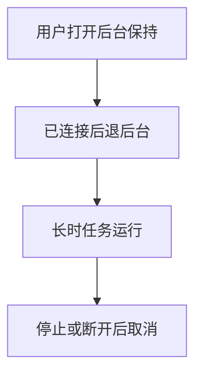
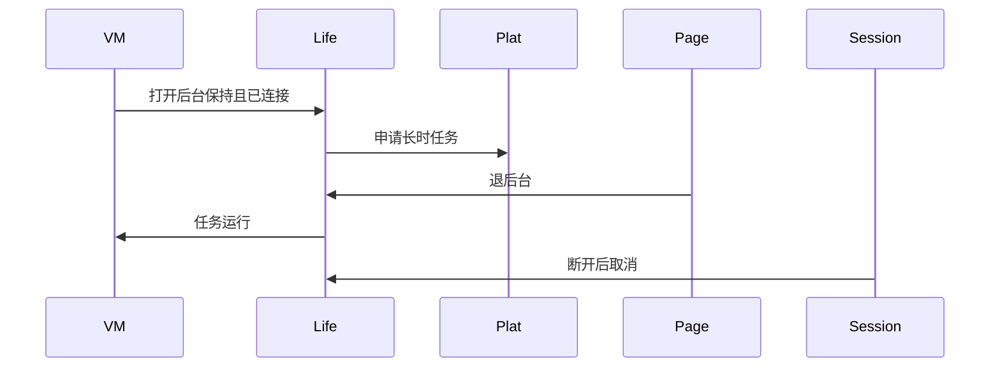
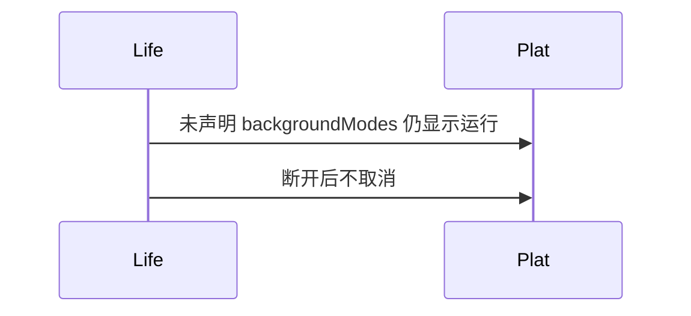

# BT-095 长时任务声明蓝牙交互类型

## 1. 条目与非目标

**判定：** 支持

**Given** 用户打开后台保持，且授予 `KEEP_BACKGROUND_RUNNING`

**When** GATT 或 SPP 已连接并退到后台

**Then** `backgroundModes` 含蓝牙交互类型后任务处于运行；用户停止或断开后任务取消

**证据：** `长时任务注意事项。实现阶段仍要真机复验，本条不另发明接口`。行为以已接受的研究笔记和清单为准，本文件不重开行业调查。

**本条输入：** 用户打开后台保持，权限已授予，GATT 或 SPP 已连接，应用退到后台。

**本条输出：** 产品声明含蓝牙交互 `backgroundModes`。长时任务处于运行。用户停止或断开后任务取消。

**本条失败：** 未声明类型却显示任务在运行，或断开后任务仍运行。

**本条所有者：** 声明在 `product/phone` 的 `module.json5`。权限常量放进已有 `common/platform` 的 `AppPermission`。申请走 `common/debug_core` 权限场景。启停由 `LifecycleCoordinator` 按 `BackgroundPolicyCatalog` 的 `BLE_SPP_CONNECTION` 执行。蓝牙会话只报告连接是否还在。

**非目标：**

- 不把车钥匙子类型纳入通用调试。
- 不在未连接时启动该任务。
- 不把真机复验写成第二套 API。
- 不新增 `common/yobluetooth` 以外的蓝牙栈，不增加包装层或版本兼容层。版本判断留在本条调用点。

## 2. 模块边界与分层

本组是回连、后台与诊断。依赖方向是 `product/phone` → `features/bluetooth` → `common/yobluetooth`。权限、生命周期和系统设置走 `common/platform` 与 `common/debug_core`。字节与 `Result` 走 `common/core`。日志门面走 `common/yolog`。收藏、会话记录和导出走 `common/storage`。`common/youi_kit` 只提供通用控件，不解释蓝牙状态。

**调用点：** 长时任务 Kit 调用放在 `common/platform` 生命周期，不放进 `yobluetooth` 数据源，也不是第二蓝牙栈。

| 包 | 类型 | 职责 |
| --- | --- | --- |
| product/phone | module.json5 | backgroundModes 含蓝牙交互 |
| common/platform | AppPermission | KEEP_BACKGROUND_RUNNING 常量 |
| common/debug_core | BackgroundPolicyCatalog | 连接类别请求长时任务 |
| common/platform | LifecycleCoordinator | 退后台启动，断开或停止则取消 |
| common/yobluetooth | 会话账本 | 只提供是否已连接 |

**设计前：** 清单没有 `backgroundModes`，后台保持没有归属。

**设计后：** 只有权限授予且会话已连接才在退后台时启动。停止保持或断开就取消任务。扫描不使用该任务。

## 3. 架构图

本组总图在 [`BT-091.md`](BT-091.md)。下图只覆盖本条。

## 4. 序列图

### 成功路径

### 错误路径

## 5. 数据模型

领域模型放在 `common/yobluetooth`，持久化模型放在 `common/storage`，平台传输对象只出现在数据源调用点，跨层用 `common/core` 的 `Result` 与 `ResultError`。错误只带类别和结构化字段，不把界面句子塞进邻层错误。

| 模型 | 所在层 | 字段 | 来源 |
| --- | --- | --- | --- |
| BackgroundSessionAction | debug_core | REQUEST_LONG_TASK | 仅连接且用户打开 |
| 权限 | platform | KEEP_BACKGROUND_RUNNING | 需授予 |

## 6. 层间接口

| 从 | 到 | 接口 | 成功 | 失败 |
| --- | --- | --- | --- | --- |
| 会话 ViewModel | LifecycleCoordinator | 连接已建立 | 允许申请 | 未连接不申请 |
| LifecycleCoordinator | 长时任务 | start 与 stop | 退后台运行 | 断开或用户停止则取消 |

下层不持有页面类型。结果用 `Result` 或已有观察者回传。`common/yobluetooth` 的 `Index.ets` 继续只导出用例、领域模型和必要门面，不把数据源具体类变成第二套公开栈。

## 7. 权限与生命周期

新增常量属于已有 `AppPermission`，由产品清单声明。未授予则保持 BT-094 的行为。

任务与连接绑定。页面销毁但任务仍需连接证据；连接没有了就取消。实现阶段用真机复验挂起行为，不改变本调用链。

## 8. 日志

- `YoLogTag.LIFE` 记录 longTask=bluetoothInteraction running 或 cancelled。
- 领域标签加在已有 `BtLogTag`，不在 `common/yolog` 的 `YoLogTag` 里再开一套蓝牙标签。
- 日志走 `YoLog`，不在页面里直接写 hilog。

## 9. 反模式

- 为蓝牙单独写一个后台服务模块。
- 扫描也申请 `BLUETOOTH_INTERACTION`。
- 断开后把任务留着。
- 用新的蓝牙 HAR、适配器或 `ApiCompat` 把本条版本差异包起来。版本判断只留在上面写明的调用点。
- 页面或 `common/youi_kit` 直接调用 `ohos.bluetooth.*`。
