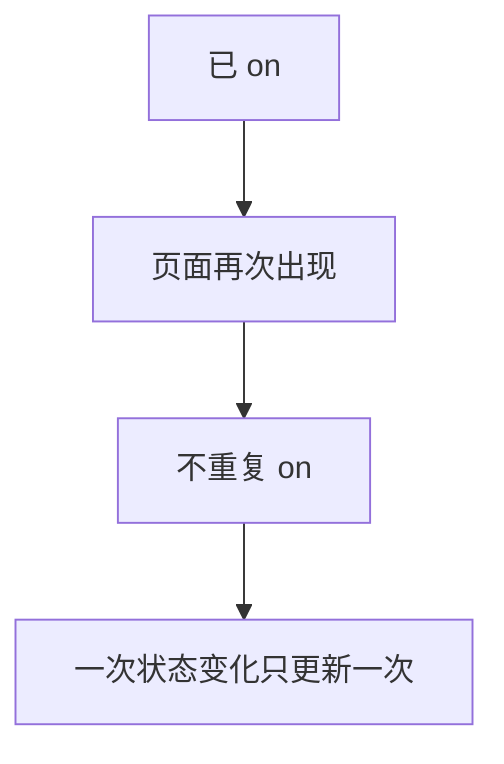
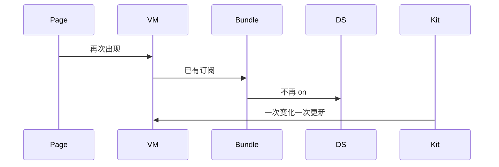
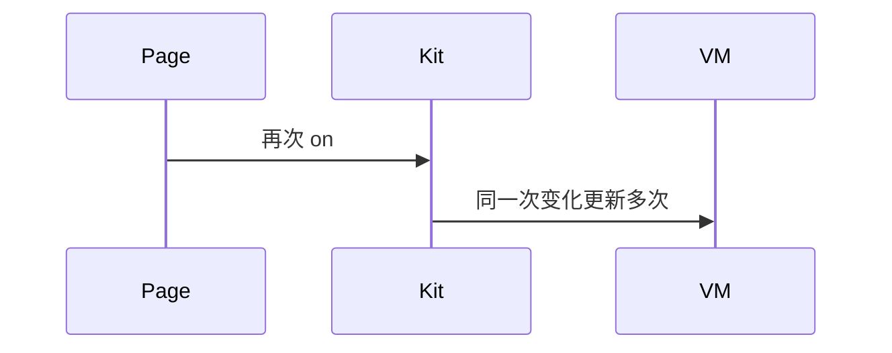

# BT-096 重复订阅同一事件不会多播

## 1. 条目与非目标

**判定：** 支持

**Given** 已经 `on` 某个蓝牙事件

**When** 页面再次出现

**Then** 同一次状态变化只更新一次界面。重复 `on` 导致的多次回调被取消订阅去掉

**证据：** `FAQ「蓝牙监听接口重复触发」；如何解决蓝牙订阅事件异常`。行为以已接受的研究笔记和清单为准，本文件不重开行业调查。

**本条输入：** 某个蓝牙事件已经 `on`，页面再次出现。

**本条输出：** 同一次状态变化只更新一次界面。重复注册被取消，只留一对订阅。

**本条失败：** 一次适配器变化刷新多次界面。

**本条所有者：** 订阅集中在 `BluetoothSubscriptionBundle`。页面再次出现时先 `off` 再按需 `on`，或发现已有订阅则不再 `on`。数据源不在页面里直接订阅。

**非目标：**

- 不为每个页面复制一套 Kit 订阅。
- 不靠忽略多余回调来掩盖重复 `on`。
- 不新增 `common/yobluetooth` 以外的蓝牙栈，不增加包装层或版本兼容层。版本判断留在本条调用点。

## 2. 模块边界与分层

本组是回连、后台与诊断。依赖方向是 `product/phone` → `features/bluetooth` → `common/yobluetooth`。权限、生命周期和系统设置走 `common/platform` 与 `common/debug_core`。字节与 `Result` 走 `common/core`。日志门面走 `common/yolog`。收藏、会话记录和导出走 `common/storage`。`common/youi_kit` 只提供通用控件，不解释蓝牙状态。

**调用点：** `on` 与 `off` 写在持有 Kit 对象的数据源方法里，由 bundle 调用。页面没有调用点。

| 包 | 类型 | 职责 |
| --- | --- | --- |
| common/yobluetooth | BluetoothSubscriptionBundle | 成对 on 与 off |
| product/phone | 页面 | 再次出现时通知 ViewModel |
| features/bluetooth | ViewModel | 不直接 Kit.on |
| common/yobluetooth | 各数据源 | 由 bundle 注册 |

**设计前：** 页面每次 `aboutToAppear` 都 `on`，一次事件会进多次。

**设计后：** bundle 保证同一事件只有一个有效订阅。再次出现不增加回调。离开时 `off`。

## 3. 架构图

本组总图在 [`BT-091.md`](BT-091.md)。下图只覆盖本条。

## 4. 序列图

### 成功路径

### 错误路径

## 5. 数据模型

领域模型放在 `common/yobluetooth`，持久化模型放在 `common/storage`，平台传输对象只出现在数据源调用点，跨层用 `common/core` 的 `Result` 与 `ResultError`。错误只带类别和结构化字段，不把界面句子塞进邻层错误。

| 模型 | 所在层 | 字段 | 来源 |
| --- | --- | --- | --- |
| 订阅记录 | BluetoothSubscriptionBundle | 事件与是否已 on | 成对 |

## 6. 层间接口

| 从 | 到 | 接口 | 成功 | 失败 |
| --- | --- | --- | --- | --- |
| ViewModel | BluetoothSubscriptionBundle | ensure | 已有则复用 | 不第二次 on |
| 页面离开 | bundle | off | 取消 | 泄漏则多播 |

下层不持有页面类型。结果用 `Result` 或已有观察者回传。`common/yobluetooth` 的 `Index.ets` 继续只导出用例、领域模型和必要门面，不把数据源具体类变成第二套公开栈。

## 7. 权限与生命周期

订阅不另要权限。开关订阅从 API 18 起不再校验该权限，这不改变本条的成对规则。

出现与消失成对。销毁页面必须 `off`。

## 8. 日志

- `BtLogTag.CONN` 记录 subscribeOnce。发现重复时先 off 并记 duplicateRemoved。
- 领域标签加在已有 `BtLogTag`，不在 `common/yolog` 的 `YoLogTag` 里再开一套蓝牙标签。
- 日志走 `YoLog`，不在页面里直接写 hilog。

## 9. 反模式

- 在回调里若已处理就 return，却保留多个 on。
- 每个 ViewModel 各自 connection.on。
- 用新的蓝牙 HAR、适配器或 `ApiCompat` 把本条版本差异包起来。版本判断只留在上面写明的调用点。
- 页面或 `common/youi_kit` 直接调用 `ohos.bluetooth.*`。
