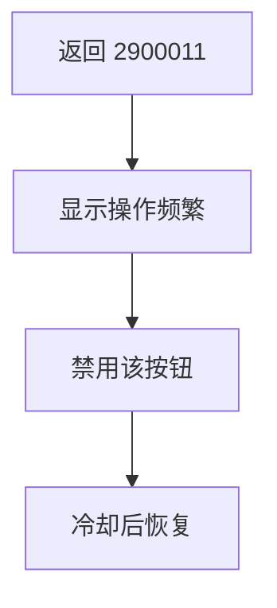
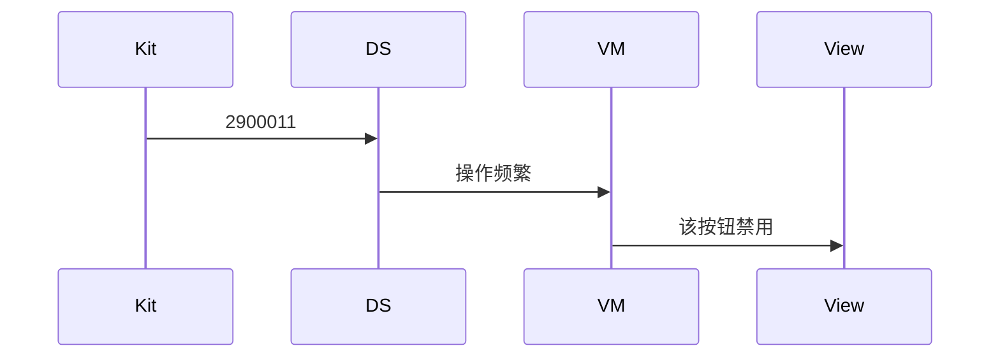
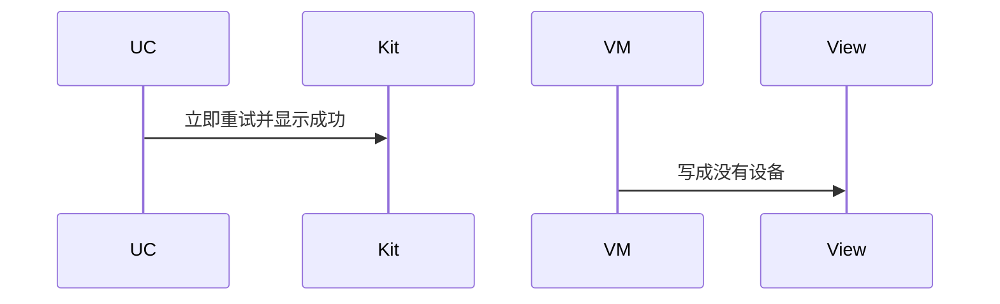

# BT-097 操作频繁时可见 2900011

## 1. 条目与非目标

**判定：** 支持

**Given** 短时间反复扫描或连接

**When** 返回 2900011

**Then** 显示操作频繁，并暂时禁用该按钮

**证据：** `错误码 2900011`。行为以已接受的研究笔记和清单为准，本文件不重开行业调查。

**本条输入：** 短时间反复扫描或连接，平台返回 2900011。

**本条输出：** 显示操作频繁。对应按钮暂时禁用。冷却结束后可再点。

**本条失败：** 立刻自动重试并显示成功，或把该码当成附近没有设备。

**本条所有者：** 平台码在扫描或连接数据源识别。冷却状态在对应 ViewModel。时钟用 `common/core` 的单调时钟，不用 sleep。

**非目标：**

- 不把冷却做成长时任务。
- 不禁用无关按钮。
- 不新增 `common/yobluetooth` 以外的蓝牙栈，不增加包装层或版本兼容层。版本判断留在本条调用点。

## 2. 模块边界与分层

本组是回连、后台与诊断。依赖方向是 `product/phone` → `features/bluetooth` → `common/yobluetooth`。权限、生命周期和系统设置走 `common/platform` 与 `common/debug_core`。字节与 `Result` 走 `common/core`。日志门面走 `common/yolog`。收藏、会话记录和导出走 `common/storage`。`common/youi_kit` 只提供通用控件，不解释蓝牙状态。

**调用点：** 码的识别在发出扫描或连接的数据源。

| 包 | 类型 | 职责 |
| --- | --- | --- |
| common/yobluetooth | 扫描或连接数据源 | 映射 2900011 |
| features/bluetooth | 对应 ViewModel | 暂时禁用该按钮 |
| common/core | IMonotonicClock | 计算冷却结束 |
| common/youi_kit | 通用按钮 | 只反映禁用，不认识错误码 |

**设计前：** 频繁错误若被重试逻辑吃掉，按钮一直可点。

**设计后：** 2900011 到达页面后禁用触发它的按钮。期间用例直接拒绝。到期恢复。

## 3. 架构图

本组总图在 [`BT-091.md`](BT-091.md)。下图只覆盖本条。

## 4. 序列图

### 成功路径

### 错误路径

## 5. 数据模型

领域模型放在 `common/yobluetooth`，持久化模型放在 `common/storage`，平台传输对象只出现在数据源调用点，跨层用 `common/core` 的 `Result` 与 `ResultError`。错误只带类别和结构化字段，不把界面句子塞进邻层错误。

| 模型 | 所在层 | 字段 | 来源 |
| --- | --- | --- | --- |
| ResultError | 领域 | platformCode=2900011 | 频繁 |
| 按钮冷却 | features/bluetooth | untilMs | 该操作 |

## 6. 层间接口

| 从 | 到 | 接口 | 成功 | 失败 |
| --- | --- | --- | --- | --- |
| 数据源 | ViewModel | 失败 | 2900011 | 不自动重试 |
| ViewModel | 对应用例 | 冷却期内 execute | 拒绝 | 不打到 Kit |

下层不持有页面类型。结果用 `Result` 或已有观察者回传。`common/yobluetooth` 的 `Index.ets` 继续只导出用例、领域模型和必要门面，不把数据源具体类变成第二套公开栈。

## 7. 权限与生命周期

不弹权限。

离开页面可保留冷却到再次进入，避免立刻再打。不因此继续扫描。

## 8. 日志

- 扫描或连接日志记录 platformCode=2900011 cooldown=1。
- 领域标签加在已有 `BtLogTag`，不在 `common/yolog` 的 `YoLogTag` 里再开一套蓝牙标签。
- 日志走 `YoLog`，不在页面里直接写 hilog。

## 9. 反模式

- 用 while 重试。
- 禁用整页所有蓝牙按钮。
- 用新的蓝牙 HAR、适配器或 `ApiCompat` 把本条版本差异包起来。版本判断只留在上面写明的调用点。
- 页面或 `common/youi_kit` 直接调用 `ohos.bluetooth.*`。
